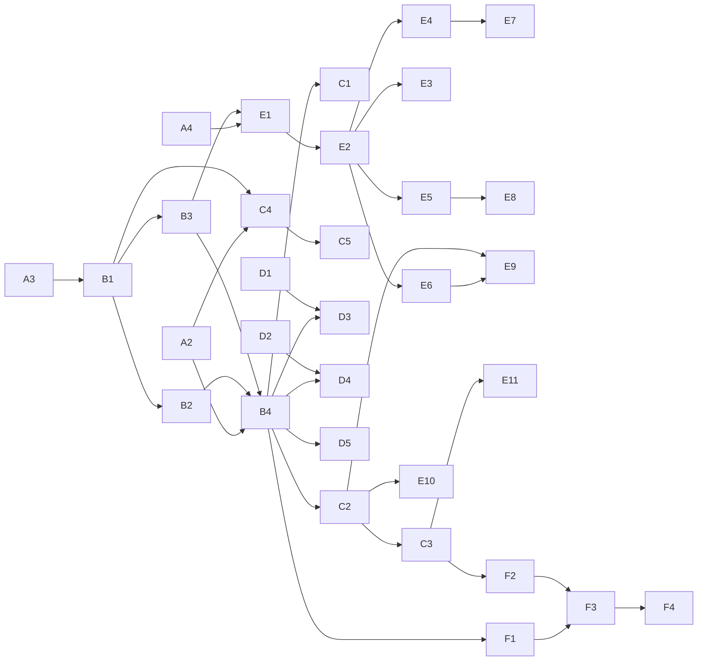

# CardDemo migration plan: small, independently mergeable PRs

Status: proposal for review. This document is advice and sequencing only; it adds
no migration code. It is the single place where the migration is tracked: each PR
below gets its link and status filled in the [tracker](#7-tracker) as it lands.

Target (default from `docs/LAB.md` and the transaction-type module already on main):
**Java 21 / Spring Boot 3.3 / Spring Batch on PostgreSQL 15**, Maven, Testcontainers.
New batch code goes in a new top-level `java/` directory (as `docs/LAB.md` prompt 2
asks); online screens follow the REST + React pattern of `carddemo-online-api` /
`carddemo-online-ui`. The existing transaction-type code is on Java 17; Java 21 is
backward compatible, so it is not upgraded until a PR needs it.

## 1. Rules every PR follows

1. **One concern, mergeable alone.** Main stays green after any single PR merges,
   in any order allowed by its dependencies. No PR rewires production behaviour of
   another PR's area.
2. **Additive to the estate.** Never edit `app/**` COBOL, copybooks or
   `fixtures/*/expected` (AGENTS.md). Golden files change only via `make record`
   on an explicit owner request; PRs that need new goldens say so and wait for it.
3. **Proof is the comparator.** A batch PR is done when
   `make parity-java CHAIN=<chain>` passes every case under `fixtures/<chain>/`
   through `tools/parity/compare.py` (field-level, COMP-3/overpunch/EBCDIC aware),
   *and* `make parity` (legacy) stays green. Online PRs, which have no off-host
   oracle (CICS is analysis-only), prove themselves with API + UI tests traced to
   the COBOL paragraph they replace.
4. **Legacy quirks are reproduced, then reported** (`docs/BASELINE.md`):
   CBACT04C truncates interest and never updates the last account on TCATBALF;
   CBTRN02C checks the limit against cycle amounts; COBTUPDT ignores SQLCODE +100.
   Each chain PR lists the quirks it reproduces in its README.
5. **Size budget:** aim for under ~600 changed lines of hand-written code per PR
   (generated code, fixtures and lockfiles excluded). Larger means split.
6. **CI gate per PR:** every new module adds its own job to
   `.github/workflows/parity.yml` in the same PR, so the proof runs on every
   later PR too.

## 2. Estate inventory (main @ `8980e53`)

| Technology | Count | Where | Off-host runnable? |
|---|---|---|---|
| COBOL batch (`CB*`) | 13 | `app/cbl` | Yes, via `tools/runjcl` (CBEXPORT/CBIMPORT do not compile: `EXPORT-SEQUENCE-NUM` undefined) |
| COBOL CICS online (`CO*`) | 17 | `app/cbl` | No (analysis only) |
| COBOL utilities | 2 | `app/cbl` (`COBSWAIT`, `CSUTLDTC`) | Yes |
| Transaction-type Db2 sub-app | 4 COBOL, 2 BMS, 4 JCL | `app/app-transaction-type-db2` | Batch yes (ocesql on PG15); CICS no |
| Authorization IMS/Db2/MQ sub-app | 8 COBOL, 2 BMS, 5 JCL, 8 IMS DBD/PSB | `app/app-authorization-ims-db2-mq` | No |
| VSAM/MQ sub-app | 2 COBOL | `app/app-vsam-mq` | No |
| Copybooks | 41 (+21 BMS symbolic) | `app/cpy`, sub-app `cpy/` | n/a |
| BMS maps | 21 | `app/bms`, sub-app `bms/` | No |
| JCL members | 48 | `app/jcl` (39) + sub-apps (9) | 4 chains in harness |
| HLASM | 2 (`COBDATFT`, `MVSWAIT`) | `app/asm` | No (`docs/LEGACY-LANGUAGES.md`) |
| PL/I | 1 (`CBFEECAL`) | `app/pli` | No |

Totals: 46 COBOL members across all directories. Note: `docs/BASELINE.md` says
"19 online"; the source has 17 CICS programs in `app/cbl` (COBSWAIT is a batch
utility despite its `CO` prefix). The CSD defines `CDV1 -> COCRDSEC`, which is not
supplied: unresolved, not a migration unit until the source is found.

### 2.1 Batch jobs and data

Dataset prefix `AWS.M2.CARDDEMO.`; masters are VSAM KSDS. Full step/DD graph:
`docs/chain-graph.md`.

| JCL | Program(s) | Reads | Writes | In harness |
|---|---|---|---|---|
| INTCALC | CBACT04C | TCATBALF, CARDXREF, DISCGRP, ACCTDATA | ACCTDATA (rewrite), SYSTRAN GDG | `interest` (7 cases) |
| POSTTRAN | CBTRN02C | DALYTRAN, CARDXREF, ACCTDATA, TCATBALF, TRANSACT | TRANSACT, ACCTDATA, TCATBALF, DALYREJS GDG | `posting` (7 cases) |
| TRANREPT | IDCAMS REPRO, SORT, CBTRN03C | TRANSACT, CARDXREF, TRANTYPE, TRANCATG, DATEPARM | TRANSACT backup GDGs, TRANREPT GDG (133-col) | `posting` |
| MNTTRDB2 | IKJEFT01 -> COBTUPDT | INPFILE | Db2 `TRANSACTION_TYPE` | `trantype-update` (7) |
| MNTTRDYN | IKJEFT01 -> CBTRNDYN -> dynamic CALL COBTUPDT | DYNSQL, INPFILE, PARM | Db2 dynamic SQL | `trantype-dynamic` (3) |
| READACCT / READCARD / READXREF / READCUST | CBACT01C / 02C / 03C / CBCUS01C | one master each | SYSOUT (+ OUTFILE for CBACT01C) | no |
| CREASTMT | SORT/REPRO, CBSTM03A -> CBSTM03B | TRANSACT, ACCT, CUST, XREF | STMTFILE, HTMLFILE | no |
| CBEXPORT / CBIMPORT | CBEXPORT / CBIMPORT | masters / EXPFILE | EXPFILE / staging files | no (do not compile) |
| FEECALC | CBFEEDRV -> CBFEECAL (PL/I) | ACCTFILE | FEEOUT | no |
| WAITSTEP | COBSWAIT -> MVSWAIT (HLASM) | PARM | none | no |
| (no JCL) | CBTRN01C | DALYTRAN + masters | validation SYSOUT | no |
| Setup/ops JCL | IDCAMS, SORT, FTP, PDF, GDG defs | | | used as chain setup |

### 2.2 Online transactions and the files they share with batch

| TRANID -> program | Data touched | Shared with batch |
|---|---|---|
| CC00 COSGN00C (sign-on) | USRSEC read | no |
| CM00 COMEN01C, CA00 COADM01C (menus) | none | no |
| CU00-CU03 COUSR00C-03C (user admin) | USRSEC browse/add/update/delete | no |
| CAVW COACTVWC (account view) | ACCTDAT, CUSTDAT, CXACAIX read | ACCTDATA, CARDXREF |
| CAUP COACTUPC (account update) | ACCTDAT, CUSTDAT update | ACCTDATA (INTCALC, POSTTRAN write it) |
| CCLI / CCDL / CCUP COCRDLIC / COCRDSLC / COCRDUPC (cards) | CARDDAT browse/read/update | CARDDATA |
| CT00 / CT01 COTRN00C / 01C (tran list/view) | TRANSACT browse/read | TRANSACT |
| CT02 COTRN02C (tran add) | CCXREF, CXACAIX read; TRANSACT write | TRANSACT (POSTTRAN appends) |
| CB00 COBIL00C (bill pay) | ACCTDAT update, TRANSACT write | ACCTDATA, TRANSACT |
| CR00 CORPT00C (reports) | submits TRANREPT via JOBS TD queue | triggers batch |
| CTLI / CTTU COTRTLIC / COTRTUPC | Db2 TRANSACTION_TYPE | MNTTRDB2, TRANEXTR |
| CP00 / CPVS / CPVD (authorization) | IMS, Db2, MQ | CBPAUP0J |
| CDRA / CDRD (VSAM/MQ) | ACCTDAT, MQ | ACCTDATA |

Shared files (ACCTDATA, TRANSACT, CARDDATA, CARDXREF) mean an online screen and a
batch chain cannot be cut over independently in production: PostgreSQL becomes the
system of record for a table only at that table's cutover (Batch F). Until then
the Java code runs against PostgreSQL loaded from fixture or unloaded data, in
parallel with the mainframe.

### 2.3 The proof harness today

* `make parity` runs the **legacy** recorder then `tools/parity/compare.py` on 4
  chains / 24 cases; CI (`.github/workflows/parity.yml`, job `parity`) runs it on
  every PR. There is no Java job and no `make parity-java` yet.
* There is no program-swap hook in `tools/runjcl`. The seam a candidate uses is
  the output contract: `datasets/<DSN>.txt`, `sysout/<JOB>.<STEP>.txt`, `rc.json`,
  `db/<schema.table>.csv`, compared with
  `compare.py <chain> <case> --actual <dir> --label java`.
* Limitation: a missing text file compares equal to an empty expected file
  (`read_lines` returns `[]`). PR A2 closes this before any candidate relies on it.
* Comparison is per chain; `posting` covers POSTTRAN **and** TRANREPT, so a
  candidate for only one of them needs a step-scoped compare (PR A2).

## 3. What is already migrated, and what earlier attempts teach

| Work | Where | State | What this plan takes from it |
|---|---|---|---|
| CTLI/CTTU transaction-type list/update | `carddemo-online-api` + `carddemo-online-ui` (top level) | Spring Boot 3.3.5, Java 17, Flyway, JWT, React/Vite; tested in CI | [Transaction-type docs](trantype/) are the template for every online PR. Deviation D-20: no TRANEXTR/VSAM sync, so batch consumers of the extract diverge until Batch F |
| .NET 8 batch port (READACCT, READCARD, INTCALC, POSTTRAN, TRANREPT) + atomic chunk commits | PRs #19, #23 | **Reverted** by PR #28 (98 + 14 files). No reason recorded in the commits | Landed as one 98-file PR on a non-default stack. This plan keeps Java as the target and splits the same scope into ~10 PRs, each proving one chain |
| Java ports of CBACT04C and CBTRN02C | `devin/1785356770-cbact04c-java-port`, `devin/1785356347-cbtrn02c-java-port` | Branches, isolated `java/` modules with unit tests; comparator parity never shown | Starting code for C1/C2; their codecs and the final-account behaviour are reused only after passing `compare.py` |
| Java data layer (entities for all masters, ASCII loader) | `devin/1785941621-carddemo-data-layer` | Branch | Input for B2/B3 schema and loader |
| Broad Spring Boot port (APIs + Spring Batch) | `devin/1787158883-cobol-to-spring-boot`, `devin/1789516557-carddemo-java-engagement` (599 files) | Branches, never merged | Big-bang again; mine per-screen code for Batch E, do not merge wholesale |
| Spring Batch POSTTRAN+INTCALC, Java 21 + kind manifests | `assessment/*` (shared ancestry) | Branches; inventories + wave plan | Confirms Java 21 / Spring Batch choice; inventory cross-check |
| INTCALC design, standards, staging schema, record codecs, checkpoint/restart | `demo/03-rules` ... `demo/05-g3-data-flow` | Branches | Rulebook and codec evidence for B1/C1; restart semantics for F2 |
| mftb estate scans (AUTH, CARDDEMO, TRANTYPE, VSAMMQ modules) | `demo/01-intake*` | Branches | Module boundaries used in section 2 |
| NestJS/Prisma rewrite | `aws-transform*` | Branches, different stack | Not reused (stack mismatch); its TRACEABILITY table is a useful checklist for Batch E |
| .NET wave branches, `dotnet-migration` | `wave/*`, `dotnet-migration` | Branches | Not reused |
| Statement/dashboard experiments | `DJ-*`, `devin/dj*` | Branches | Out of scope (new features, not migration) |

## 4. PR sequence

Batches run in order; **PRs inside one batch can be built in parallel**. Each PR
names what it depends on; nothing else is required before it merges.

### Batch A: groundwork (no Java business logic; all parallel)

| PR | Scope | Touches | Proves itself by | Depends on |
|---|---|---|---|---|
| A1 | This plan | `docs/MIGRATION-PLAN.md` | Review | none |
| A2 | Candidate seam in the harness: `make parity-java CHAIN= CASE=` runs a candidate command per case, writes `work/parity-java/<chain>/<case>/actual`, then `compare.py`; add `--steps JOB[.STEP]` scoping to `compare.py`; missing actual file = failure | `Makefile`, `tools/parity/compare.py`, `tools/parity/run_candidate.py` (new), `tools/parity/README` | Self-test: a "candidate" that copies `expected/` passes 24/24; a candidate that drops one file fails; `make parity` still green | none |
| A3 | Java CI job: JDK 21 + Maven cache; runs `mvn -B verify` for `carddemo-trantype-api` (Testcontainers) and `npm test` for the UI, which are on main but untested in CI | `.github/workflows/parity.yml` | CI job green on the PR | none |
| A4 | One transaction-type implementation: keep the top-level `carddemo-trantype-api/-ui` (used by the blueprint and `docker-compose.yml`); move the nested `modernized-trantype/docs` to `docs/trantype/`, delete the nested code copy | `modernized-trantype/**`, `docs/trantype/**`, README links | `mvn test`, `npm test`, A3 job (if merged) | none (rebase if A3 lands first) |
| A5 | Fix inventory facts in `docs/BASELINE.md` (17 online, not 19; CDV1/COCRDSEC missing) | `docs/BASELINE.md` | Review | none |

### Batch B: shared Java foundation (B1 first, then B2 and B3 in parallel, then B4)

| PR | Scope | Touches | Proves itself by | Depends on |
|---|---|---|---|---|
| B1 | `java/` Maven multi-module skeleton: parent POM (Java 21, Spring Boot 3.3, Spring Batch, Flyway, Testcontainers), empty `java/common`, frozen-clock `Clock` bean, `docker` profile running inside the `estate` network | `java/pom.xml`, `java/common/**`, `.github/workflows/parity.yml` (java job) | `mvn -B verify` in CI | A3 |
| B2 | Fixed-record codec in `java/common`: PIC X, zoned with EBCDIC overpunch sign, COMP-3, COMP; record layouts for CVACT01Y, CVACT02Y, CVACT03Y, CVCUS01Y, CVTRA01Y-06Y, REJTRAN | `java/common/src/**` | Round-trip test over **every** `fixtures/*/*/input` and `expected/datasets` file: decode then encode is byte-identical | B1 |
| B3 | PostgreSQL schema for the VSAM masters (Flyway `V1__vsam_masters.sql`): account, card, customer, card_xref, tran_cat_bal, disclosure_group, transaction, tran_type, tran_category, with exact `NUMERIC(p,s)` from each PIC; `docs/schema-mapping-vsam.md` lists every COMP-3/truncation decision | `java/common/src/main/resources/db/migration/**`, `docs/schema-mapping-vsam.md` | Testcontainers PG15: migrate, insert boundary values (max PIC, negative zoned) and read back | B1 |
| B4 | Loader/exporter: fixture `input/*.txt` -> PG; PG -> `datasets/<DSN>.txt`; writers for `rc.json` and `sysout/` | `java/common/src/**` | Load every interest and posting input, export untouched masters: byte-identical to input; `make parity-java` with a no-op job fails only on the fields the job must change | B2, B3, A2 |

### Batch C: proven batch chains (C1, C2, C4 in parallel; C3 after C2; C5 after C4)

| PR | Scope | Touches | Proves itself by | Depends on |
|---|---|---|---|---|
| C1 | INTCALC / CBACT04C as a Spring Batch job | `java/interest/**`, `Makefile` (chain entry), CI | `make parity-java CHAIN=interest`: 7/7 incl. `i02-tie-half-cent` (truncate, `RoundingMode.DOWN`) and the last-account quirk; `make parity-naive` behaviour unchanged | B4 |
| C2 | POSTTRAN / CBTRN02C (validate, post, reject with RC 4) | `java/posting/**` | `make parity-java CHAIN=posting --steps POSTTRAN`: 7/7 (TRANSACT, ACCTDATA, TCATBALF, DALYREJS, STEP15 SYSOUT, rc) | B4 |
| C3 | TRANREPT: REPRO backup + SORT + CBTRN03C report | `java/posting/**` (report step) | `make parity-java CHAIN=posting` full chain 7/7 incl. 133-col TRANREPT | C2 |
| C4 | MNTTRDB2 / COBTUPDT against PG (keeps SQLCODE +100 quirk) | `java/trantype-batch/**` | `make parity-java CHAIN=trantype-update`: 7/7 incl. DB snapshot CSVs (padded VARCHAR) | B1, A2 |
| C5 | MNTTRDYN / CBTRNDYN: dynamic SQL + PARM-selected target as a strategy map | `java/trantype-batch/**` | `make parity-java CHAIN=trantype-dynamic`: 3/3 incl. `d03-bad-statement` | C4 |

Each C PR makes its chain's `parity-java` step a required CI check.

### Batch D: extend the oracle, then port the rest of batch

New chains need new golden files, which only `make record` produces and only on an
explicit owner request. Each D-record PR is opened as a draft and asks for that
approval; nothing else waits on it.

| PR | Scope | Touches | Proves itself by | Depends on |
|---|---|---|---|---|
| D1 | `read-masters` chain: READACCT, READCARD, READXREF, READCUST with fixtures (reuse posting inputs) — [#50](https://github.com/TCS-Devin-Sandbox/ts-cobol-carddemo/pull/50) (merged) | `tools/runjcl/chains.json`, `fixtures/read-masters/**`, `tools/fixtures/gen_fixtures.py` | `make parity CHAIN=read-masters` green after approved `make record` | owner approval |
| D2 | `statements` chain: CREASTMT (SORT/REPRO, CBSTM03A/B) — [#51](https://github.com/TCS-Devin-Sandbox/ts-cobol-carddemo/pull/51) (merged) | same files, `fixtures/statements/**` | `make parity CHAIN=statements` | owner approval |
| D3 | Java port of the read utilities — [#52](https://github.com/TCS-Devin-Sandbox/ts-cobol-carddemo/pull/52) (merged) | `java/read-masters/**` | `make parity-java CHAIN=read-masters` | D1, B4 |
| D4 | Java port of statements (text + HTML) — [#53](https://github.com/TCS-Devin-Sandbox/ts-cobol-carddemo/pull/53) (merged) | `java/statements/**` | `make parity-java CHAIN=statements` | D2, B4 |
| D5 | FEECALC: Java port of CBFEEDRV + CBFEECAL using the worked examples in `docs/LEGACY-LANGUAGES.md` as unit tests (no off-host oracle for PL/I) | `java/fees/**` | Unit tests on every documented example; flagged as weaker proof | B4 |
| D6 | Replace HLASM `COBDATFT` (date format) and `MVSWAIT` with `java.time` / no-op step, per `docs/LEGACY-LANGUAGES.md` | `java/common/**` | Unit tests against the documented formats | B1 |

Not planned until the owner decides (see section 6): CBEXPORT/CBIMPORT (do not
compile), CBTRN01C (no JCL runs it).

### Batch E: online screens (REST + React, one screen per PR)

Pattern: the transaction-type module. Each PR adds a controller/service in the
online API, a React page, a `docs/online/<TRANID>.md` with requirement-to-test
trace and deviations, and API (Testcontainers) + UI tests. Proof is tests, not
parity: CICS cannot run off-host.

| PR | Scope | Touches | Proves itself by | Depends on |
|---|---|---|---|---|
| E1 | Generalize `carddemo-trantype-api/-ui` into `carddemo-online-api/-ui` (mechanical rename, no behaviour change) and reuse B3 schema via Flyway | rename + `docker-compose.yml`, blueprint docs | All existing trantype tests green | A4, B3 |
| E2 | Sign-on CC00 + menus CM00/CA00 on USRSEC table (COMMAREA -> JWT claims) | online api/ui | Tests per COSGN00C/COMEN01C paragraph | E1 |
| E3 | User admin CU00-CU03 | online api/ui | Tests | E2 |
| E4 | Account view CAVW | online api/ui | Tests | E2 |
| E5 | Card list/view CCLI, CCDL | online api/ui | Tests | E2 |
| E6 | Transaction list/view CT00, CT01 | online api/ui | Tests | E2 |
| E7 | Account update CAUP (optimistic lock replaces READ UPDATE) — [#68](https://github.com/TCS-Devin-Sandbox/ts-cobol-carddemo/pull/68) (merged) | online api/ui | Tests incl. concurrent update | E4 |
| E8 | Card update CCUP — [#66](https://github.com/TCS-Devin-Sandbox/ts-cobol-carddemo/pull/66) (merged) | online api/ui | Tests | E5 |
| E9 | Transaction add CT02 ([trace](online/CT02.md)) — [#65](https://github.com/TCS-Devin-Sandbox/ts-cobol-carddemo/pull/65) (merged) | online api/ui | Paragraph tests and opt-in API→CVTRA06Y→C2 posting acceptance | E6, C2 |
| E10 | Bill pay CB00 — [#67](https://github.com/TCS-Devin-Sandbox/ts-cobol-carddemo/pull/67) (merged) | online api/ui | Tests; balance consistent with C2 | E4, C2 |
| E11 | Report request CR00 launching the C3 job (replaces JOBS TD queue) | online api/ui, `java/posting` launcher | Tests; launched job passes posting parity | E2, C3 |

E3-E6 run in parallel after E2; E7-E11 in parallel once their dependencies land.

### Batch F: run it as one system and cut over

| PR | Scope | Depends on |
|---|---|---|
| F1 | Production data load: EBCDIC VSAM unload -> PG using B2 codecs, with record counts and per-field checksums report — [java/data-load](../java/data-load/README.md) (merged) | B4 |
| F2 | Job scheduling and restart: Spring Batch job repository and step checkpoints in [chain order](chain-graph.md). See the [launch and restart runbook](BATCH-RESTART.md). | C1-C3 |
| F3 | [Nightly shadow run](SHADOW-RUN.md): F1 unload load, B4 export, F2 launch and mainframe comparison with drift report ([#58](https://github.com/TCS-Devin-Sandbox/ts-cobol-carddemo/pull/58) merged; CI uses synthetic drops) | F1, F2 |
| F4 | Per-table cutover runbook and rollback, decommission of each JCL member | F3, owner sign-off |

### Batch G: separate modules, after a target decision

Authorization (IMS DB + Db2 + MQ: CP00, CPVS, CPVD, CBPAUP0C, IMS loaders) and
VSAM/MQ (CDRA, CDRD) need decisions on the IMS hierarchical data model and the MQ
replacement before any port PR starts. [Batch G scope](batch-g/scope.md) proposes
both targets and splits the batch into PRs G1-G11; the cited source map is
[batch-g/inventory.md](batch-g/inventory.md).

## 5. Dependency graph

## 6. Decisions needed from the owner

1. **Legacy quirks:** reproduce (default, required for parity) and log as
   findings, or fix after cutover? Applies to CBACT04C truncation and last-account
   skip, CBTRN02C cycle-amount limit check, COBTUPDT +100.
2. **New golden files** for D1/D2 (`make record`): approve per chain.
3. **CBEXPORT/CBIMPORT:** they do not compile on main. Retire, or specify the
   intended behaviour so Java can implement it without an oracle?
4. **CBTRN01C:** no JCL runs it. Retire?
5. **Authorization and VSAM/MQ modules (Batch G):** in scope, and if so the IMS
   and MQ targets.
6. **Reuse of branch code:** the CBACT04C/CBTRN02C Java ports and data layer are
   used as starting points (default), never merged as-is.

## 7. Tracker

| PR | Batch | Title | Link | Status |
|---|---|---|---|---|
| A1 | A | Migration plan | [#30](https://github.com/TCS-Devin-Sandbox/ts-cobol-carddemo/pull/30) | merged |
| A2 | A | `make parity-java` candidate seam + step-scoped compare | [#34](https://github.com/TCS-Devin-Sandbox/ts-cobol-carddemo/pull/34) | merged |
| A3 | A | Java CI job (trantype tests) | [#32](https://github.com/TCS-Devin-Sandbox/ts-cobol-carddemo/pull/32) | merged |
| A4 | A | Single transaction-type implementation | [#33](https://github.com/TCS-Devin-Sandbox/ts-cobol-carddemo/pull/33), [#36](https://github.com/TCS-Devin-Sandbox/ts-cobol-carddemo/pull/36) | merged |
| A5 | A | BASELINE inventory corrections | [#31](https://github.com/TCS-Devin-Sandbox/ts-cobol-carddemo/pull/31) | merged |
| B1 | B | `java/` skeleton | [#35](https://github.com/TCS-Devin-Sandbox/ts-cobol-carddemo/pull/35) | merged |
| B2 | B | Fixed-record codec | [#38](https://github.com/TCS-Devin-Sandbox/ts-cobol-carddemo/pull/38) | merged |
| B3 | B | VSAM master schema | [#37](https://github.com/TCS-Devin-Sandbox/ts-cobol-carddemo/pull/37) (follow-up [#40](https://github.com/TCS-Devin-Sandbox/ts-cobol-carddemo/pull/40) merged) | merged |
| B4 | B | Loader/exporter | [#41](https://github.com/TCS-Devin-Sandbox/ts-cobol-carddemo/pull/41) | merged |
| C1 | C | INTCALC | [#43](https://github.com/TCS-Devin-Sandbox/ts-cobol-carddemo/pull/43) | merged |
| C2 | C | POSTTRAN | [#42](https://github.com/TCS-Devin-Sandbox/ts-cobol-carddemo/pull/42) | merged |
| C3 | C | TRANREPT | [#45](https://github.com/TCS-Devin-Sandbox/ts-cobol-carddemo/pull/45) | merged |
| C4 | C | MNTTRDB2 | [#44](https://github.com/TCS-Devin-Sandbox/ts-cobol-carddemo/pull/44) | merged |
| C5 | C | MNTTRDYN | [#48](https://github.com/TCS-Devin-Sandbox/ts-cobol-carddemo/pull/48) | merged |
| D1 | D | Read-masters oracle | [#50](https://github.com/TCS-Devin-Sandbox/ts-cobol-carddemo/pull/50) | merged |
| D2 | D | Statements oracle (scratch-only TIOT adaptation) | [#51](https://github.com/TCS-Devin-Sandbox/ts-cobol-carddemo/pull/51) | merged |
| D3 | D | Java read-masters utilities | [#52](https://github.com/TCS-Devin-Sandbox/ts-cobol-carddemo/pull/52) | merged |
| D4 | D | Java statements (text + HTML) | [#53](https://github.com/TCS-Devin-Sandbox/ts-cobol-carddemo/pull/53) | merged |
| D5 | D | FEECALC | [#46](https://github.com/TCS-Devin-Sandbox/ts-cobol-carddemo/pull/46) | merged |
| D6 | D | HLASM date and wait routines | [#47](https://github.com/TCS-Devin-Sandbox/ts-cobol-carddemo/pull/47) | merged |
| E1 | E | Online API/UI foundation | [#54](https://github.com/TCS-Devin-Sandbox/ts-cobol-carddemo/pull/54) | merged |
| E2 | E | Sign-on CC00 and menus CM00/CA00 | [#57](https://github.com/TCS-Devin-Sandbox/ts-cobol-carddemo/pull/57) | merged |
| E3 | E | User admin [CU00](online/CU00.md)–[CU03](online/CU03.md) | [#59](https://github.com/TCS-Devin-Sandbox/ts-cobol-carddemo/pull/59) | merged |
| E4 | E | Account view [CAVW](online/CAVW.md) | [#60](https://github.com/TCS-Devin-Sandbox/ts-cobol-carddemo/pull/60) | merged |
| E5 | E | [Card list/view CCLI, CCDL](online/cards.md) | [#63](https://github.com/TCS-Devin-Sandbox/ts-cobol-carddemo/pull/63) | merged |
| E6 | E | [Transaction list/view CT00, CT01](online/CT00-CT01.md) | [#61](https://github.com/TCS-Devin-Sandbox/ts-cobol-carddemo/pull/61) | merged |
| E7 | E | Account update CAUP | [#68](https://github.com/TCS-Devin-Sandbox/ts-cobol-carddemo/pull/68) | merged |
| E8 | E | Card update CCUP | [#66](https://github.com/TCS-Devin-Sandbox/ts-cobol-carddemo/pull/66) | merged |
| E9 | E | Transaction add CT02 | [#65](https://github.com/TCS-Devin-Sandbox/ts-cobol-carddemo/pull/65) | merged |
| E10 | E | Bill pay CB00 | [#67](https://github.com/TCS-Devin-Sandbox/ts-cobol-carddemo/pull/67) | merged |
| E11 | E | Report request [CR00](online/CR00.md) | [#62](https://github.com/TCS-Devin-Sandbox/ts-cobol-carddemo/pull/62) | merged |
| F1 | F | [Data load and reconciliation](../java/data-load/README.md) | [#55](https://github.com/TCS-Devin-Sandbox/ts-cobol-carddemo/pull/55) | merged |
| F2 | F | [Scheduling and restart](BATCH-RESTART.md) | [#56](https://github.com/TCS-Devin-Sandbox/ts-cobol-carddemo/pull/56) | merged |
| F3 | F | [Nightly shadow run](SHADOW-RUN.md) | [#58](https://github.com/TCS-Devin-Sandbox/ts-cobol-carddemo/pull/58) | merged |
| F4 | F | Cutover | | not started |
| G | G | Authorization, VSAM/MQ | | needs decision |
| G1 | G | [IMS segment codecs and unload reader/writer](../java/common/README.md#ims-unload-proof) | [#72](https://github.com/TCS-Devin-Sandbox/ts-cobol-carddemo/pull/72) | merged |
| G2 | G | [Pending authorization schema](schema-mapping-auth.md) | [#74](https://github.com/TCS-Devin-Sandbox/ts-cobol-carddemo/pull/74) | in review |
| G9 | G | [CDRA account inquiry over REST](online/CDRA.md) | [#73](https://github.com/TCS-Devin-Sandbox/ts-cobol-carddemo/pull/73) | merged |
| G10 | G | System date/time [CDRD](online/CDRD.md) as REST | [#71](https://github.com/TCS-Devin-Sandbox/ts-cobol-carddemo/pull/71) | in review |
