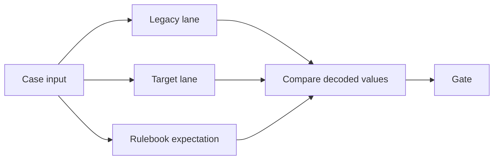

# Interest replay lab

Compare the legacy COBOL batch lane, the Java/Spring Batch target and a
rulebook expectation on the same synthetic inputs. This is evidence for
modernization, not SME sign-off or permission to change legacy quirks.

Run `make lab-jar` after `make up && make build`, then `make lab-gate`.
Host Python needs PyYAML; `replay.py` automatically uses the provisioned
`~/envs/lab` virtualenv if the invoking Python lacks it. Java 21 and Maven are
host build dependencies; Java 21 also ships in the estate image.

## Run

```sh
make lab                       # browser workbench, foreground
make lab-gate                  # complete golden + edge replay
make lab-gate-negative         # succeeds only when the mutation is detected
make lab-e2e                   # twelve UI plan rows, saves lab/evidence/e2e-output.txt
```

Install browser dependencies with
`~/envs/lab/bin/python -m pip install -r lab/e2e/requirements.txt` and
`~/envs/lab/bin/python -m playwright install --with-deps chromium`.
`make lab-e2e` uses `~/envs/lab/bin/python` when available, otherwise `python3`;
override `LAB_PY` if needed. It runs one pytest test per [UI plan](ui-test-plan.md)
row, starts an isolated server on a free `LAB_PORT`, and stops that server
afterward. Set `LAB_URL` to test an already running lab instead. Do not run
the suite in parallel: replays share estate files. The suite first runs the
full CLI gate for comparisons and refreshes the committed gate/report evidence.
`JAVA21_HOME` and `MVN` override the Java build tool locations. If Docker Hub
is rate-limited, set `ESTATE_BASE_IMAGE=mirror.gcr.io/library/ubuntu:22.04`
and pull/retag `postgres:15` and `postgres:15-alpine` from `mirror.gcr.io/library/`.

`make lab` serves the workbench in the foreground at http://localhost:8090
(`LAB_PORT` overrides the port). The stdlib HTTP server queues replays through
one worker. It gathers toolchain metadata once at startup. `POST /api/runs`
accepts `{"case":"E09"}`, `{"set":"golden"}`, or `{"inputs":{...}}` with
the four dataset filenames as keys. Poll `GET /api/runs/<id>`. The UI restores
its own run on Back, clears on reload, and can save a script-free HTML snapshot.
UI gates judge the selected cases; the full CLI gate still requires 7/7 goldens.
Invalid custom input returns HTTP 200 with `ok:false` and a readable error,
without queuing a replay or generating a browser network error.

E09's intake hold is NOT JUDGED only when its category is `TARGET_INTAKE_HELD`
and decoded input actually contains multiple cards for an account. This covers
target termination and absent outputs; legacy termination remains judged.
Other failures, including RC 12 without that category, are not exempt.

```
python3 lab/replay.py gate --set all
python3 lab/replay.py run --case E08 --json
python3 lab/replay.py run --input-dir /path/to/input --json
python3 -m unittest discover -s lab/tests -v
make lab-gate-negative MVN=$HOME/apache-maven-3.9.9/bin/mvn
```

All execution/results stay under ignored `work/lab/`. A container-side file
lock serializes the shared datasets across lab invocations (external estate
commands do not honor it). Golden inputs and the immutable rulebook are read
only. Probes can be regenerated with `python3 lab/build_probes.py`.

## How the replay works



The host coordinator calls `lab/lanes.py` in the estate container. Imported
legacy and Java adapters use private scratch fixture roots. The server queues
runs through one worker. Outputs are decoded only through the existing
copybook codec. Golden cases use checked-in rulebook expectations; probes
and custom cases call the rulebook evaluator on their own inputs. Golden
legacy reruns are also checked against immutable golden files.

### Classes and independent rule verdicts

| Class | Meaning |
| --- | --- |
| MATCH | Engines agree and no open alternative affects the value. |
| INTENDED_CHANGE | Engines differ; target matches an APPROVED/DECIDED option. |
| UNRESOLVED | An open alternative exists (engines agree), or an open option/host-evidence hole explains a difference (engines differ). Decision IDs link to the register. |
| UNCLASSIFIED | No registered explanation covers the difference; fails the gate. |

Verdicts are independent for each engine: **CONFORMS** means its value equals
the required rulebook value; **VIOLATES** means it does not; **NOT JUDGED**
means off-host evidence cannot establish the requirement; **NOT EXERCISED**
means no selected case touched the rule. While a decision is OPEN, the
as-coded legacy option remains required, except for explicit host-evidence holes.

Page coverage is scoped to the selected run: golden-only is 17 of 21;
the full CLI gate exercises 21 of 21 replay-exercisable rules. Four questions
cannot be settled by a replay: INT-H02, INT-H03, INT-H05 and INT-H09.

### E08: second run / INT-H06

E08 runs legacy twice without reset, captures its first-run file state, and
feeds that state to Java's second run while retaining Java's PostgreSQL state.
Both first and second results are retained in JSON. Second-run comparisons
are the E08 gate evidence. The Java lane is a private shadow computation; it
does not rewrite host files or release a production generation.

Both engines return RC 0 on both runs. In this probe, account 2003 moves from
1235.50 to 1236.50 on run 1 and 1237.50 on run 2; each run emits two 1.00
transactions. Final account 2004 stays 1234.50, preserving the last-account
quirk. Run 2's rulebook expectation is evaluated on the run-1 host state.

### E09: multiple cards / INT-H03

Legacy returns RC 0 and emits two transactions, selecting card
`4000000000002003` for account 2003 in this lab. Java returns RC 12,
`TARGET_INTAKE_HELD`, with no output datasets: it waits for host first-return
card evidence. This shows what each engine does today, not which card is right.
Only target termination/absent outputs get the narrow exemption described
above. Legacy remains judged; differences remain UNRESOLVED / INT-H03. Reason:

> INT-H03 open: target holds intake pending host first-return-card evidence; required outcome needs host evidence (Card operations / VSAM owner)

JSON includes decoded output records, output-file inventory, timing, expected
cells, per-value classification and per-engine rule verdicts. Markdown shows
the classified comparison. Abends compare termination only, not partial files.
A run that stops is compared on how it ended: its STEP15 return code and
job log/SYSOUT up to and including `ABENDING PROGRAM`. Its output files are
shown, not compared; partial output is not successful completion evidence.
TN-07: harness return code 12 represents the requested host U999; this is not
host LE behavior proof. Restricted transcripts may include synthetic account
identifiers; ordinary target logs remain independently available as artifacts.

Gate success requires all seven golden parity checks, no unclassified value,
and no rule violations. CLI subsets therefore report incomplete golden parity
when they do not include all seven; UI gates judge only their selected cases.
No business decision is silently accepted: OPEN requires legacy option A.

### Half-even negative control

`make lab-gate-negative` copies the module under `work/lab-negative/`, changes
only the copy's `InterestRules` from `RoundingMode.DOWN` to `HALF_EVEN`, builds
it and runs the gate with that jar. **`java/` is untouched.** The mutated gate
must fail, with violations exactly target INT-Q01 on i02 and tie-flagged E01.
The negative-control command itself succeeds only when this exact check holds.

## What the lab does not prove

- Account "updated (rewrite effects)" compares the observable cycle-field
  reset, not a physical I/O trace. An unchanged zero-valued record cannot
  prove whether a REWRITE occurred; balance arithmetic is judged separately.
- Sequential batch replay only: no CICS execution and no concurrency proof.
- GnuCOBOL rather than Enterprise COBOL arithmetic; no host overflow/TRUNC proof.
- No real Db2: the off-host harness and Java shadow lane use PostgreSQL.
- Harness RC 12 represents host U999 (TN-07), not host LE abend behavior.
- The lab ASCII codec profile is not the EBCDIC host environment.
- Local AIX card ordering is not host first-return-card evidence. Passing
  comparisons do not close the register or establish production readiness.

## Evidence

The manual Chrome run passed all twelve rows in [ui-test-plan.md](ui-test-plan.md).
Rows 4, 8 and 10 are qualified: the desktop harness folds new tabs into the
current tab. Fresh headless Chromium verified real popups and that original
results remain. This is supplementary browser evidence, not a claim that the
desktop harness displayed separate tabs. The automated suite also checks these
popups through clicks, without using API calls or injected application state.

Committed files under `lab/evidence/`:

Latest automated Chromium result: **12 passed** (one test per UI plan row).

- `e2e-output.txt`: latest full `make lab-e2e` pytest result, one test per plan row.
- `gate-output.txt`: full `make lab-gate` output, including its exit code.
- `gate-negative-output.txt`: full half-even negative-control output and exit code.
- `classified-report.md` and `report.json`: the normal gate's classified report.
- `ui/row-01.png` through `ui/row-12.png`: manual desktop check screenshots.
- `golden-run.html`: saved script-free all-golden snapshot from the manual check.

Captured reports name the tested baseline SHA; the evidence commit itself will
have a newer SHA. Snapshot evidence links point at the original run's local
`work/lab/` artifacts, which are intentionally not committed. The normal gate
and browser suite pass only for the required behavior; the negative command
passes when it detects the deliberately failing copied Java lane.
