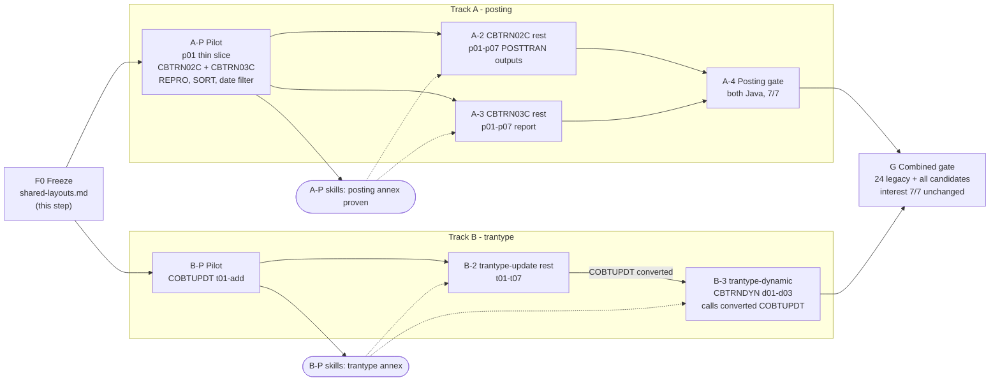

# Parallel tracks after interest — TRACKS v1.0 (open this first)

**Status: PROPOSED · not started · awaiting human approval.** Base `demo/06-lab @ 1341a98`; branch `demo/07-handoff`. No Java was written, no `app/` or `fixtures/` file changed, and no track session was started. Inputs: [AGENTS.md](../../AGENTS.md), [INT-ARCH](architecture.md), [INT-MAP](data-map-interest.md), [tools/runjcl/chains.json](../../tools/runjcl/chains.json).

| Read next | What it is |
|---|---|
| [shared-layouts.md](shared-layouts.md) | The freeze: four shared layouts, two shared tables, the COBTUPDT interface, change register SH-01…SH-05 (all OPEN) |
| [posting hand-off](../streams/posting/handoff.md) | Track A |
| [trantype-update hand-off](../streams/trantype-update/handoff.md) | Track B, part 1 |
| [trantype-dynamic hand-off](../streams/trantype-dynamic/handoff.md) | Track B, part 2 |
| [tickets/posting](tickets/posting/README.md), [tickets/trantype-update](tickets/trantype-update/README.md), [tickets/trantype-dynamic](tickets/trantype-dynamic/README.md) | Work items (Markdown only) |

Legacy baseline on this branch: `make parity` 24/24 PASS (interest 7, posting 7, trantype-update 7, trantype-dynamic 3) — [modernization/evidence/parity-step7.log](../evidence/parity-step7.log).

## 1 · Flow and what each piece waits for

Every arrow is a hard wait: a piece starts when the pieces pointing at it are merged to its track integration branch by a person. The two tracks share no code; they meet only at the frozen files and at G.

## 2 · Track A — posting

* **A-P pilot (one session):** a thin slice across both programs. `fixtures/posting/p01-baseline-mixed` posted by a Java CBTRN02C replacement in POSTTRAN STEP15 and reported by a Java CBTRN03C replacement in TRANREPT STEP10R, with the real setup jobs, the REPROC PRC001 unload, the SORT `FIELDS=(TRAN-CARD-NUM,A)` (263,16,ZD) and the `INCLUDE` date filter on `TRAN-PROC-DT` 305,10,CH between `2022-01-01` and `2022-07-06` of [TRANREPT.jcl](../../app/jcl/TRANREPT.jcl), plus the DATEPARM gate in CBTRN03C. p01 passes the comparator with both Java programs. The pilot creates the module, its schema, the candidate driver and the skills.
* **Then the rest of each program, one program per session, in parallel:** A-2 finishes CBTRN02C (rejects 100–103 and precedence, RC 4, category create, signed cycle totals, empty day) with legacy CBTRN03C still in STEP10R; A-3 finishes CBTRN03C (account/page/grand totals, page breaks, edited amounts, lookups, empty report) with legacy CBTRN02C still in STEP15. A-4 runs both Java programs on all seven cases.

## 3 · Track B — trantype

* **B-P pilot (one session):** trantype-update case `t01-add` only: Java COBTUPDT reads INPFILE, two INSERTs, exact SYSOUT, `rc.json`, both table snapshots. It closes gaps G1–G5 far enough for t01 and writes the trantype skills.
* **B-2:** the rest of trantype-update, t01–t07 (update, delete, comments, `+100` per the golden, negative SQLCODE, mixed batch), and the callable COBTUPDT boundary (C1–C7).
* **B-3:** trantype-dynamic, d01–d03, **only once COBTUPDT is converted** (B-2 passes 7/7): Java CBTRNDYN with dynamic SQL (G6) and the dynamic call (G7) into the converted COBTUPDT.

## 4 · What each pilot's skills leave out

| Skills from | Proven by the pilot | Left out (later pieces must add evidence; skills must say so) |
|---|---|---|
| A-P (posting annex promoted from DRAFT, posting build/verify bindings) | One clean posting run and one report: CVTRA06Y read, keyed xref/account reads, account and category rewrite, TRANSACT write, REPRO, SORT, two date gates, detail lines, card/grand totals, RC 0/0 | Rejects and `DALYREJS` content (p02–p05), 103-over-102 precedence, RC 4 and the report after RC 4, category create (p06), negative amounts to CYC-DEBIT (p06), empty day and the zero-byte report (p07), page breaks, lookup failures and abends, restart and recovery, production order with interest (SH-02), TRANEXTR refresh |
| B-P (trantype annex, trantype build/verify bindings) | One INSERT batch: INPFILE decode, static SQL with host variables, success SQLCODE, SYSOUT, commit at end of task, table snapshots | UPDATE and DELETE, `+100` (SH-03), negative SQLCODE and the `-403` text (t06), comments and invalid type, mixed batch in one unit of work (t07), FK RESTRICT, the callable boundary (SH-04), **all of dynamic SQL and the dynamic call (G6, G7)**, PostgreSQL abort semantics (SH-05) |

## 5 · Ownership

| Piece | Track | Stream | Programs | Java module | Branch prefix | Cases to pass | Waits for | Must not touch |
|---|---|---|---|---|---|---|---|---|
| F0 Freeze | — | all | — | — | `demo/07-handoff` | 24/24 legacy | interest (demo/06-lab) | Java, `app/`, `fixtures/` |
| A-P | A | posting | CBTRN02C, CBTRN03C | `java/posting/posting-batch` | `trackA/posting/pilot-` | p01-baseline-mixed (both programs); interest 7/7 | F0 | `java/interest/**`, `java/trantype/**`, `app/`, `fixtures/`, `tools/parity`, `db/postgres`, frozen files |
| A-2 | A | posting | CBTRN02C | `java/posting/posting-batch` (package `…posting.post`) | `trackA/posting/cbtrn02c-` | p01–p07 POSTTRAN outputs and STEP15 SYSOUT/RC (TRANREPT legacy); interest 7/7 | A-P | CBTRN03C code (`…posting.report`), module POM/migrations except via Track A lead, all of the above |
| A-3 | A | posting | CBTRN03C | `java/posting/posting-batch` (package `…posting.report`) | `trackA/posting/cbtrn03c-` | p01–p07 `TRANREPT(0)` and STEP10R SYSOUT/RC (POSTTRAN legacy); interest 7/7 | A-P | CBTRN02C code (`…posting.post`), module POM/migrations except via Track A lead, all of the above |
| A-4 | A | posting | CBTRN02C + CBTRN03C | `java/posting/posting-batch` | `trackA/posting/gate-` | p01–p07 with both Java programs; interest 7/7 | A-2, A-3 | anything outside the posting module and its evidence |
| B-P | B | trantype-update | COBTUPDT | `java/trantype/trantype-batch` | `trackB/trantype-update/pilot-` | t01-add; interest 7/7 | F0 | `java/interest/**`, `java/posting/**`, `app/`, `fixtures/`, `tools/parity`, `db/postgres`, `db/seed.sql`, frozen files |
| B-2 | B | trantype-update | COBTUPDT | `java/trantype/trantype-batch` (package `…trantype.update`) | `trackB/trantype-update/` | t01–t07; interest 7/7 | B-P | the same as B-P |
| B-3 | B | trantype-dynamic | CBTRNDYN (calls COBTUPDT) | `java/trantype/trantype-batch` (package `…trantype.dynamic`) | `trackB/trantype-dynamic/` | d01–d03; t01–t07 still pass; interest 7/7 | B-2 | `…trantype.update` (COBTUPDT) — change by register row only; the same as B-P |
| G | — | all | all four | — | `integration/streams-` | §6 in full | A-4, B-3 | any golden; any decision row |

### Ticket-write policy

Track A — Ticket writes: prohibited

Track B — Ticket writes: prohibited

No tracker was authorized by the presenter, so no project and no transitions are named. Tickets live only as Markdown under [tickets/posting](tickets/posting/README.md), [tickets/trantype-update](tickets/trantype-update/README.md) and [tickets/trantype-dynamic](tickets/trantype-dynamic/README.md).

### File owners

One owner for each file every track touches. Other tracks **propose** a change (a PR comment or a change-register row in [shared-layouts.md](shared-layouts.md#change-register)); only the owner commits it.

| File(s) | Owner | Others |
|---|---|---|
| `Makefile` | Integration owner (G) | Tracks propose new targets, e.g. `posting-jar`, `trantype-jar` |
| `.github/workflows/parity.yml`, `.github/workflows/lab.yml` | Integration owner (G) | Propose jobs; do not edit |
| Shared skills `.agents/skills/carddemo-conversion-standards`, `carddemo-ticket-build`, `carddemo-ticket-verify`, `carddemo-parity`, `carddemo-pitfalls` | Skills owner | Tracks propose; stream annexes are owned by their track: `carddemo-stream-posting` → Track A lead, a new `carddemo-stream-trantype` → Track B lead, `carddemo-stream-interest` → interest owner |
| Shared schema: INT-MAP column rows, `FixedRecordCodec`, `db/postgres/01-transaction-type.sql`, `db/seed.sql`, `chains.json` `database` | Data architect | All frozen; change by register row |
| `shared-layouts.md`, this file | Data architect / Integration owner | Propose |
| Posting module POM and migrations | Track A lead | A-2, A-3 propose |
| Trantype module POM and migrations | Track B lead | B-3 proposes |
| `fixtures/**`, `tools/parity/**`, `app/**` | Not owned by any track | Goldens change only by `make record` on an explicit request |

## 6 · What each stream must pass with `make parity`

`make parity` reruns the legacy chains (24 cases); each candidate passes the same cases through its driver and `tools/parity/compare.py <chain> <case>` (as the interest driver does), field by field, SYSOUT, `rc.json` and DB snapshots included.

| Stream | Cases | Count |
|---|---|---:|
| posting | p01-baseline-mixed, p02-invalid-card, p03-account-missing, p04-overlimit-reject, p05-expired-account, p06-credits-new-category, p07-empty-day | 7 |
| trantype-update | t01-add, t02-update, t03-delete, t04-comments, t05-delete-missing, t06-duplicate-add, t07-mixed-batch | 7 |
| trantype-dynamic | d01-update-then-apply, d02-delete-statement, d03-bad-statement | 3 |
| **interest, after every change in any track** | i01-baseline, i02-tie-half-cent, i03-zero-rate-skipped, i04-default-group-fallback, i05-multi-category, i06-negative-balance, i07-nontie-rounding — unchanged: `make parity CHAIN=interest` 7/7 and the interest Java candidate 7/7 (`make lab-gate`) | 7 |

Also unchanged after every change: `make parity-naive CASE=i02-tie-half-cent` fails and `CASE=i07-nontie-rounding` passes (CI `parity.yml`), `make chain-graph-check`.

## 7 · How many engineers, and what cannot run in parallel

| Stage | Pieces | Engineers | Why not more |
|---|---|---:|---|
| 0 | F0 | 1 | Done in this step. |
| 1 | A-P, B-P | 2 | Each pilot creates its module, schema, driver and skills; work split before that would invent them twice. |
| 2 | A-2, A-3, B-2 | 3 | One program per session; COBTUPDT is one program, so B-2 is one engineer. |
| 3 | A-4, B-3 | 2 | A-4 needs both posting programs; B-3 needs converted COBTUPDT. |
| 4 | G | 1 | Single integration owner of Makefile/CI. |

Cannot run in parallel, and why:

* **A-2/A-3 before A-P**, **B-2 before B-P**: the pilot owns the module skeleton, POM, migrations, codec wiring and the skills the later sessions follow.
* **B-3 before B-2 is done**: CBTRNDYN calls COBTUPDT by the name in its PARM (C1–C7); d01–d03 cannot pass against an unconverted or partial COBTUPDT, and B-3 must not edit it.
* **A-4 before A-2 and A-3**: the seven cases need both programs.
* **Edits to an owned file** (Makefile, CI, shared skills, shared schema, module POMs): serialized through the owner to avoid conflicting changes.
* **Two parity runs on one estate**: `make parity` resets `datasets/` and the `db` volume per case; one run per machine at a time (each engineer uses their own VM).
* **Posting and interest on shared ACCTDATA in production**: order not proven (SH-02); kept as independent chains, no combined case.

## 8 · Not handed off

| Item | Why not | Needs first |
|---|---|---|
| CBSTM03A / CBSTM03B (statements, CREASTMT) | Compile, run in no chain, no recorded output; need COBSWAIT → HLASM MVSWAIT | A chain in `chains.json`, recorded fixtures (`make record` on request), an MVSWAIT stand-in |
| CBACT01C, CBACT02C, CBACT03C, CBCUS01C, CBTRN01C, CSUTLDTC | Compile, no chain, no recorded output (CBACT01C also calls HLASM COBDATFT) | Chain, fixtures, goldens |
| COMBTRAN, TRANBKP, PRTCATBL, TRANEXTR and other utility JCL | Sort/IDCAMS/DSNTIAUL only, no chain or golden (TRANEXTR: see posting PA-2/PA-3) | Chain, recorded output, scheduler evidence |
| CBEXPORT / CBIMPORT | Do not compile (`EXPORT-SEQUENCE-NUM` undefined) | Missing copybook from the customer |
| CBFEEDRV + PL/I CBFEECAL (FEECALC) | No PL/I compiler; cannot run | Licensed compiler or a host-recorded golden |
| HLASM COBDATFT, MVSWAIT | No assembler off-host | Host evidence or a reviewed stand-in |
| Online CICS programs (`app/cbl/CO*`, COTRTLIC/COTRTUPC, auth and VSAM-MQ sub-apps) | No CICS region or BMS assembler; analysis-only | A CICS emulation or online target decision, plus screen-level oracles |
| IMS/MQ authorization sub-application | No IMS/MQ runtime in the harness | Runtime and recorded fixtures |
