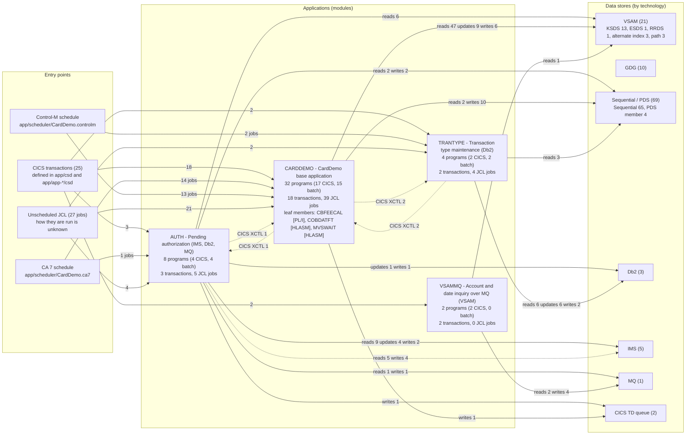
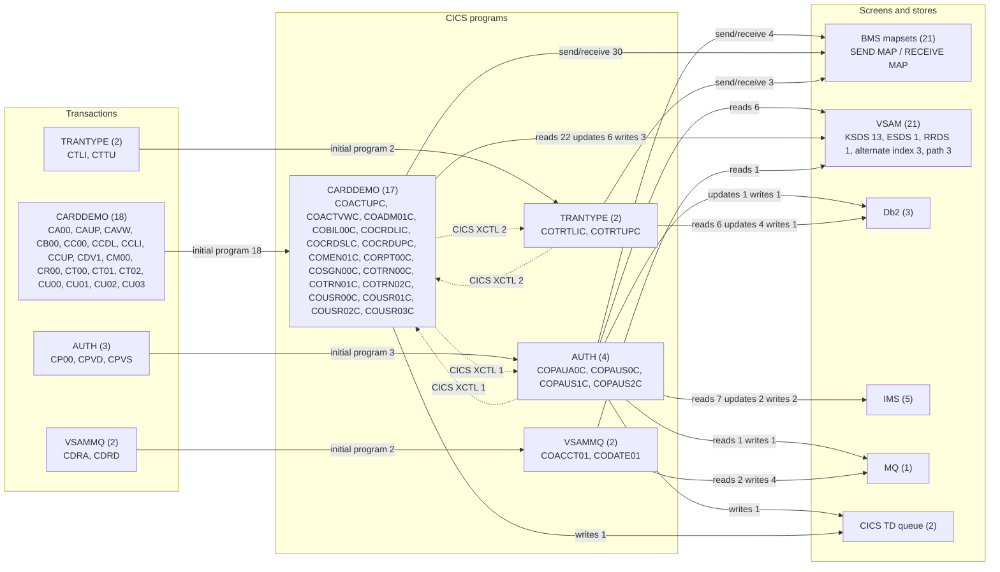
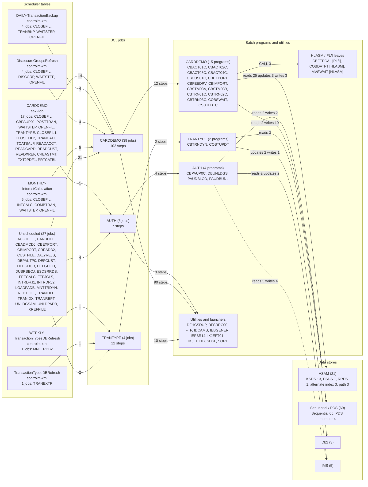
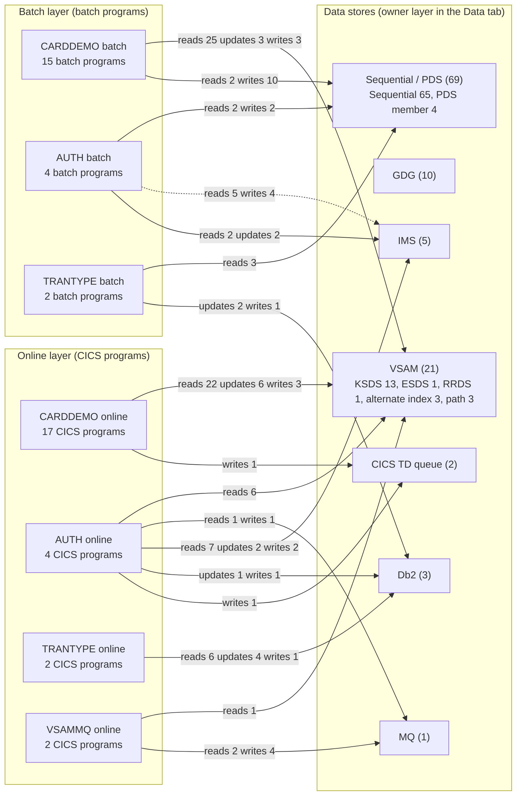

# As-is architecture of the CardDemo estate

Baseline: `922b1c23fb361b768d03f2b2c4d1e429e2fbbef0` (2026-11-19T13:53:48+05:30), repository `TCS-Devin-Sandbox/ts-cobol-carddemo`. Tool: mftb 0.2.1. Interactive page: [architecture-as-is.html](architecture-as-is.html).

This document describes what exists in the repository. It proposes no target. Every statement is taken from, and cites:

- **Part A** - [INTAKE.md](../INTAKE.md): what the estate supplies, what is absent, what runs.
- **Part B** - [fan-out.md](fan-out.md) and the module scans under `store/<MODULE>/`; module map `store/modules.json`.
- **Part C** - [INTAKE.md, scanner cross-check and open questions](../INTAKE.md#scanner-cross-check-part-c).
- **Part D** - [call-graph.md](call-graph.md): every edge with its file and line, PROVEN or CANDIDATE.

Counts in this document are counts of rows in call-graph.md (data: `graph.json`). Modules analyzed: AUTH, CARDDEMO, TRANTYPE, VSAMMQ. Not analyzed: none.

## 1. The estate

Four modules (Part B, `store/modules.json`): the base application and three sub-applications under `app/app-*`.

| Module | Name | Programs | CICS programs | Batch programs | Transactions | JCL jobs |
|---|---|---|---|---|---|---|
| CARDDEMO | CardDemo base application | 32 | 17 | 15 | 18 | 39 |
| AUTH | Pending authorization (IMS, Db2, MQ) | 8 | 4 | 4 | 3 | 5 |
| TRANTYPE | Transaction type maintenance (Db2) | 4 | 2 | 2 | 2 | 4 |
| VSAMMQ | Account and date inquiry over MQ (VSAM) | 2 | 2 | 0 | 2 | 0 |

Solid arrows are PROVEN edges only, dashed arrows CANDIDATE edges only (Part D).

## 2. Online layer

CICS pseudo-conversational programs entered through 25 transaction ids (call-graph.md, *Transaction id to initial program*). A program is counted as online when a CSD defines it or it issues EXEC CICS commands. None of these programs runs off-host: the CICS-supplied copybooks and the generated symbolic maps are not available (Part A, INTAKE.md).

| Transaction | Initial program | Module | Cited at |
|---|---|---|---|
| CA00 | COADM01C | CARDDEMO | `app/csd/CARDDEMO.CSD:327` |
| CAUP | COACTUPC | CARDDEMO | `app/csd/CARDDEMO.CSD:306` |
| CAVW | COACTVWC | CARDDEMO | `app/csd/CARDDEMO.CSD:317` |
| CB00 | COBIL00C | CARDDEMO | `app/csd/CARDDEMO.CSD:337` |
| CC00 | COSGN00C | CARDDEMO | `app/csd/CARDDEMO.CSD:378` |
| CCDL | COCRDSLC | CARDDEMO | `app/csd/CARDDEMO.CSD:347` |
| CCLI | COCRDLIC | CARDDEMO | `app/csd/CARDDEMO.CSD:357` |
| CCUP | COCRDUPC | CARDDEMO | `app/csd/CARDDEMO.CSD:367` |
| CDRA | COACCT01 | VSAMMQ | `app/app-vsam-mq/csd/CRDDEMOM.csd:17` |
| CDRD | CODATE01 | VSAMMQ | `app/app-vsam-mq/csd/CRDDEMOM.csd:27` |
| CDV1 | COCRDSEC | CARDDEMO | `app/csd/CARDDEMO.CSD:388` |
| CM00 | COMEN01C | CARDDEMO | `app/csd/CARDDEMO.CSD:399` |
| CP00 | COPAUA0C | AUTH | `app/app-authorization-ims-db2-mq/csd/CRDDEMO2.csd:59` |
| CPVD | COPAUS1C | AUTH | `app/app-authorization-ims-db2-mq/csd/CRDDEMO2.csd:39` |
| CPVS | COPAUS0C | AUTH | `app/app-authorization-ims-db2-mq/csd/CRDDEMO2.csd:49` |
| CR00 | CORPT00C | CARDDEMO | `app/csd/CARDDEMO.CSD:409` |
| CT00 | COTRN00C | CARDDEMO | `app/csd/CARDDEMO.CSD:419` |
| CT01 | COTRN01C | CARDDEMO | `app/csd/CARDDEMO.CSD:429` |
| CT02 | COTRN02C | CARDDEMO | `app/csd/CARDDEMO.CSD:439` |
| CTLI | COTRTLIC | TRANTYPE | `app/app-transaction-type-db2/csd/CRDDEMOD.csd:25` |
| CTTU | COTRTUPC | TRANTYPE | `app/app-transaction-type-db2/csd/CRDDEMOD.csd:35` |
| CU00 | COUSR00C | CARDDEMO | `app/csd/CARDDEMO.CSD:449` |
| CU01 | COUSR01C | CARDDEMO | `app/csd/CARDDEMO.CSD:459` |
| CU02 | COUSR02C | CARDDEMO | `app/csd/CARDDEMO.CSD:469` |
| CU03 | COUSR03C | CARDDEMO | `app/csd/CARDDEMO.CSD:479` |

Program-to-program navigation is almost entirely dynamic: 2 PROVEN and 82 CANDIDATE XCTL/LINK edges, plus 21 open asks where the target is run-time data (call-graph.md, *Program to program* and *Open asks*).

## 3. Batch layer

48 JCL jobs; 21 are ordered by a scheduler table, 27 are not (call-graph.md, *Scheduler order* and *Unscheduled JCL jobs*). Two scheduler exports exist: CA 7 and Control-M; which is in force is unknown.

| Scheduler table | Dialect | Source | Jobs in order of appearance |
|---|---|---|---|
| CARDDEMO | ca7-ljob | `app/scheduler/CardDemo.ca7` | CLOSEFIL, CBPAUP0J, POSTTRAN, WAITSTEP, OPENFIL, TRANTYPE, CLOSEFIL1, CLOSEFIL2, TRANCATG, TCATBALF, READACCT, READCARD, READCUST, READXREF, CREASTMT, TXT2PDF1, PRTCATBL |
| DAILY-TransactionBackup | controlm-xml | `app/scheduler/CardDemo.controlm` | CLOSEFIL, TRANBKP, WAITSTEP, OPENFIL |
| WEEKLY-TransactionTypesDBRefresh | controlm-xml | `app/scheduler/CardDemo.controlm` | MNTTRDB2 |
| DisclosureGroupsRefresh | controlm-xml | `app/scheduler/CardDemo.controlm` | CLOSEFIL, DISCGRP, WAITSTEP, OPENFIL |
| TransactionTypesDBRefresh | controlm-xml | `app/scheduler/CardDemo.controlm` | TRANEXTR |
| MONTHLY-InterestCalculation | controlm-xml | `app/scheduler/CardDemo.controlm` | CLOSEFIL, INTCALC, COMBTRAN, WAITSTEP, OPENFIL |

What runs today off-host is four chains (posting, interest, trantype-update, trantype-dynamic), proven in Part A (INTAKE.md, *What runs today*).

## 4. Data layer

Owner layer rule used here: the layer whose programs write or update the store (call-graph.md, *Program to dataset, table, queue or map*). A store written by both layers is shared; a store only touched by utility steps (IDCAMS, SORT, IEBGENER) is batch; a store that is only read in the scan has an unknown owner.

| Technology | Stores |
|---|---|
| CICS TD queue | 2 |
| Db2 table | 3 |
| GDG | 10 |
| IMS | 5 |
| MQ | 1 |
| Other / unresolved | 13 |
| PDS member | 4 |
| Sequential | 65 |
| VSAM ESDS | 1 |
| VSAM KSDS | 13 |
| VSAM RRDS | 1 |
| VSAM alternate index | 3 |
| VSAM path | 3 |

### VSAM (21)

| Store | Technology | Module (first seen) | Owner layer | Online writers | Online readers | Batch writers | Batch readers | Defined / typed at | Definition detail | Utility steps |
|---|---|---|---|---|---|---|---|---|---|---|
| AWS.M2.CARDDEMO.CARDDATA.VSAM.AIX | VSAM alternate index | CARDDEMO | batch (utility steps only: no program writes it) | - | - | - | - | `app/jcl/CARDFILE.jcl:83` | keys=11 16; paths=AWS.M2.CARDDEMO.CARDDATA.VSAM.AIX.PATH | 0 |
| AWS.M2.CARDDEMO.CARDXREF.VSAM.AIX | VSAM alternate index | CARDDEMO | batch (utility steps only: no program writes it) | - | - | - | - | `app/jcl/XREFFILE.jcl:72` | keys=11,25; paths=AWS.M2.CARDDEMO.CARDXREF.VSAM.AIX.PATH | 0 |
| AWS.M2.CARDDEMO.TRANSACT.VSAM.AIX | VSAM alternate index | CARDDEMO | batch (utility steps only: no program writes it) | - | - | - | - | `app/jcl/TRANIDX.jcl:25` | keys=26 304; paths=AWS.M2.CARDDEMO.TRANSACT.VSAM.AIX.PATH, AWS.M2.CARDDEMO.TRANSACT.VSAM.AIX.PATH | 0 |
| AWS.M2.CARDDEMO.USRSEC.VSAM.ESDS | VSAM ESDS | CARDDEMO | batch (utility steps only: no program writes it) | - | - | - | - | `app/jcl/ESDSRRDS.jcl:65` | organization=ESDS; recordsize=80,80 | 1 |
| AWS.CUSTDATA.CLUSTER | VSAM KSDS | CARDDEMO | batch (utility steps only: no program writes it) | - | - | - | - | `app/jcl/DEFCUST.jcl:35` | keys=10 0; organization=KSDS; recordsize=500 500 | 0 |
| AWS.M2.CARDDEMO.ACCTDATA.VSAM.KSDS | VSAM KSDS | CARDDEMO | shared (online and batch write) | COACTUPC, COBIL00C | COACCT01, COACTUPC, COACTVWC, COBIL00C, COPAUA0C, COPAUS0C | CBACT04C, CBTRN02C | CBACT01C, CBACT04C, CBEXPORT, CBFEEDRV, CBSTM03B, CBTRN02C | `app/jcl/ACCTFILE.jcl:36` | keys=11 0; organization=KSDS; recordsize=300 300 | 1 |
| AWS.M2.CARDDEMO.CARDDATA.VSAM.KSDS | VSAM KSDS | CARDDEMO | online | COCRDUPC | COCRDLIC, COCRDSLC, COCRDUPC | - | CBACT02C, CBEXPORT | `app/jcl/CARDFILE.jcl:50` | alternate_indexes=AWS.M2.CARDDEMO.CARDDATA.VSAM.AIX; keys=16 0; organization=KSDS; recordsize=150 150 | 1 |
| AWS.M2.CARDDEMO.CARDXREF.VSAM.KSDS | VSAM KSDS | CARDDEMO | batch (utility steps only: no program writes it) | - | COPAUA0C, COTRN02C | - | CBACT03C, CBACT04C, CBEXPORT, CBSTM03B, CBTRN02C, CBTRN03C | `app/jcl/XREFFILE.jcl:39` | alternate_indexes=AWS.M2.CARDDEMO.CARDXREF.VSAM.AIX; keys=16 0; organization=KSDS; recordsize=50 50 | 1 |
| AWS.M2.CARDDEMO.CUSTDATA.VSAM.KSDS | VSAM KSDS | CARDDEMO | online | COACTUPC | COACTUPC, COACTVWC, COPAUA0C, COPAUS0C | - | CBCUS01C, CBEXPORT, CBSTM03B | `app/jcl/CUSTFILE.jcl:46` | keys=9 0; organization=KSDS; recordsize=500 500 | 1 |
| AWS.M2.CARDDEMO.DISCGRP.VSAM.KSDS | VSAM KSDS | CARDDEMO | batch (utility steps only: no program writes it) | - | - | - | CBACT04C | `app/jcl/DISCGRP.jcl:36` | keys=16 0; organization=KSDS; recordsize=50 50 | 1 |
| AWS.M2.CARDDEMO.EXPORT.DATA | VSAM KSDS | CARDDEMO | batch | - | - | CBEXPORT | CBIMPORT | `app/jcl/CBEXPORT.jcl:30` | keys=4 28; organization=KSDS; recordsize=500 500 | 0 |
| AWS.M2.CARDDEMO.TCATBALF.VSAM.KSDS | VSAM KSDS | CARDDEMO | batch | - | - | CBTRN02C | CBACT04C, CBTRN02C | `app/jcl/TCATBALF.jcl:36` | keys=17 0; organization=KSDS; recordsize=50 50 | 2 |
| AWS.M2.CARDDEMO.TRANCATG.VSAM.KSDS | VSAM KSDS | CARDDEMO | batch (utility steps only: no program writes it) | - | - | - | CBTRN03C | `app/jcl/TRANCATG.jcl:36` | keys=6 0; organization=KSDS; recordsize=60 60 | 1 |
| AWS.M2.CARDDEMO.TRANSACT.VSAM.KSDS | VSAM KSDS | CARDDEMO | shared (online and batch write) | COBIL00C, COTRN02C | COBIL00C, COTRN00C, COTRN01C, COTRN02C | CBTRN02C | CBEXPORT | `app/jcl/TRANFILE.jcl:49` | alternate_indexes=AWS.M2.CARDDEMO.TRANSACT.VSAM.AIX, AWS.M2.CARDDEMO.TRANSACT.VSAM.AIX; keys=16 0; organization=KSDS; recordsize=350 350 | 5 |
| AWS.M2.CARDDEMO.TRANTYPE.VSAM.KSDS | VSAM KSDS | CARDDEMO | batch (utility steps only: no program writes it) | - | - | - | CBTRN03C | `app/jcl/TRANTYPE.jcl:36` | keys=2 0; organization=KSDS; recordsize=60 60 | 1 |
| AWS.M2.CARDDEMO.TRXFL.VSAM.KSDS | VSAM KSDS | CARDDEMO | batch (utility steps only: no program writes it) | - | - | - | CBSTM03B | `app/jcl/CREASTMT.JCL:29` | keys=32 0; organization=KSDS; recordsize=350 350 | 1 |
| AWS.M2.CARDDEMO.USRSEC.VSAM.KSDS | VSAM KSDS | CARDDEMO | online | COUSR01C, COUSR02C, COUSR03C | COSGN00C, COUSR00C, COUSR02C, COUSR03C | - | - | `app/jcl/DUSRSECJ.jcl:64` | keys=8,0; organization=KSDS; recordsize=80,80 | 1 |
| AWS.M2.CARDDEMO.CARDDATA.VSAM.AIX.PATH | VSAM path | CARDDEMO | batch (utility steps only: no program writes it) | - | COCRDSLC | - | - | `app/jcl/CARDFILE.jcl:100` | - | 0 |
| AWS.M2.CARDDEMO.CARDXREF.VSAM.AIX.PATH | VSAM path | CARDDEMO | batch (utility steps only: no program writes it) | - | COACTUPC, COACTVWC, COBIL00C, COPAUS0C, COTRN02C | - | - | `app/jcl/XREFFILE.jcl:90` | - | 0 |
| AWS.M2.CARDDEMO.TRANSACT.VSAM.AIX.PATH | VSAM path | CARDDEMO | batch (utility steps only: no program writes it) | - | - | - | - | `app/jcl/TRANIDX.jcl:42` | - | 0 |
| AWS.M2.CARDDEMO.USRSEC.VSAM.RRDS | VSAM RRDS | CARDDEMO | batch (utility steps only: no program writes it) | - | - | - | - | `app/jcl/ESDSRRDS.jcl:99` | organization=RRDS; recordsize=80,80 | 1 |

### GDG (10)

| Store | Technology | Module (first seen) | Owner layer | Online writers | Online readers | Batch writers | Batch readers | Defined / typed at | Definition detail | Utility steps |
|---|---|---|---|---|---|---|---|---|---|---|
| AWS.M2.CARDDEMO.DALYREJS | GDG | CARDDEMO | batch (utility steps only: no program writes it) | - | - | - | - | `app/jcl/DALYREJS.jcl:24` | limit=5 | 0 |
| AWS.M2.CARDDEMO.DISCGRP.BKUP | GDG | CARDDEMO | batch (utility steps only: no program writes it) | - | - | - | - | `app/jcl/DEFGDGD.jcl:73` | limit=5 | 1 |
| AWS.M2.CARDDEMO.SYSTRAN | GDG | CARDDEMO | batch (utility steps only: no program writes it) | - | - | - | - | `app/jcl/DEFGDGB.jcl:48` | limit=5 | 1 |
| AWS.M2.CARDDEMO.TCATBALF.BKUP | GDG | CARDDEMO | batch (utility steps only: no program writes it) | - | - | - | - | `app/jcl/DEFGDGB.jcl:42` | limit=5 | 2 |
| AWS.M2.CARDDEMO.TRANCATG.PS.BKUP | GDG | CARDDEMO | batch (utility steps only: no program writes it) | - | - | - | - | `app/jcl/DEFGDGD.jcl:50` | limit=5 | 1 |
| AWS.M2.CARDDEMO.TRANREPT | GDG | CARDDEMO | batch (utility steps only: no program writes it) | - | - | - | - | `app/jcl/REPTFILE.jcl:25` | limit=10 | 0 |
| AWS.M2.CARDDEMO.TRANSACT.BKUP | GDG | CARDDEMO | batch (utility steps only: no program writes it) | - | - | - | - | `app/jcl/DEFGDGB.jcl:24` | limit=5 | 4 |
| AWS.M2.CARDDEMO.TRANSACT.COMBINED | GDG | CARDDEMO | batch (utility steps only: no program writes it) | - | - | - | - | `app/jcl/DEFGDGB.jcl:54` | limit=5 | 2 |
| AWS.M2.CARDDEMO.TRANSACT.DALY | GDG | CARDDEMO | batch (utility steps only: no program writes it) | - | - | - | - | `app/jcl/DEFGDGB.jcl:30` | limit=5 | 1 |
| AWS.M2.CARDDEMO.TRANTYPE.BKUP | GDG | CARDDEMO | batch (utility steps only: no program writes it) | - | - | - | - | `app/jcl/DEFGDGD.jcl:27` | limit=5 | 1 |

### Sequential / PDS (69)

| Store | Technology | Module (first seen) | Owner layer | Online writers | Online readers | Batch writers | Batch readers | Defined / typed at | Definition detail | Utility steps |
|---|---|---|---|---|---|---|---|---|---|---|
| &LBNM..CNTL | PDS member | TRANTYPE | batch (utility steps only: no program writes it) | - | - | - | - | `app/app-transaction-type-db2/jcl/CREADB21.jcl:46` | - | 7 |
| AWS.M2.CARDDEMO.CNTL | PDS member | CARDDEMO | batch (utility steps only: no program writes it) | - | - | - | - | `app/proc/REPROC.prc:27` | - | 3 |
| AWS.M2.CARDDEMO.JCL | PDS member | CARDDEMO | batch (utility steps only: no program writes it) | - | - | - | - | `app/jcl/INTRDRJ1.JCL:17` | - | 1 |
| OEMPP.IMS.V15R01MB.PROCLIB | PDS member | AUTH | batch (utility steps only: no program writes it) | - | - | - | - | `app/app-authorization-ims-db2-mq/jcl/DBPAUTP0.jcl:33` | - | 4 |
| &HLQ..TRANCATG.PS.BKUP | Sequential | TRANTYPE | batch (utility steps only: no program writes it) | - | - | - | - | `app/app-transaction-type-db2/jcl/TRANEXTR.jcl:46` | - | 1 |
| &HLQ..TRANTYPE.BKUP | Sequential | TRANTYPE | batch (utility steps only: no program writes it) | - | - | - | - | `app/app-transaction-type-db2/jcl/TRANEXTR.jcl:35` | - | 1 |
| AWS.M2.CARDDEMO.ACCTDATA.ARRYPS | Sequential | CARDDEMO | batch | - | - | CBACT01C | - | `app/jcl/READACCT.jcl:41` | - | 1 |
| AWS.M2.CARDDEMO.ACCTDATA.IMPORT | Sequential | CARDDEMO | batch | - | - | CBIMPORT | - | `app/jcl/CBIMPORT.jcl:38` | - | 0 |
| AWS.M2.CARDDEMO.ACCTDATA.PSCOMP | Sequential | CARDDEMO | batch | - | - | CBACT01C | - | `app/jcl/READACCT.jcl:37` | - | 1 |
| AWS.M2.CARDDEMO.ACCTDATA.VBPS | Sequential | CARDDEMO | batch | - | - | CBACT01C | - | `app/jcl/READACCT.jcl:45` | - | 1 |
| AWS.M2.CARDDEMO.CARDXREF.IMPORT | Sequential | CARDDEMO | batch | - | - | CBIMPORT | - | `app/jcl/CBIMPORT.jcl:43` | - | 0 |
| AWS.M2.CARDDEMO.CUSTDATA.IMPORT | Sequential | CARDDEMO | batch | - | - | CBIMPORT | - | `app/jcl/CBIMPORT.jcl:33` | - | 0 |
| AWS.M2.CARDDEMO.ESDSRRDS.PS | Sequential | CARDDEMO | batch (utility steps only: no program writes it) | - | - | - | - | `app/jcl/ESDSRRDS.jcl:47` | - | 4 |
| AWS.M2.CARDDEMO.IMPORT.ERRORS | Sequential | CARDDEMO | batch | - | - | CBIMPORT | - | `app/jcl/CBIMPORT.jcl:56` | - | 0 |
| AWS.M2.CARDDEMO.IMSDATA.DBPAUTP0 | Sequential | AUTH | batch (utility steps only: no program writes it) | - | - | - | - | `app/app-authorization-ims-db2-mq/jcl/DBPAUTP0.jcl:25` | - | 2 |
| AWS.M2.CARDDEMO.LATEFEES | Sequential | CARDDEMO | unknown | - | - | - | - | `app/jcl/FEECALC.jcl:28` | - | 0 |
| AWS.M2.CARDDEMO.PAUTDB.CHILD.FILEO | Sequential | AUTH | batch | - | - | PAUDBUNL | PAUDBLOD | `app/app-authorization-ims-db2-mq/jcl/UNLDPADB.JCL:53` | - | 3 |
| AWS.M2.CARDDEMO.PAUTDB.ROOT.FILEO | Sequential | AUTH | batch | - | - | PAUDBUNL | PAUDBLOD | `app/app-authorization-ims-db2-mq/jcl/UNLDPADB.JCL:48` | - | 3 |
| AWS.M2.CARDDEMO.STATEMNT.HTML | Sequential | CARDDEMO | batch | - | - | CBSTM03A | - | `app/jcl/CREASTMT.JCL:67` | - | 1 |
| AWS.M2.CARDDEMO.STATEMNT.PS | Sequential | CARDDEMO | batch | - | - | CBSTM03A | - | `app/jcl/CREASTMT.JCL:72` | - | 2 |
| AWS.M2.CARDDEMO.TCATBALF.REPT | Sequential | CARDDEMO | batch (utility steps only: no program writes it) | - | - | - | - | `app/jcl/PRTCATBL.jcl:59` | - | 2 |
| AWS.M2.CARDDEMO.TRANSACT.IMPORT | Sequential | CARDDEMO | batch | - | - | CBIMPORT | - | `app/jcl/CBIMPORT.jcl:48` | - | 0 |
| AWS.M2.CARDDEMO.TRXFL.SEQ | Sequential | CARDDEMO | batch (utility steps only: no program writes it) | - | - | - | - | `app/jcl/CREASTMT.JCL:48` | - | 2 |
| AWS.M2.CARDDEMO.USRSEC.PS | Sequential | CARDDEMO | batch (utility steps only: no program writes it) | - | - | - | - | `app/jcl/DUSRSECJ.jcl:46` | - | 3 |
| &HLQ..TRANCATG.PS | Sequential | TRANTYPE | batch (utility steps only: no program writes it) | - | - | - | - | `app/app-transaction-type-db2/jcl/TRANEXTR.jcl:45` | - | 3 |
| &HLQ..TRANTYPE.PS | Sequential | TRANTYPE | batch (utility steps only: no program writes it) | - | - | - | - | `app/app-transaction-type-db2/jcl/TRANEXTR.jcl:34` | - | 3 |
| AWS.M2.CARDDEMO.ACCTDATA.PS | Sequential | CARDDEMO | batch (utility steps only: no program writes it) | - | - | - | - | `app/jcl/ACCTFILE.jcl:56` | - | 1 |
| AWS.M2.CARDDEMO.CARDDATA.PS | Sequential | CARDDEMO | batch (utility steps only: no program writes it) | - | - | - | - | `app/jcl/CARDFILE.jcl:70` | - | 1 |
| AWS.M2.CARDDEMO.CARDXREF.PS | Sequential | CARDDEMO | batch (utility steps only: no program writes it) | - | - | - | - | `app/jcl/XREFFILE.jcl:59` | - | 1 |
| AWS.M2.CARDDEMO.CUSTDATA.PS | Sequential | CARDDEMO | batch (utility steps only: no program writes it) | - | - | - | - | `app/jcl/CUSTFILE.jcl:66` | - | 1 |
| AWS.M2.CARDDEMO.DALYTRAN.PS | Sequential | CARDDEMO | unknown (read only in the scan; writer not in the repository) | - | - | - | CBTRN02C | `app/cbl/CBTRN02C.cbl:29` | - | 0 |
| AWS.M2.CARDDEMO.DALYTRAN.PS.INIT | Sequential | CARDDEMO | batch (utility steps only: no program writes it) | - | - | - | - | `app/jcl/TRANFILE.jcl:69` | - | 1 |
| AWS.M2.CARDDEMO.DATEPARM | Sequential | CARDDEMO | unknown (read only in the scan; writer not in the repository) | - | - | - | CBTRN03C | `app/cbl/CBTRN03C.cbl:55` | - | 0 |
| AWS.M2.CARDDEMO.DBRMLIB | Sequential | TRANTYPE | batch (utility steps only: no program writes it) | - | - | - | - | `app/app-transaction-type-db2/jcl/MNTTRDB2.jcl:25` | - | 2 |
| AWS.M2.CARDDEMO.DISCGRP.PS | Sequential | CARDDEMO | batch (utility steps only: no program writes it) | - | - | - | - | `app/jcl/DEFGDGD.jcl:85` | - | 2 |
| AWS.M2.CARDDEMO.LOADLIB | Sequential | AUTH | batch (utility steps only: no program writes it) | - | - | - | - | `app/app-authorization-ims-db2-mq/jcl/DBPAUTP0.jcl:19` | - | 6 |
| AWS.M2.CARDDEMO.PAUTDB.CHILD.GSAM | Sequential | AUTH | batch (utility steps only: no program writes it) | - | - | - | - | `app/app-authorization-ims-db2-mq/jcl/UNLDGSAM.JCL:39` | - | 1 |
| AWS.M2.CARDDEMO.PAUTDB.ROOT.GSAM | Sequential | AUTH | batch (utility steps only: no program writes it) | - | - | - | - | `app/app-authorization-ims-db2-mq/jcl/UNLDGSAM.JCL:36` | - | 1 |
| AWS.M2.CARDDEMO.TCATBALF.PS | Sequential | CARDDEMO | batch (utility steps only: no program writes it) | - | - | - | - | `app/jcl/TCATBALF.jcl:56` | - | 1 |
| AWS.M2.CARDDEMO.TRANCATG.PS | Sequential | CARDDEMO | batch (utility steps only: no program writes it) | - | - | - | - | `app/jcl/DEFGDGD.jcl:62` | - | 2 |
| AWS.M2.CARDDEMO.TRANTYPE.PS | Sequential | CARDDEMO | batch (utility steps only: no program writes it) | - | - | - | - | `app/jcl/DEFGDGD.jcl:39` | - | 2 |
| AWS.M2.CARDEMO.FTP.TEST | Sequential | CARDDEMO | batch (utility steps only: no program writes it) | - | - | - | - | `app/jcl/INTRDRJ1.JCL:8` | - | 1 |
| AWS.M2.CARDEMO.FTP.TEST.BKUP | Sequential | CARDDEMO | batch (utility steps only: no program writes it) | - | - | - | - | `app/jcl/INTRDRJ1.JCL:9` | - | 2 |
| AWS.M2.CARDEMO.FTP.TEST.BKUP.INTRDR | Sequential | CARDDEMO | batch (utility steps only: no program writes it) | - | - | - | - | `app/jcl/INTRDRJ2.JCL:10` | - | 1 |
| AWS.M2.LBD.TXT2PDF.EXEC | Sequential | CARDDEMO | batch (utility steps only: no program writes it) | - | - | - | - | `app/jcl/TXT2PDF1.JCL:31` | - | 1 |
| AWS.M2.LBD.TXT2PDF.LOAD | Sequential | CARDDEMO | batch (utility steps only: no program writes it) | - | - | - | - | `app/jcl/TXT2PDF1.JCL:28` | - | 1 |
| CEE.SCEERUN | Sequential | CARDDEMO | unknown | - | - | - | - | `app/jcl/FEECALC.jcl:26` | - | 0 |
| DYNSQL | Sequential | TRANTYPE | batch (utility steps only: no program writes it) | - | - | - | CBTRNDYN | `app/app-transaction-type-db2/cbl/CBTRNDYN.cbl:34` | - | 1 |
| IMS.DBDLIB | Sequential | AUTH | batch (utility steps only: no program writes it) | - | - | - | - | `app/app-authorization-ims-db2-mq/jcl/CBPAUP0J.jcl:34` | - | 1 |
| IMS.PROCLIB | Sequential | AUTH | batch (utility steps only: no program writes it) | - | - | - | - | `app/app-authorization-ims-db2-mq/jcl/CBPAUP0J.jcl:29` | - | 1 |
| IMS.PSBLIB | Sequential | AUTH | batch (utility steps only: no program writes it) | - | - | - | - | `app/app-authorization-ims-db2-mq/jcl/CBPAUP0J.jcl:33` | - | 1 |
| IMS.SDFSRESL | Sequential | AUTH | batch (utility steps only: no program writes it) | - | - | - | - | `app/app-authorization-ims-db2-mq/jcl/CBPAUP0J.jcl:26` | - | 3 |
| INPFILE | Sequential | TRANTYPE | batch (utility steps only: no program writes it) | - | - | - | COBTUPDT | `app/app-transaction-type-db2/cbl/COBTUPDT.cbl:31` | - | 2 |
| OEM.CICSTS.DFHCSD | Sequential | CARDDEMO | batch (utility steps only: no program writes it) | - | - | - | - | `app/jcl/CBADMCDJ.jcl:30` | - | 1 |
| OEM.CICSTS.V05R06M0.CICS.SDFHLOAD | Sequential | CARDDEMO | batch (utility steps only: no program writes it) | - | - | - | - | `app/jcl/CBADMCDJ.jcl:29` | - | 1 |
| OEM.DB2.&DB2S..RUNLIB.LOAD | Sequential | TRANTYPE | batch (utility steps only: no program writes it) | - | - | - | - | `app/app-transaction-type-db2/jcl/CREADB21.jcl:53` | - | 3 |
| OEM.DB2.DAZ1.RUNLIB.LOAD | Sequential | TRANTYPE | batch (utility steps only: no program writes it) | - | - | - | - | `app/app-transaction-type-db2/jcl/TRANEXTR.jcl:66` | - | 2 |
| OEM.DB2.DAZ1.SDSNEXIT | Sequential | TRANTYPE | batch (utility steps only: no program writes it) | - | - | - | - | `app/app-transaction-type-db2/jcl/CREADB21.jcl:41` | - | 3 |
| OEM.IMS.IMSP.DBDLIB | Sequential | AUTH | batch (utility steps only: no program writes it) | - | - | - | - | `app/app-authorization-ims-db2-mq/jcl/DBPAUTP0.jcl:22` | - | 4 |
| OEM.IMS.IMSP.PAUTHDB | Sequential | AUTH | batch (utility steps only: no program writes it) | - | - | - | - | `app/app-authorization-ims-db2-mq/jcl/DBPAUTP0.jcl:31` | - | 3 |
| OEM.IMS.IMSP.PAUTHDBX | Sequential | AUTH | batch (utility steps only: no program writes it) | - | - | - | - | `app/app-authorization-ims-db2-mq/jcl/DBPAUTP0.jcl:32` | - | 3 |
| OEM.IMS.IMSP.PSBLIB | Sequential | AUTH | batch (utility steps only: no program writes it) | - | - | - | - | `app/app-authorization-ims-db2-mq/jcl/DBPAUTP0.jcl:21` | - | 4 |
| OEM.IMS.IMSP.RECON1 | Sequential | AUTH | batch (utility steps only: no program writes it) | - | - | - | - | `app/app-authorization-ims-db2-mq/jcl/DBPAUTP0.jcl:40` | - | 1 |
| OEM.IMS.IMSP.RECON2 | Sequential | AUTH | batch (utility steps only: no program writes it) | - | - | - | - | `app/app-authorization-ims-db2-mq/jcl/DBPAUTP0.jcl:41` | - | 1 |
| OEM.IMS.IMSP.RECON3 | Sequential | AUTH | batch (utility steps only: no program writes it) | - | - | - | - | `app/app-authorization-ims-db2-mq/jcl/DBPAUTP0.jcl:42` | - | 1 |
| OEMA.DB2.VERSIONA.SDSNLOAD | Sequential | TRANTYPE | batch (utility steps only: no program writes it) | - | - | - | - | `app/app-transaction-type-db2/jcl/CREADB21.jcl:42` | - | 8 |
| OEMA.IMS.IMSP.SDFSRESL | Sequential | AUTH | batch (utility steps only: no program writes it) | - | - | - | - | `app/app-authorization-ims-db2-mq/jcl/DBPAUTP0.jcl:18` | - | 8 |
| OEMA.IMS.IMSP.SDFSRESL.V151 | Sequential | AUTH | batch (utility steps only: no program writes it) | - | - | - | - | `app/app-authorization-ims-db2-mq/jcl/LOADPADB.JCL:29` | - | 3 |
| XXXXXXXX.PROD.LOADLIB | Sequential | AUTH | batch (utility steps only: no program writes it) | - | - | - | - | `app/app-authorization-ims-db2-mq/jcl/CBPAUP0J.jcl:27` | - | 1 |

### Db2 (3)

| Store | Technology | Module (first seen) | Owner layer | Online writers | Online readers | Batch writers | Batch readers | Defined / typed at | Definition detail | Utility steps |
|---|---|---|---|---|---|---|---|---|---|---|
| CARDDEMO.AUTHFRDS | Db2 table | AUTH | online | COPAUS2C | - | - | - | - | - | 0 |
| CARDDEMO.TRANSACTION_TYPE | Db2 table | TRANTYPE | shared (online and batch write) | COTRTLIC, COTRTUPC | COTRTLIC, COTRTUPC | COBTUPDT | - | - | - | 0 |
| SYSIBM.SYSDUMMY1 | Db2 table | TRANTYPE | unknown (read only in the scan; writer not in the repository) | - | COTRTLIC | - | - | - | - | 0 |

### IMS (5)

| Store | Technology | Module (first seen) | Owner layer | Online writers | Online readers | Batch writers | Batch readers | Defined / typed at | Definition detail | Utility steps |
|---|---|---|---|---|---|---|---|---|---|---|
| IMS PCB PADFLPCB | IMS | AUTH | batch | - | - | DBUNLDGS | - | - | - | 0 |
| IMS PCB PASFLPCB | IMS | AUTH | batch | - | - | DBUNLDGS | - | - | - | 0 |
| IMS PCB PAUTBPCB | IMS | AUTH | batch | - | - | PAUDBLOD | DBUNLDGS, PAUDBLOD, PAUDBUNL | - | - | 0 |
| IMS segment PAUTDTL1 | IMS | AUTH | shared (online and batch write) | COPAUS1C | COPAUS0C, COPAUS1C | CBPAUP0C | CBPAUP0C | - | - | 0 |
| IMS segment PAUTSUM0 | IMS | AUTH | shared (online and batch write) | COPAUA0C | COPAUA0C, COPAUS0C, COPAUS1C | CBPAUP0C | CBPAUP0C | - | - | 0 |

### MQ (1)

| Store | Technology | Module (first seen) | Owner layer | Online writers | Online readers | Batch writers | Batch readers | Defined / typed at | Definition detail | Utility steps |
|---|---|---|---|---|---|---|---|---|---|---|
| MQ queue (name is run-time data) | MQ | AUTH | online | COACCT01, CODATE01, COPAUA0C | COACCT01, CODATE01, COPAUA0C | - | - | - | - | 0 |

### CICS TD queue (2)

| Store | Technology | Module (first seen) | Owner layer | Online writers | Online readers | Batch writers | Batch readers | Defined / typed at | Definition detail | Utility steps |
|---|---|---|---|---|---|---|---|---|---|---|
| CSSL | CICS TD queue | AUTH | online | COPAUA0C | - | - | - | - | - | 0 |
| JOBS | CICS TD queue | CARDDEMO | online | CORPT00C | - | - | - | - | - | 0 |

### Other / unresolved (13)

| Store | Technology | Module (first seen) | Owner layer | Online writers | Online readers | Batch writers | Batch readers | Defined / typed at | Definition detail | Utility steps |
|---|---|---|---|---|---|---|---|---|---|---|
| (DD ACCTFILE: not allocated by any scanned JCL) | Other / unresolved | CARDDEMO | unknown (read only in the scan; writer not in the repository) | - | - | - | CBTRN01C | - | - | 0 |
| (DD CARDFILE: not allocated by any scanned JCL) | Other / unresolved | CARDDEMO | unknown (read only in the scan; writer not in the repository) | - | - | - | CBTRN01C | - | - | 0 |
| (DD CARDOUT: no DSN) | Other / unresolved | CARDDEMO | batch | - | - | CBIMPORT | - | - | - | 0 |
| (DD CUSTFILE: not allocated by any scanned JCL) | Other / unresolved | CARDDEMO | unknown (read only in the scan; writer not in the repository) | - | - | - | CBTRN01C | - | - | 0 |
| (DD DALYTRAN: not allocated by any scanned JCL) | Other / unresolved | CARDDEMO | unknown (read only in the scan; writer not in the repository) | - | - | - | CBTRN01C | - | - | 0 |
| (DD TRANFILE: not allocated by any scanned JCL) | Other / unresolved | CARDDEMO | unknown (read only in the scan; writer not in the repository) | - | - | - | CBTRN01C | - | - | 0 |
| (DD XREFFILE: not allocated by any scanned JCL) | Other / unresolved | CARDDEMO | unknown (read only in the scan; writer not in the repository) | - | - | - | CBTRN01C | - | - | 0 |
| AWS.M2.CARDDEMO.DALYREJS(+1) | Other / unresolved | CARDDEMO | batch | - | - | CBTRN02C | - | - | - | 0 |
| AWS.M2.CARDDEMO.LATEFEES(+1) | Other / unresolved | CARDDEMO | batch | - | - | CBFEEDRV | - | - | - | 0 |
| AWS.M2.CARDDEMO.SYSTRAN(+1) | Other / unresolved | CARDDEMO | batch | - | - | CBACT04C | - | - | - | 0 |
| AWS.M2.CARDDEMO.TRANREPT(+1) | Other / unresolved | CARDDEMO | batch | - | - | CBTRN03C | - | - | - | 0 |
| AWS.M2.CARDDEMO.TRANSACT.DALY(+1) | Other / unresolved | CARDDEMO | unknown (read only in the scan; writer not in the repository) | - | - | - | CBTRN03C | - | - | 0 |
| AWS.CCDA.CUSTDATA.CLUSTER | Other / unresolved | CARDDEMO | unknown | - | - | - | - | - | - | 0 |

MQ queue names are not in the scan results: the MQ calls are proven, the queue names are open asks (call-graph.md, *Open asks*).

## 5. Where online and batch share data

Stores touched by at least one online program and by at least one batch program or utility step (9). There is no evidence in the repository of how the two are kept apart in time: the scheduler exports contain file close and open jobs around batch steps, but their effect on the CICS region is not provable from source (INTAKE.md, open questions).

| Store | Technology | Module (first seen) | Owner layer | Online writers | Online readers | Batch writers | Batch readers | Defined / typed at | Definition detail | Utility steps |
|---|---|---|---|---|---|---|---|---|---|---|
| CARDDEMO.TRANSACTION_TYPE | Db2 table | TRANTYPE | shared (online and batch write) | COTRTLIC, COTRTUPC | COTRTLIC, COTRTUPC | COBTUPDT | - | - | - | 0 |
| IMS segment PAUTDTL1 | IMS | AUTH | shared (online and batch write) | COPAUS1C | COPAUS0C, COPAUS1C | CBPAUP0C | CBPAUP0C | - | - | 0 |
| IMS segment PAUTSUM0 | IMS | AUTH | shared (online and batch write) | COPAUA0C | COPAUA0C, COPAUS0C, COPAUS1C | CBPAUP0C | CBPAUP0C | - | - | 0 |
| AWS.M2.CARDDEMO.ACCTDATA.VSAM.KSDS | VSAM KSDS | CARDDEMO | shared (online and batch write) | COACTUPC, COBIL00C | COACCT01, COACTUPC, COACTVWC, COBIL00C, COPAUA0C, COPAUS0C | CBACT04C, CBTRN02C | CBACT01C, CBACT04C, CBEXPORT, CBFEEDRV, CBSTM03B, CBTRN02C | `app/jcl/ACCTFILE.jcl:36` | keys=11 0; organization=KSDS; recordsize=300 300 | 1 |
| AWS.M2.CARDDEMO.CARDDATA.VSAM.KSDS | VSAM KSDS | CARDDEMO | online | COCRDUPC | COCRDLIC, COCRDSLC, COCRDUPC | - | CBACT02C, CBEXPORT | `app/jcl/CARDFILE.jcl:50` | alternate_indexes=AWS.M2.CARDDEMO.CARDDATA.VSAM.AIX; keys=16 0; organization=KSDS; recordsize=150 150 | 1 |
| AWS.M2.CARDDEMO.CARDXREF.VSAM.KSDS | VSAM KSDS | CARDDEMO | batch (utility steps only: no program writes it) | - | COPAUA0C, COTRN02C | - | CBACT03C, CBACT04C, CBEXPORT, CBSTM03B, CBTRN02C, CBTRN03C | `app/jcl/XREFFILE.jcl:39` | alternate_indexes=AWS.M2.CARDDEMO.CARDXREF.VSAM.AIX; keys=16 0; organization=KSDS; recordsize=50 50 | 1 |
| AWS.M2.CARDDEMO.CUSTDATA.VSAM.KSDS | VSAM KSDS | CARDDEMO | online | COACTUPC | COACTUPC, COACTVWC, COPAUA0C, COPAUS0C | - | CBCUS01C, CBEXPORT, CBSTM03B | `app/jcl/CUSTFILE.jcl:46` | keys=9 0; organization=KSDS; recordsize=500 500 | 1 |
| AWS.M2.CARDDEMO.TRANSACT.VSAM.KSDS | VSAM KSDS | CARDDEMO | shared (online and batch write) | COBIL00C, COTRN02C | COBIL00C, COTRN00C, COTRN01C, COTRN02C | CBTRN02C | CBEXPORT | `app/jcl/TRANFILE.jcl:49` | alternate_indexes=AWS.M2.CARDDEMO.TRANSACT.VSAM.AIX, AWS.M2.CARDDEMO.TRANSACT.VSAM.AIX; keys=16 0; organization=KSDS; recordsize=350 350 | 5 |
| AWS.M2.CARDDEMO.USRSEC.VSAM.KSDS | VSAM KSDS | CARDDEMO | online | COUSR01C, COUSR02C, COUSR03C | COSGN00C, COUSR00C, COUSR02C, COUSR03C | - | - | `app/jcl/DUSRSECJ.jcl:64` | keys=8,0; organization=KSDS; recordsize=80,80 | 1 |

## 6. Sub-applications under `app/app-*` and how they attach to the base

### AUTH - Pending authorization (IMS, Db2, MQ)

Programs: CBPAUP0C, COPAUA0C, COPAUS0C, COPAUS1C, COPAUS2C, DBUNLDGS, PAUDBLOD, PAUDBUNL. Jobs: CBPAUP0J, DBPAUTP0, LOADPADB, UNLDGSAM, UNLDPADB. Transactions: CP00 -> COPAUA0C at app/app-authorization-ims-db2-mq/csd/CRDDEMO2.csd:59; CPVD -> COPAUS1C at app/app-authorization-ims-db2-mq/csd/CRDDEMO2.csd:39; CPVS -> COPAUS0C at app/app-authorization-ims-db2-mq/csd/CRDDEMO2.csd:49.

**Base program transfers control into it** (1)

- COMEN01C CICS XCTL COPAUS0C [CANDIDATE] at app/cbl/COMEN01C.cbl:156

**It transfers control back to the base** (1)

- COPAUS0C CICS XCTL COMEN01C [CANDIDATE] at app/app-authorization-ims-db2-mq/cbl/COPAUS0C.cbl:674

**It compiles against base copybooks** (6)

- COCOM01Y (2 programs of AUTH)
- CSDAT01Y (2 programs of AUTH)
- CVACT01Y (2 programs of AUTH)
- CVACT02Y (1 programs of AUTH)
- CVACT03Y (2 programs of AUTH)
- CVCUS01Y (2 programs of AUTH)

**It reads or writes base files through CICS file definitions in the base CSD** (6)

- COPAUA0C reads AWS.M2.CARDDEMO.ACCTDATA.VSAM.KSDS via CICS file ACCTDAT [PROVEN] at app/app-authorization-ims-db2-mq/cbl/COPAUA0C.cbl:525; file defined at app/csd/CARDDEMO.CSD:1
- COPAUA0C reads AWS.M2.CARDDEMO.CARDXREF.VSAM.KSDS via CICS file CCXREF [PROVEN] at app/app-authorization-ims-db2-mq/cbl/COPAUA0C.cbl:477; file defined at app/csd/CARDDEMO.CSD:37
- COPAUA0C reads AWS.M2.CARDDEMO.CUSTDATA.VSAM.KSDS via CICS file CUSTDAT [PROVEN] at app/app-authorization-ims-db2-mq/cbl/COPAUA0C.cbl:573; file defined at app/csd/CARDDEMO.CSD:50
- COPAUS0C reads AWS.M2.CARDDEMO.ACCTDATA.VSAM.KSDS via CICS file ACCTDAT [PROVEN] at app/app-authorization-ims-db2-mq/cbl/COPAUS0C.cbl:869; file defined at app/csd/CARDDEMO.CSD:1
- COPAUS0C reads AWS.M2.CARDDEMO.CARDXREF.VSAM.AIX.PATH via CICS file CXACAIX [PROVEN] at app/app-authorization-ims-db2-mq/cbl/COPAUS0C.cbl:818; file defined at app/csd/CARDDEMO.CSD:63
- COPAUS0C reads AWS.M2.CARDDEMO.CUSTDATA.VSAM.KSDS via CICS file CUSTDAT [PROVEN] at app/app-authorization-ims-db2-mq/cbl/COPAUS0C.cbl:920; file defined at app/csd/CARDDEMO.CSD:50

**The base scheduler exports order its jobs** (1)

- TABLE CARDDEMO orders CBPAUP0J [PROVEN] at app/scheduler/CardDemo.ca7:43

### TRANTYPE - Transaction type maintenance (Db2)

Programs: CBTRNDYN, COBTUPDT, COTRTLIC, COTRTUPC. Jobs: CREADB2, MNTTRDB2, MNTTRDYN, TRANEXTR. Transactions: CTLI -> COTRTLIC at app/app-transaction-type-db2/csd/CRDDEMOD.csd:25; CTTU -> COTRTUPC at app/app-transaction-type-db2/csd/CRDDEMOD.csd:35.

**Base program transfers control into it** (2)

- COADM01C CICS XCTL COTRTLIC [CANDIDATE] at app/cbl/COADM01C.cbl:145
- COADM01C CICS XCTL COTRTUPC [CANDIDATE] at app/cbl/COADM01C.cbl:145

**It transfers control back to the base** (2)

- COTRTLIC CICS XCTL COADM01C [CANDIDATE] at app/app-transaction-type-db2/cbl/COTRTLIC.cbl:620
- COTRTUPC CICS XCTL COADM01C [CANDIDATE] at app/app-transaction-type-db2/cbl/COTRTUPC.cbl:457

**It compiles against base copybooks** (5)

- COCOM01Y (2 programs of TRANTYPE)
- CSDAT01Y (2 programs of TRANTYPE)
- CSUSR01Y (2 programs of TRANTYPE)
- CVACT02Y (1 programs of TRANTYPE)
- CVCRD01Y (2 programs of TRANTYPE)

**It reads or writes base files through CICS file definitions in the base CSD** (0)

- none found in the scan

**The base scheduler exports order its jobs** (2)

- TABLE TransactionTypesDBRefresh orders TRANEXTR [PROVEN] at app/scheduler/CardDemo.controlm:58
- TABLE WEEKLY-TransactionTypesDBRefresh orders MNTTRDB2 [PROVEN] at app/scheduler/CardDemo.controlm:27

### VSAMMQ - Account and date inquiry over MQ (VSAM)

Programs: COACCT01, CODATE01. Jobs: none. Transactions: CDRA -> COACCT01 at app/app-vsam-mq/csd/CRDDEMOM.csd:17; CDRD -> CODATE01 at app/app-vsam-mq/csd/CRDDEMOM.csd:27.

**Base program transfers control into it** (0)

- none found in the scan

**It transfers control back to the base** (0)

- none found in the scan

**It compiles against base copybooks** (1)

- CVACT01Y (1 programs of VSAMMQ)

**It reads or writes base files through CICS file definitions in the base CSD** (1)

- COACCT01 reads AWS.M2.CARDDEMO.ACCTDATA.VSAM.KSDS via CICS file ACCTDAT [PROVEN] at app/app-vsam-mq/cbl/COACCT01.cbl:396; file defined at app/csd/CARDDEMO.CSD:1

**The base scheduler exports order its jobs** (0)

- none found in the scan

## 7. HLASM and PL/I members

Leaf nodes: the scanner records their names and callers, not their logic (INTAKE.md, open questions; docs/LEGACY-LANGUAGES.md). None runs off-host.

| Member | Language | Source | Module | Callers (call-graph.md) |
|---|---|---|---|---|
| CBFEECAL | PL/I | `app/pli/CBFEECAL.pli` | CARDDEMO | CBFEEDRV CALL at app/cbl/CBFEEDRV.cbl:101 [PROVEN] |
| COBDATFT | HLASM | `app/asm/COBDATFT.asm` | CARDDEMO | CBACT01C CALL at app/cbl/CBACT01C.cbl:231 [PROVEN] |
| MVSWAIT | HLASM | `app/asm/MVSWAIT.asm` | CARDDEMO | COBSWAIT CALL at app/cbl/COBSWAIT.cbl:38 [PROVEN] |

## 8. What the repository does not show (unknown)

| Area | Unknown |
|---|---|
| Operations | Batch window, run frequency beyond what the two scheduler exports state, restart and rerun procedures, on-call and incident handling, monitoring, SLAs, backup and recovery, and how the 27 unscheduled jobs are started. |
| Operations | Which of the two scheduler exports (CA 7, Control-M) is in force, or whether both are. They order overlapping job names. |
| Security | The external security manager and its rules (RACF/ACF2/Top Secret profiles, CICS transaction security, dataset and Db2 authorizations). The repository holds only the application's own user file and sign-on program. |
| Security | Encryption at rest and in transit, key management, audit logging, data masking policy, and PCI scope. |
| Volumes | Record counts, transaction rates, file sizes and growth, batch run times, online response times and concurrency. The sample data under app/data is synthetic and says nothing about production volumes. |
| External interfaces | Who sends and receives the MQ messages (queue names are run-time data, see call-graph open asks), the partner for the FTP job, the consumer of statement and report output, and any card network or authorization switch. |
| External interfaces | Any interface not expressed as source in app/: none can be ruled in or out from the repository. |
| Platform | z/OS, CICS, Db2, IMS and MQ versions, LPAR and region topology, compiler and options, library manager, and the build and promotion path. |
