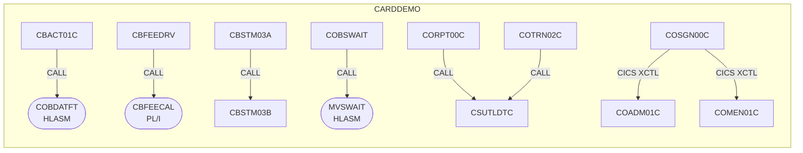

# Call graph of the whole estate (as scanned)

Baseline: `922b1c23fb361b768d03f2b2c4d1e429e2fbbef0` (2026-11-19T13:53:48+05:30), repository `TCS-Devin-Sandbox/ts-cobol-carddemo`. Tool: mftb 0.2.1. Built by `modernization/legacy/scripts/build_graph.py` from the module scans in `store/<MODULE>/` and the estate catalogue; data in `modernization/legacy/graph.json`. Interactive page: [call-graph.html](call-graph.html).

Modules analyzed: AUTH, CARDDEMO, TRANTYPE, VSAMMQ. Modules not analyzed: none.

Every edge below is in exactly one of two lists, never both:

- **PROVEN (static, cited file and line)**: the source states the edge literally; the file and line are given.
- **CANDIDATE (dynamic or inferred)**: the target is held in a data item or is inferred by joining two sources; the basis is given. A dynamic site with no settled target is not an edge at all: it is in [Open asks](#open-asks).

## Counts

| Edge category | PROVEN | CANDIDATE |
|---|---|---|
| Program to program | 65 | 84 |
| Job to step to program | 121 | 1 |
| Program to dataset, table, queue or map | 178 | 9 |
| Programs sharing copybook layouts | 30 | 0 |
| Transaction id to initial program | 25 | 0 |
| Scheduler order | 67 | 2 |

| Item | Count |
|---|---|
| Programs (COBOL) | 46 |
| Leaf members (HLASM, PL/I) | 3 |
| JCL jobs | 48 |
| Edges that cross a module boundary | 244 |
| Open asks (dynamic targets, never guessed) | 31 |
| Uncalled programs | 4 |
| Unreferenced members | 7 |
| Unscheduled JCL jobs | 27 |
| Disagreements with docs/chain-graph.md | 26 |

## Diagram: proven program-to-program edges

Only PROVEN (static, cited file and line) edges between estate members. Candidate edges are drawn separately below.



## Diagram: candidate program-to-program edges

Only CANDIDATE (dynamic or inferred) edges. None of these is proven.

```mermaid
flowchart LR
  subgraph CARDDEMO
    COACTUPC
    COACTVWC
    COADM01C
    COBIL00C
    COCRDLIC
    COCRDSLC
    COCRDUPC
    COMEN01C
    CORPT00C
    COSGN00C
    COTRN00C
    COTRN01C
    COTRN02C
    COUSR00C
    COUSR01C
    COUSR02C
    COUSR03C
  end
  subgraph AUTH
    COPAUS0C
    COPAUS1C
    COPAUS2C
  end
  subgraph TRANTYPE
    CBTRNDYN
    COBTUPDT
    COTRTLIC
    COTRTUPC
  end
  COPAUS1C -.->|CICS LINK| COPAUS2C
  COPAUS0C -.->|CICS XCTL| COMEN01C
  COPAUS0C -.->|CICS XCTL| COPAUS1C
  COPAUS1C -.->|CICS XCTL| COPAUS0C
  COACTUPC -.->|CICS XCTL| COMEN01C
  COACTVWC -.->|CICS XCTL| COMEN01C
  COADM01C -.->|CICS XCTL| COSGN00C
  COADM01C -.->|CICS XCTL| COTRTLIC
  COADM01C -.->|CICS XCTL| COTRTUPC
  COADM01C -.->|CICS XCTL| COUSR00C
  COADM01C -.->|CICS XCTL| COUSR01C
  COADM01C -.->|CICS XCTL| COUSR02C
  COADM01C -.->|CICS XCTL| COUSR03C
  COBIL00C -.->|CICS XCTL| COMEN01C
  COBIL00C -.->|CICS XCTL| COSGN00C
  COCRDLIC -.->|CICS XCTL| COCRDSLC
  COCRDLIC -.->|CICS XCTL| COCRDUPC
  COCRDLIC -.->|CICS XCTL| COMEN01C
  COCRDSLC -.->|CICS XCTL| COMEN01C
  COCRDUPC -.->|CICS XCTL| COMEN01C
  COMEN01C -.->|CICS XCTL| COACTUPC
  COMEN01C -.->|CICS XCTL| COACTVWC
  COMEN01C -.->|CICS XCTL| COBIL00C
  COMEN01C -.->|CICS XCTL| COCRDLIC
  COMEN01C -.->|CICS XCTL| COCRDSLC
  COMEN01C -.->|CICS XCTL| COCRDUPC
  COMEN01C -.->|CICS XCTL| COPAUS0C
  COMEN01C -.->|CICS XCTL| CORPT00C
  COMEN01C -.->|CICS XCTL| COSGN00C
  COMEN01C -.->|CICS XCTL| COTRN00C
  COMEN01C -.->|CICS XCTL| COTRN01C
  COMEN01C -.->|CICS XCTL| COTRN02C
  CORPT00C -.->|CICS XCTL| COMEN01C
  CORPT00C -.->|CICS XCTL| COSGN00C
  COTRN00C -.->|CICS XCTL| COMEN01C
  COTRN00C -.->|CICS XCTL| COSGN00C
  COTRN00C -.->|CICS XCTL| COTRN01C
  COTRN01C -.->|CICS XCTL| COMEN01C
  COTRN01C -.->|CICS XCTL| COSGN00C
  COTRN01C -.->|CICS XCTL| COTRN00C
  COTRN02C -.->|CICS XCTL| COMEN01C
  COTRN02C -.->|CICS XCTL| COSGN00C
  COUSR00C -.->|CICS XCTL| COADM01C
  COUSR00C -.->|CICS XCTL| COSGN00C
  COUSR00C -.->|CICS XCTL| COUSR02C
  COUSR00C -.->|CICS XCTL| COUSR03C
  COUSR01C -.->|CICS XCTL| COADM01C
  COUSR01C -.->|CICS XCTL| COSGN00C
  COUSR02C -.->|CICS XCTL| COADM01C
  COUSR02C -.->|CICS XCTL| COSGN00C
  COUSR03C -.->|CICS XCTL| COADM01C
  COUSR03C -.->|CICS XCTL| COSGN00C
  CBTRNDYN -.->|CALL (dynamic)| COBTUPDT
  COTRTLIC -.->|CICS XCTL| COADM01C
  COTRTLIC -.->|CICS XCTL| COTRTUPC
  COTRTUPC -.->|CICS XCTL| COADM01C
  COTRTUPC -.->|CICS XCTL| COTRTLIC
```

## Program to program

COBOL CALL, CICS LINK and CICS XCTL. HLASM and PL/I members are leaf nodes (target is leaf-HLASM / leaf-PL/I). Targets marked runtime or not-in-estate are system routines (LE, MQ, DL/I) the repository does not supply.

### Program to program - PROVEN (static, cited file and line) (65)

| From | Module | Edge | To | Target is | To module | Cross-module | Cited at |
|---|---|---|---|---|---|---|---|
| CBACT01C | CARDDEMO | CALL | CEE3ABD | runtime | - | no | `app/cbl/CBACT01C.cbl:410` |
| CBACT01C | CARDDEMO | CALL | COBDATFT | leaf-HLASM | CARDDEMO | no | `app/cbl/CBACT01C.cbl:231` |
| CBACT02C | CARDDEMO | CALL | CEE3ABD | runtime | - | no | `app/cbl/CBACT02C.cbl:158` |
| CBACT03C | CARDDEMO | CALL | CEE3ABD | runtime | - | no | `app/cbl/CBACT03C.cbl:158` |
| CBACT04C | CARDDEMO | CALL | CEE3ABD | runtime | - | no | `app/cbl/CBACT04C.cbl:632` |
| CBCUS01C | CARDDEMO | CALL | CEE3ABD | runtime | - | no | `app/cbl/CBCUS01C.cbl:158` |
| CBEXPORT | CARDDEMO | CALL | CEE3ABD | runtime | - | no | `app/cbl/CBEXPORT.cbl:579` |
| CBFEEDRV | CARDDEMO | CALL | CBFEECAL | leaf-PL/I | CARDDEMO | no | `app/cbl/CBFEEDRV.cbl:101` |
| CBIMPORT | CARDDEMO | CALL | CEE3ABD | runtime | - | no | `app/cbl/CBIMPORT.cbl:484` |
| CBSTM03A | CARDDEMO | CALL | CBSTM03B | program | CARDDEMO | no | `app/cbl/CBSTM03A.CBL:351` |
| CBSTM03A | CARDDEMO | CALL | CBSTM03B | program | CARDDEMO | no | `app/cbl/CBSTM03A.CBL:377` |
| CBSTM03A | CARDDEMO | CALL | CBSTM03B | program | CARDDEMO | no | `app/cbl/CBSTM03A.CBL:401` |
| CBSTM03A | CARDDEMO | CALL | CBSTM03B | program | CARDDEMO | no | `app/cbl/CBSTM03A.CBL:734` |
| CBSTM03A | CARDDEMO | CALL | CBSTM03B | program | CARDDEMO | no | `app/cbl/CBSTM03A.CBL:746` |
| CBSTM03A | CARDDEMO | CALL | CBSTM03B | program | CARDDEMO | no | `app/cbl/CBSTM03A.CBL:769` |
| CBSTM03A | CARDDEMO | CALL | CBSTM03B | program | CARDDEMO | no | `app/cbl/CBSTM03A.CBL:787` |
| CBSTM03A | CARDDEMO | CALL | CBSTM03B | program | CARDDEMO | no | `app/cbl/CBSTM03A.CBL:805` |
| CBSTM03A | CARDDEMO | CALL | CBSTM03B | program | CARDDEMO | no | `app/cbl/CBSTM03A.CBL:835` |
| CBSTM03A | CARDDEMO | CALL | CBSTM03B | program | CARDDEMO | no | `app/cbl/CBSTM03A.CBL:860` |
| CBSTM03A | CARDDEMO | CALL | CBSTM03B | program | CARDDEMO | no | `app/cbl/CBSTM03A.CBL:877` |
| CBSTM03A | CARDDEMO | CALL | CBSTM03B | program | CARDDEMO | no | `app/cbl/CBSTM03A.CBL:893` |
| CBSTM03A | CARDDEMO | CALL | CBSTM03B | program | CARDDEMO | no | `app/cbl/CBSTM03A.CBL:909` |
| CBSTM03A | CARDDEMO | CALL | CEE3ABD | runtime | - | no | `app/cbl/CBSTM03A.CBL:923` |
| CBTRN01C | CARDDEMO | CALL | CEE3ABD | runtime | - | no | `app/cbl/CBTRN01C.cbl:473` |
| CBTRN02C | CARDDEMO | CALL | CEE3ABD | runtime | - | no | `app/cbl/CBTRN02C.cbl:711` |
| CBTRN03C | CARDDEMO | CALL | CEE3ABD | runtime | - | no | `app/cbl/CBTRN03C.cbl:630` |
| COACCT01 | VSAMMQ | CALL | MQCLOSE | not-in-estate | - | no | `app/app-vsam-mq/cbl/COACCT01.cbl:557` |
| COACCT01 | VSAMMQ | CALL | MQCLOSE | not-in-estate | - | no | `app/app-vsam-mq/cbl/COACCT01.cbl:579` |
| COACCT01 | VSAMMQ | CALL | MQCLOSE | not-in-estate | - | no | `app/app-vsam-mq/cbl/COACCT01.cbl:602` |
| COACCT01 | VSAMMQ | CALL | MQGET | not-in-estate | - | no | `app/app-vsam-mq/cbl/COACCT01.cbl:352` |
| COACCT01 | VSAMMQ | CALL | MQOPEN | not-in-estate | - | no | `app/app-vsam-mq/cbl/COACCT01.cbl:233` |
| COACCT01 | VSAMMQ | CALL | MQOPEN | not-in-estate | - | no | `app/app-vsam-mq/cbl/COACCT01.cbl:267` |
| COACCT01 | VSAMMQ | CALL | MQOPEN | not-in-estate | - | no | `app/app-vsam-mq/cbl/COACCT01.cbl:302` |
| COACCT01 | VSAMMQ | CALL | MQPUT | not-in-estate | - | no | `app/app-vsam-mq/cbl/COACCT01.cbl:479` |
| COACCT01 | VSAMMQ | CALL | MQPUT | not-in-estate | - | no | `app/app-vsam-mq/cbl/COACCT01.cbl:516` |
| COBSWAIT | CARDDEMO | CALL | MVSWAIT | leaf-HLASM | CARDDEMO | no | `app/cbl/COBSWAIT.cbl:38` |
| CODATE01 | VSAMMQ | CALL | MQCLOSE | not-in-estate | - | no | `app/app-vsam-mq/cbl/CODATE01.cbl:461` |
| CODATE01 | VSAMMQ | CALL | MQCLOSE | not-in-estate | - | no | `app/app-vsam-mq/cbl/CODATE01.cbl:483` |
| CODATE01 | VSAMMQ | CALL | MQCLOSE | not-in-estate | - | no | `app/app-vsam-mq/cbl/CODATE01.cbl:506` |
| CODATE01 | VSAMMQ | CALL | MQGET | not-in-estate | - | no | `app/app-vsam-mq/cbl/CODATE01.cbl:301` |
| CODATE01 | VSAMMQ | CALL | MQOPEN | not-in-estate | - | no | `app/app-vsam-mq/cbl/CODATE01.cbl:182` |
| CODATE01 | VSAMMQ | CALL | MQOPEN | not-in-estate | - | no | `app/app-vsam-mq/cbl/CODATE01.cbl:216` |
| CODATE01 | VSAMMQ | CALL | MQOPEN | not-in-estate | - | no | `app/app-vsam-mq/cbl/CODATE01.cbl:251` |
| CODATE01 | VSAMMQ | CALL | MQPUT | not-in-estate | - | no | `app/app-vsam-mq/cbl/CODATE01.cbl:383` |
| CODATE01 | VSAMMQ | CALL | MQPUT | not-in-estate | - | no | `app/app-vsam-mq/cbl/CODATE01.cbl:420` |
| COPAUA0C | AUTH | CALL | MQCLOSE | not-in-estate | - | no | `app/app-authorization-ims-db2-mq/cbl/COPAUA0C.cbl:956` |
| COPAUA0C | AUTH | CALL | MQGET | not-in-estate | - | no | `app/app-authorization-ims-db2-mq/cbl/COPAUA0C.cbl:400` |
| COPAUA0C | AUTH | CALL | MQOPEN | not-in-estate | - | no | `app/app-authorization-ims-db2-mq/cbl/COPAUA0C.cbl:262` |
| COPAUA0C | AUTH | CALL | MQPUT1 | not-in-estate | - | no | `app/app-authorization-ims-db2-mq/cbl/COPAUA0C.cbl:758` |
| CORPT00C | CARDDEMO | CALL | CSUTLDTC | program | CARDDEMO | no | `app/cbl/CORPT00C.cbl:392` |
| CORPT00C | CARDDEMO | CALL | CSUTLDTC | program | CARDDEMO | no | `app/cbl/CORPT00C.cbl:412` |
| COSGN00C | CARDDEMO | CICS XCTL | COADM01C | program | CARDDEMO | no | `app/cbl/COSGN00C.cbl:231` |
| COSGN00C | CARDDEMO | CICS XCTL | COMEN01C | program | CARDDEMO | no | `app/cbl/COSGN00C.cbl:236` |
| COTRN02C | CARDDEMO | CALL | CSUTLDTC | program | CARDDEMO | no | `app/cbl/COTRN02C.cbl:393` |
| COTRN02C | CARDDEMO | CALL | CSUTLDTC | program | CARDDEMO | no | `app/cbl/COTRN02C.cbl:413` |
| CSUTLDTC | CARDDEMO | CALL | CEEDAYS | runtime | - | no | `app/cbl/CSUTLDTC.cbl:116` |
| DBUNLDGS | AUTH | CALL | CBLTDLI | not-in-estate | - | no | `app/app-authorization-ims-db2-mq/cbl/DBUNLDGS.CBL:222` |
| DBUNLDGS | AUTH | CALL | CBLTDLI | not-in-estate | - | no | `app/app-authorization-ims-db2-mq/cbl/DBUNLDGS.CBL:267` |
| DBUNLDGS | AUTH | CALL | CBLTDLI | not-in-estate | - | no | `app/app-authorization-ims-db2-mq/cbl/DBUNLDGS.CBL:302` |
| DBUNLDGS | AUTH | CALL | CBLTDLI | not-in-estate | - | no | `app/app-authorization-ims-db2-mq/cbl/DBUNLDGS.CBL:321` |
| PAUDBLOD | AUTH | CALL | CBLTDLI | not-in-estate | - | no | `app/app-authorization-ims-db2-mq/cbl/PAUDBLOD.CBL:244` |
| PAUDBLOD | AUTH | CALL | CBLTDLI | not-in-estate | - | no | `app/app-authorization-ims-db2-mq/cbl/PAUDBLOD.CBL:296` |
| PAUDBLOD | AUTH | CALL | CBLTDLI | not-in-estate | - | no | `app/app-authorization-ims-db2-mq/cbl/PAUDBLOD.CBL:321` |
| PAUDBUNL | AUTH | CALL | CBLTDLI | not-in-estate | - | no | `app/app-authorization-ims-db2-mq/cbl/PAUDBUNL.CBL:213` |
| PAUDBUNL | AUTH | CALL | CBLTDLI | not-in-estate | - | no | `app/app-authorization-ims-db2-mq/cbl/PAUDBUNL.CBL:257` |

### Program to program - CANDIDATE (dynamic or inferred) (84)

| From | Module | Edge | To | Target is | To module | Cross-module | Cited at | Basis |
|---|---|---|---|---|---|---|---|---|
| CBTRNDYN | TRANTYPE | CALL (dynamic) | COBTUPDT | program | TRANTYPE | no | `app/app-transaction-type-db2/cbl/CBTRNDYN.cbl:62` | dynamic operand WS-PGM-NAME; value cited at app/app-transaction-type-db2/jcl/MNTTRDYN.jcl:23, app/app-transaction-type-db2/jcl/MNTTRDYN.jcl:33, app/app-transaction-type-db2/cbl/CBTRNDYN.cbl:59-62, app/app-transaction-type-db2/cbl/CBTRNDYN.cbl:53-56 |
| CBTRNDYN | TRANTYPE | CALL (dynamic) | COBTUPDT | program | TRANTYPE | no | `app/app-transaction-type-db2/jcl/MNTTRDYN.jcl:33` | inferred by the parent: job MNTTRDYN passes PARMS('COBTUPDT') to CBTRNDYN, which has a dynamic CALL; the scan itself leaves the target open |
| COACTUPC | CARDDEMO | CICS XCTL | COACTUPC | program | CARDDEMO | no | `app/cbl/COACTUPC.cbl:956` | dynamic operand CDEMO-TO-PROGRAM; value cited at app/cbl/COACTUPC.cbl:533 |
| COACTUPC | CARDDEMO | CICS XCTL | COMEN01C | program | CARDDEMO | no | `app/cbl/COACTUPC.cbl:956` | dynamic operand CDEMO-TO-PROGRAM; value cited at app/cbl/COACTUPC.cbl:557 |
| COACTVWC | CARDDEMO | CICS XCTL | COACTVWC | program | CARDDEMO | no | `app/cbl/COACTVWC.cbl:349` | dynamic operand CDEMO-TO-PROGRAM; value cited at app/cbl/COACTVWC.cbl:143 |
| COACTVWC | CARDDEMO | CICS XCTL | COMEN01C | program | CARDDEMO | no | `app/cbl/COACTVWC.cbl:349` | dynamic operand CDEMO-TO-PROGRAM; value cited at app/cbl/COACTVWC.cbl:167 |
| COADM01C | CARDDEMO | CICS XCTL | COSGN00C | program | CARDDEMO | no | `app/cbl/COADM01C.cbl:168` | dynamic operand CDEMO-TO-PROGRAM; value cited at app/cbl/COADM01C.cbl:101, app/cbl/COADM01C.cbl:166 |
| COADM01C | CARDDEMO | CICS XCTL | COTRTLIC | program | TRANTYPE | yes | `app/cbl/COADM01C.cbl:145` | dynamic operand CDEMO-ADMIN-OPT-PGMNAME; value cited at n/a |
| COADM01C | CARDDEMO | CICS XCTL | COTRTUPC | program | TRANTYPE | yes | `app/cbl/COADM01C.cbl:145` | dynamic operand CDEMO-ADMIN-OPT-PGMNAME; value cited at n/a |
| COADM01C | CARDDEMO | CICS XCTL | COUSR00C | program | CARDDEMO | no | `app/cbl/COADM01C.cbl:145` | dynamic operand CDEMO-ADMIN-OPT-PGMNAME; value cited at app/cpy/COADM02Y.cpy:24 |
| COADM01C | CARDDEMO | CICS XCTL | COUSR01C | program | CARDDEMO | no | `app/cbl/COADM01C.cbl:145` | dynamic operand CDEMO-ADMIN-OPT-PGMNAME; value cited at app/cpy/COADM02Y.cpy:24 |
| COADM01C | CARDDEMO | CICS XCTL | COUSR02C | program | CARDDEMO | no | `app/cbl/COADM01C.cbl:145` | dynamic operand CDEMO-ADMIN-OPT-PGMNAME; value cited at app/cpy/COADM02Y.cpy:24 |
| COADM01C | CARDDEMO | CICS XCTL | COUSR03C | program | CARDDEMO | no | `app/cbl/COADM01C.cbl:145` | dynamic operand CDEMO-ADMIN-OPT-PGMNAME; value cited at app/cpy/COADM02Y.cpy:24 |
| COBIL00C | CARDDEMO | CICS XCTL | COBIL00C | program | CARDDEMO | no | `app/cbl/COBIL00C.cbl:281` | dynamic operand CDEMO-TO-PROGRAM; value cited at app/cbl/COBIL00C.cbl:37 |
| COBIL00C | CARDDEMO | CICS XCTL | COMEN01C | program | CARDDEMO | no | `app/cbl/COBIL00C.cbl:281` | dynamic operand CDEMO-TO-PROGRAM; value cited at app/cbl/COBIL00C.cbl:130 |
| COBIL00C | CARDDEMO | CICS XCTL | COSGN00C | program | CARDDEMO | no | `app/cbl/COBIL00C.cbl:281` | dynamic operand CDEMO-TO-PROGRAM; value cited at app/cbl/COBIL00C.cbl:108, app/cbl/COBIL00C.cbl:276 |
| COCRDLIC | CARDDEMO | CICS XCTL | COCRDLIC | program | CARDDEMO | no | `app/cbl/COCRDLIC.cbl:538` | dynamic operand CCARD-NEXT-PROG; value cited at app/cbl/COCRDLIC.cbl:179 |
| COCRDLIC | CARDDEMO | CICS XCTL | COCRDLIC | program | CARDDEMO | no | `app/cbl/COCRDLIC.cbl:566` | dynamic operand CCARD-NEXT-PROG; value cited at app/cbl/COCRDLIC.cbl:179 |
| COCRDLIC | CARDDEMO | CICS XCTL | COCRDSLC | program | CARDDEMO | no | `app/cbl/COCRDLIC.cbl:538` | dynamic operand CCARD-NEXT-PROG; value cited at app/cbl/COCRDLIC.cbl:195 |
| COCRDLIC | CARDDEMO | CICS XCTL | COCRDSLC | program | CARDDEMO | no | `app/cbl/COCRDLIC.cbl:566` | dynamic operand CCARD-NEXT-PROG; value cited at app/cbl/COCRDLIC.cbl:195 |
| COCRDLIC | CARDDEMO | CICS XCTL | COCRDUPC | program | CARDDEMO | no | `app/cbl/COCRDLIC.cbl:538` | dynamic operand CCARD-NEXT-PROG; value cited at app/cbl/COCRDLIC.cbl:203 |
| COCRDLIC | CARDDEMO | CICS XCTL | COCRDUPC | program | CARDDEMO | no | `app/cbl/COCRDLIC.cbl:566` | dynamic operand CCARD-NEXT-PROG; value cited at app/cbl/COCRDLIC.cbl:203 |
| COCRDLIC | CARDDEMO | CICS XCTL | COMEN01C | program | CARDDEMO | no | `app/cbl/COCRDLIC.cbl:402` | dynamic operand LIT-MENUPGM; value cited at app/cbl/COCRDLIC.cbl:187 |
| COCRDSLC | CARDDEMO | CICS XCTL | COCRDSLC | program | CARDDEMO | no | `app/cbl/COCRDSLC.cbl:331` | dynamic operand CDEMO-TO-PROGRAM; value cited at app/cbl/COCRDSLC.cbl:163 |
| COCRDSLC | CARDDEMO | CICS XCTL | COMEN01C | program | CARDDEMO | no | `app/cbl/COCRDSLC.cbl:331` | dynamic operand CDEMO-TO-PROGRAM; value cited at app/cbl/COCRDSLC.cbl:179 |
| COCRDUPC | CARDDEMO | CICS XCTL | COCRDUPC | program | CARDDEMO | no | `app/cbl/COCRDUPC.cbl:473` | dynamic operand CDEMO-TO-PROGRAM; value cited at app/cbl/COCRDUPC.cbl:219 |
| COCRDUPC | CARDDEMO | CICS XCTL | COMEN01C | program | CARDDEMO | no | `app/cbl/COCRDUPC.cbl:473` | dynamic operand CDEMO-TO-PROGRAM; value cited at app/cbl/COCRDUPC.cbl:235 |
| COMEN01C | CARDDEMO | CICS XCTL | COACTUPC | program | CARDDEMO | no | `app/cbl/COMEN01C.cbl:184` | dynamic operand CDEMO-MENU-OPT-PGMNAME; value cited at app/cpy/COMEN02Y.cpy:22, app/cbl/COMEN01C.cbl:147, app/cbl/COMEN01C.cbl:169, app/cbl/COMEN01C.cbl:177-187 |
| COMEN01C | CARDDEMO | CICS XCTL | COACTVWC | program | CARDDEMO | no | `app/cbl/COMEN01C.cbl:184` | dynamic operand CDEMO-MENU-OPT-PGMNAME; value cited at app/cpy/COMEN02Y.cpy:22, app/cbl/COMEN01C.cbl:147, app/cbl/COMEN01C.cbl:169, app/cbl/COMEN01C.cbl:177-187 |
| COMEN01C | CARDDEMO | CICS XCTL | COBIL00C | program | CARDDEMO | no | `app/cbl/COMEN01C.cbl:184` | dynamic operand CDEMO-MENU-OPT-PGMNAME; value cited at app/cpy/COMEN02Y.cpy:22, app/cbl/COMEN01C.cbl:147, app/cbl/COMEN01C.cbl:169, app/cbl/COMEN01C.cbl:177-187 |
| COMEN01C | CARDDEMO | CICS XCTL | COCRDLIC | program | CARDDEMO | no | `app/cbl/COMEN01C.cbl:184` | dynamic operand CDEMO-MENU-OPT-PGMNAME; value cited at app/cpy/COMEN02Y.cpy:22, app/cbl/COMEN01C.cbl:147, app/cbl/COMEN01C.cbl:169, app/cbl/COMEN01C.cbl:177-187 |
| COMEN01C | CARDDEMO | CICS XCTL | COCRDSLC | program | CARDDEMO | no | `app/cbl/COMEN01C.cbl:184` | dynamic operand CDEMO-MENU-OPT-PGMNAME; value cited at app/cpy/COMEN02Y.cpy:22, app/cbl/COMEN01C.cbl:147, app/cbl/COMEN01C.cbl:169, app/cbl/COMEN01C.cbl:177-187 |
| COMEN01C | CARDDEMO | CICS XCTL | COCRDUPC | program | CARDDEMO | no | `app/cbl/COMEN01C.cbl:184` | dynamic operand CDEMO-MENU-OPT-PGMNAME; value cited at app/cpy/COMEN02Y.cpy:22, app/cbl/COMEN01C.cbl:147, app/cbl/COMEN01C.cbl:169, app/cbl/COMEN01C.cbl:177-187 |
| COMEN01C | CARDDEMO | CICS XCTL | COPAUS0C | program | AUTH | yes | `app/cbl/COMEN01C.cbl:156` | dynamic operand CDEMO-MENU-OPT-PGMNAME; value cited at n/a |
| COMEN01C | CARDDEMO | CICS XCTL | CORPT00C | program | CARDDEMO | no | `app/cbl/COMEN01C.cbl:184` | dynamic operand CDEMO-MENU-OPT-PGMNAME; value cited at app/cpy/COMEN02Y.cpy:22, app/cbl/COMEN01C.cbl:147, app/cbl/COMEN01C.cbl:169, app/cbl/COMEN01C.cbl:177-187 |
| COMEN01C | CARDDEMO | CICS XCTL | COSGN00C | program | CARDDEMO | no | `app/cbl/COMEN01C.cbl:201` | dynamic operand CDEMO-TO-PROGRAM; value cited at app/cbl/COMEN01C.cbl:97, app/cbl/COMEN01C.cbl:199 |
| COMEN01C | CARDDEMO | CICS XCTL | COTRN00C | program | CARDDEMO | no | `app/cbl/COMEN01C.cbl:184` | dynamic operand CDEMO-MENU-OPT-PGMNAME; value cited at app/cpy/COMEN02Y.cpy:22, app/cbl/COMEN01C.cbl:147, app/cbl/COMEN01C.cbl:169, app/cbl/COMEN01C.cbl:177-187 |
| COMEN01C | CARDDEMO | CICS XCTL | COTRN01C | program | CARDDEMO | no | `app/cbl/COMEN01C.cbl:184` | dynamic operand CDEMO-MENU-OPT-PGMNAME; value cited at app/cpy/COMEN02Y.cpy:22, app/cbl/COMEN01C.cbl:147, app/cbl/COMEN01C.cbl:169, app/cbl/COMEN01C.cbl:177-187 |
| COMEN01C | CARDDEMO | CICS XCTL | COTRN02C | program | CARDDEMO | no | `app/cbl/COMEN01C.cbl:184` | dynamic operand CDEMO-MENU-OPT-PGMNAME; value cited at app/cpy/COMEN02Y.cpy:22, app/cbl/COMEN01C.cbl:147, app/cbl/COMEN01C.cbl:169, app/cbl/COMEN01C.cbl:177-187 |
| COPAUS0C | AUTH | CICS XCTL | COMEN01C | program | CARDDEMO | yes | `app/app-authorization-ims-db2-mq/cbl/COPAUS0C.cbl:674` | dynamic operand CDEMO-TO-PROGRAM; value cited at n/a |
| COPAUS0C | AUTH | CICS XCTL | COPAUS1C | program | AUTH | no | `app/app-authorization-ims-db2-mq/cbl/COPAUS0C.cbl:322` | dynamic operand CDEMO-TO-PROGRAM; value cited at app/app-authorization-ims-db2-mq/cbl/COPAUS0C.cbl:316, app/app-authorization-ims-db2-mq/cbl/COPAUS0C.cbl:34, app/app-authorization-ims-db2-mq/cbl/COPAUS0C.cbl:322-325 |
| COPAUS1C | AUTH | CICS XCTL | COPAUS0C | program | AUTH | no | `app/app-authorization-ims-db2-mq/cbl/COPAUS1C.cbl:367` | dynamic operand CDEMO-TO-PROGRAM; value cited at app/app-authorization-ims-db2-mq/cbl/COPAUS1C.cbl:360-370, app/app-authorization-ims-db2-mq/cbl/COPAUS1C.cbl:168-169, app/app-authorization-ims-db2-mq/cbl/COPAUS1C.cbl:185-186, app/app-authorization-ims-db2-mq/cbl/COPAUS1C.cbl:34 |
| COPAUS1C | AUTH | CICS LINK | COPAUS2C | program | AUTH | no | `app/app-authorization-ims-db2-mq/cbl/COPAUS1C.cbl:248` | dynamic operand WS-PGM-AUTH-FRAUD; value cited at app/app-authorization-ims-db2-mq/cbl/COPAUS1C.cbl:35, app/app-authorization-ims-db2-mq/cbl/COPAUS1C.cbl:248-252 |
| CORPT00C | CARDDEMO | CICS XCTL | COMEN01C | program | CARDDEMO | no | `app/cbl/CORPT00C.cbl:548` | dynamic operand CDEMO-TO-PROGRAM; value cited at app/cbl/CORPT00C.cbl:188 |
| CORPT00C | CARDDEMO | CICS XCTL | COSGN00C | program | CARDDEMO | no | `app/cbl/CORPT00C.cbl:548` | dynamic operand CDEMO-TO-PROGRAM; value cited at app/cbl/CORPT00C.cbl:173, app/cbl/CORPT00C.cbl:543 |
| COTRN00C | CARDDEMO | CICS XCTL | COMEN01C | program | CARDDEMO | no | `app/cbl/COTRN00C.cbl:192` | dynamic operand CDEMO-TO-PROGRAM; value cited at app/cbl/COTRN00C.cbl:123 |
| COTRN00C | CARDDEMO | CICS XCTL | COMEN01C | program | CARDDEMO | no | `app/cbl/COTRN00C.cbl:518` | dynamic operand CDEMO-TO-PROGRAM; value cited at app/cbl/COTRN00C.cbl:123 |
| COTRN00C | CARDDEMO | CICS XCTL | COSGN00C | program | CARDDEMO | no | `app/cbl/COTRN00C.cbl:192` | dynamic operand CDEMO-TO-PROGRAM; value cited at app/cbl/COTRN00C.cbl:108, app/cbl/COTRN00C.cbl:513 |
| COTRN00C | CARDDEMO | CICS XCTL | COSGN00C | program | CARDDEMO | no | `app/cbl/COTRN00C.cbl:518` | dynamic operand CDEMO-TO-PROGRAM; value cited at app/cbl/COTRN00C.cbl:108, app/cbl/COTRN00C.cbl:513 |
| COTRN00C | CARDDEMO | CICS XCTL | COTRN01C | program | CARDDEMO | no | `app/cbl/COTRN00C.cbl:192` | dynamic operand CDEMO-TO-PROGRAM; value cited at app/cbl/COTRN00C.cbl:188 |
| COTRN00C | CARDDEMO | CICS XCTL | COTRN01C | program | CARDDEMO | no | `app/cbl/COTRN00C.cbl:518` | dynamic operand CDEMO-TO-PROGRAM; value cited at app/cbl/COTRN00C.cbl:188 |
| COTRN01C | CARDDEMO | CICS XCTL | COMEN01C | program | CARDDEMO | no | `app/cbl/COTRN01C.cbl:205` | dynamic operand CDEMO-TO-PROGRAM; value cited at app/cbl/COTRN01C.cbl:117 |
| COTRN01C | CARDDEMO | CICS XCTL | COSGN00C | program | CARDDEMO | no | `app/cbl/COTRN01C.cbl:205` | dynamic operand CDEMO-TO-PROGRAM; value cited at app/cbl/COTRN01C.cbl:95, app/cbl/COTRN01C.cbl:200 |
| COTRN01C | CARDDEMO | CICS XCTL | COTRN00C | program | CARDDEMO | no | `app/cbl/COTRN01C.cbl:205` | dynamic operand CDEMO-TO-PROGRAM; value cited at app/cbl/COTRN01C.cbl:126 |
| COTRN01C | CARDDEMO | CICS XCTL | COTRN01C | program | CARDDEMO | no | `app/cbl/COTRN01C.cbl:205` | dynamic operand CDEMO-TO-PROGRAM; value cited at app/cbl/COTRN01C.cbl:36 |
| COTRN02C | CARDDEMO | CICS XCTL | COMEN01C | program | CARDDEMO | no | `app/cbl/COTRN02C.cbl:508` | dynamic operand CDEMO-TO-PROGRAM; value cited at app/cbl/COTRN02C.cbl:138 |
| COTRN02C | CARDDEMO | CICS XCTL | COSGN00C | program | CARDDEMO | no | `app/cbl/COTRN02C.cbl:508` | dynamic operand CDEMO-TO-PROGRAM; value cited at app/cbl/COTRN02C.cbl:116, app/cbl/COTRN02C.cbl:503 |
| COTRN02C | CARDDEMO | CICS XCTL | COTRN02C | program | CARDDEMO | no | `app/cbl/COTRN02C.cbl:508` | dynamic operand CDEMO-TO-PROGRAM; value cited at app/cbl/COTRN02C.cbl:36 |
| COTRTLIC | TRANTYPE | CICS XCTL | COADM01C | program | CARDDEMO | yes | `app/app-transaction-type-db2/cbl/COTRTLIC.cbl:620` | dynamic operand CDEMO-TO-PROGRAM; value cited at n/a |
| COTRTLIC | TRANTYPE | CICS XCTL | COTRTUPC | program | TRANTYPE | no | `app/app-transaction-type-db2/cbl/COTRTLIC.cbl:620` | dynamic operand CDEMO-TO-PROGRAM; value cited at app/app-transaction-type-db2/cbl/COTRTLIC.cbl:50, app/app-transaction-type-db2/cbl/COTRTLIC.cbl:638 |
| COTRTLIC | TRANTYPE | CICS XCTL | COTRTUPC | program | TRANTYPE | no | `app/app-transaction-type-db2/cbl/COTRTLIC.cbl:648` | dynamic operand LIT-ADDTPGM; value cited at app/app-transaction-type-db2/cbl/COTRTLIC.cbl:50 |
| COTRTUPC | TRANTYPE | CICS XCTL | COADM01C | program | CARDDEMO | yes | `app/app-transaction-type-db2/cbl/COTRTUPC.cbl:457` | dynamic operand CDEMO-TO-PROGRAM; value cited at n/a |
| COTRTUPC | TRANTYPE | CICS XCTL | COTRTLIC | program | TRANTYPE | no | `app/app-transaction-type-db2/cbl/COTRTUPC.cbl:457` | dynamic operand CDEMO-TO-PROGRAM; value cited at app/app-transaction-type-db2/cbl/COTRTLIC.cbl:630-651, app/app-transaction-type-db2/cbl/COTRTUPC.cbl:376-377, app/app-transaction-type-db2/cbl/COTRTUPC.cbl:441-442, app/cpy/COCOM01Y.cpy:22 |
| COTRTUPC | TRANTYPE | CICS XCTL | COTRTUPC | program | TRANTYPE | no | `app/app-transaction-type-db2/cbl/COTRTUPC.cbl:457` | dynamic operand CDEMO-TO-PROGRAM; value cited at app/app-transaction-type-db2/cbl/COTRTUPC.cbl:201-202, app/app-transaction-type-db2/cbl/COTRTUPC.cbl:446 |
| COUSR00C | CARDDEMO | CICS XCTL | COADM01C | program | CARDDEMO | no | `app/cbl/COUSR00C.cbl:196` | dynamic operand CDEMO-TO-PROGRAM; value cited at app/cbl/COUSR00C.cbl:126 |
| COUSR00C | CARDDEMO | CICS XCTL | COADM01C | program | CARDDEMO | no | `app/cbl/COUSR00C.cbl:206` | dynamic operand CDEMO-TO-PROGRAM; value cited at app/cbl/COUSR00C.cbl:126 |
| COUSR00C | CARDDEMO | CICS XCTL | COADM01C | program | CARDDEMO | no | `app/cbl/COUSR00C.cbl:514` | dynamic operand CDEMO-TO-PROGRAM; value cited at app/cbl/COUSR00C.cbl:126 |
| COUSR00C | CARDDEMO | CICS XCTL | COSGN00C | program | CARDDEMO | no | `app/cbl/COUSR00C.cbl:196` | dynamic operand CDEMO-TO-PROGRAM; value cited at app/cbl/COUSR00C.cbl:111, app/cbl/COUSR00C.cbl:509 |
| COUSR00C | CARDDEMO | CICS XCTL | COSGN00C | program | CARDDEMO | no | `app/cbl/COUSR00C.cbl:206` | dynamic operand CDEMO-TO-PROGRAM; value cited at app/cbl/COUSR00C.cbl:111, app/cbl/COUSR00C.cbl:509 |
| COUSR00C | CARDDEMO | CICS XCTL | COSGN00C | program | CARDDEMO | no | `app/cbl/COUSR00C.cbl:514` | dynamic operand CDEMO-TO-PROGRAM; value cited at app/cbl/COUSR00C.cbl:111, app/cbl/COUSR00C.cbl:509 |
| COUSR00C | CARDDEMO | CICS XCTL | COUSR02C | program | CARDDEMO | no | `app/cbl/COUSR00C.cbl:196` | dynamic operand CDEMO-TO-PROGRAM; value cited at app/cbl/COUSR00C.cbl:192 |
| COUSR00C | CARDDEMO | CICS XCTL | COUSR02C | program | CARDDEMO | no | `app/cbl/COUSR00C.cbl:206` | dynamic operand CDEMO-TO-PROGRAM; value cited at app/cbl/COUSR00C.cbl:192 |
| COUSR00C | CARDDEMO | CICS XCTL | COUSR02C | program | CARDDEMO | no | `app/cbl/COUSR00C.cbl:514` | dynamic operand CDEMO-TO-PROGRAM; value cited at app/cbl/COUSR00C.cbl:192 |
| COUSR00C | CARDDEMO | CICS XCTL | COUSR03C | program | CARDDEMO | no | `app/cbl/COUSR00C.cbl:196` | dynamic operand CDEMO-TO-PROGRAM; value cited at app/cbl/COUSR00C.cbl:202 |
| COUSR00C | CARDDEMO | CICS XCTL | COUSR03C | program | CARDDEMO | no | `app/cbl/COUSR00C.cbl:206` | dynamic operand CDEMO-TO-PROGRAM; value cited at app/cbl/COUSR00C.cbl:202 |
| COUSR00C | CARDDEMO | CICS XCTL | COUSR03C | program | CARDDEMO | no | `app/cbl/COUSR00C.cbl:514` | dynamic operand CDEMO-TO-PROGRAM; value cited at app/cbl/COUSR00C.cbl:202 |
| COUSR01C | CARDDEMO | CICS XCTL | COADM01C | program | CARDDEMO | no | `app/cbl/COUSR01C.cbl:175` | dynamic operand CDEMO-TO-PROGRAM; value cited at app/cbl/COUSR01C.cbl:94 |
| COUSR01C | CARDDEMO | CICS XCTL | COSGN00C | program | CARDDEMO | no | `app/cbl/COUSR01C.cbl:175` | dynamic operand CDEMO-TO-PROGRAM; value cited at app/cbl/COUSR01C.cbl:79, app/cbl/COUSR01C.cbl:168 |
| COUSR02C | CARDDEMO | CICS XCTL | COADM01C | program | CARDDEMO | no | `app/cbl/COUSR02C.cbl:258` | dynamic operand CDEMO-TO-PROGRAM; value cited at app/cbl/COUSR02C.cbl:114, app/cbl/COUSR02C.cbl:125 |
| COUSR02C | CARDDEMO | CICS XCTL | COSGN00C | program | CARDDEMO | no | `app/cbl/COUSR02C.cbl:258` | dynamic operand CDEMO-TO-PROGRAM; value cited at app/cbl/COUSR02C.cbl:91, app/cbl/COUSR02C.cbl:253 |
| COUSR02C | CARDDEMO | CICS XCTL | COUSR02C | program | CARDDEMO | no | `app/cbl/COUSR02C.cbl:258` | dynamic operand CDEMO-TO-PROGRAM; value cited at app/cbl/COUSR02C.cbl:36 |
| COUSR03C | CARDDEMO | CICS XCTL | COADM01C | program | CARDDEMO | no | `app/cbl/COUSR03C.cbl:205` | dynamic operand CDEMO-TO-PROGRAM; value cited at app/cbl/COUSR03C.cbl:113, app/cbl/COUSR03C.cbl:124 |
| COUSR03C | CARDDEMO | CICS XCTL | COSGN00C | program | CARDDEMO | no | `app/cbl/COUSR03C.cbl:205` | dynamic operand CDEMO-TO-PROGRAM; value cited at app/cbl/COUSR03C.cbl:91, app/cbl/COUSR03C.cbl:200 |
| COUSR03C | CARDDEMO | CICS XCTL | COUSR03C | program | CARDDEMO | no | `app/cbl/COUSR03C.cbl:205` | dynamic operand CDEMO-TO-PROGRAM; value cited at app/cbl/COUSR03C.cbl:36 |

## Job to step to program

Every EXEC of every scanned JCL job, with launcher steps (IKJEFT01, DFSRRC00) unwrapped to the program they run where a card names it.

### Job to step to program - PROVEN (static, cited file and line) (121)

| Job | Module | Step | EXEC | Program run | Kind | PROC | Cited at | Note |
|---|---|---|---|---|---|---|---|---|
| ACCTFILE | CARDDEMO | STEP05 | IDCAMS | IDCAMS | utility | - | `app/jcl/ACCTFILE.jcl:22` | - |
| ACCTFILE | CARDDEMO | STEP10 | IDCAMS | IDCAMS | utility | - | `app/jcl/ACCTFILE.jcl:33` | - |
| ACCTFILE | CARDDEMO | STEP15 | IDCAMS | IDCAMS | utility | - | `app/jcl/ACCTFILE.jcl:54` | - |
| CARDFILE | CARDDEMO | STEP60 | IDCAMS | IDCAMS | utility | - | `app/jcl/CARDFILE.jcl:107` | - |
| CARDFILE | CARDDEMO | OPCIFIL | SDSF | SDSF | utility | - | `app/jcl/CARDFILE.jcl:118` | - |
| CARDFILE | CARDDEMO | CLCIFIL | SDSF | SDSF | utility | - | `app/jcl/CARDFILE.jcl:22` | - |
| CARDFILE | CARDDEMO | STEP05 | IDCAMS | IDCAMS | utility | - | `app/jcl/CARDFILE.jcl:33` | - |
| CARDFILE | CARDDEMO | STEP10 | IDCAMS | IDCAMS | utility | - | `app/jcl/CARDFILE.jcl:47` | - |
| CARDFILE | CARDDEMO | STEP15 | IDCAMS | IDCAMS | utility | - | `app/jcl/CARDFILE.jcl:68` | - |
| CARDFILE | CARDDEMO | STEP40 | IDCAMS | IDCAMS | utility | - | `app/jcl/CARDFILE.jcl:80` | - |
| CARDFILE | CARDDEMO | STEP50 | IDCAMS | IDCAMS | utility | - | `app/jcl/CARDFILE.jcl:97` | - |
| CBADMCDJ | CARDDEMO | STEP1 | DFHCSDUP | DFHCSDUP | utility | - | `app/jcl/CBADMCDJ.jcl:27` | - |
| CBEXPORT | CARDDEMO | STEP01 | IDCAMS | IDCAMS | utility | - | `app/jcl/CBEXPORT.jcl:24` | - |
| CBEXPORT | CARDDEMO | STEP02 | CBEXPORT | CBEXPORT | program | - | `app/jcl/CBEXPORT.jcl:43` | - |
| CBIMPORT | CARDDEMO | STEP01 | CBIMPORT | CBIMPORT | program | - | `app/jcl/CBIMPORT.jcl:22` | - |
| CBPAUP0J | AUTH | STEP01 | DFSRRC00 | CBPAUP0C | program | - | `app/app-authorization-ims-db2-mq/jcl/CBPAUP0J.jcl:24` | DFSRRC00 -> CBPAUP0C (ims-parm) |
| CLOSEFIL | CARDDEMO | CLCIFIL | SDSF | SDSF | utility | - | `app/jcl/CLOSEFIL.jcl:22` | - |
| COMBTRAN | CARDDEMO | STEP05R | SORT | SORT | utility | - | `app/jcl/COMBTRAN.jcl:22` | - |
| COMBTRAN | CARDDEMO | STEP10 | IDCAMS | IDCAMS | utility | - | `app/jcl/COMBTRAN.jcl:41` | - |
| CREADB2 | TRANTYPE | FREEPLN | IKJEFT01 | IKJEFT01 | launcher | - | `app/app-transaction-type-db2/jcl/CREADB21.jcl:40` | - |
| CREADB2 | TRANTYPE | CRCRDDB | IKJEFT01 | IKJEFT01 | utility | - | `app/app-transaction-type-db2/jcl/CREADB21.jcl:52` | - |
| CREADB2 | TRANTYPE | LDTTYPE | IEFBR14 | IEFBR14 | utility | - | `app/app-transaction-type-db2/jcl/CREADB21.jcl:64` | - |
| CREADB2 | TRANTYPE | RUNTEP2 | IKJEFT01 | IKJEFT01 | utility | - | `app/app-transaction-type-db2/jcl/CREADB21.jcl:65` | - |
| CREADB2 | TRANTYPE | LDTCCAT | IKJEFT01 | IKJEFT01 | utility | - | `app/app-transaction-type-db2/jcl/CREADB21.jcl:77` | - |
| CREASTMT | CARDDEMO | DELDEF01 | IDCAMS | IDCAMS | utility | - | `app/jcl/CREASTMT.JCL:22` | - |
| CREASTMT | CARDDEMO | STEP010 | SORT | SORT | utility | - | `app/jcl/CREASTMT.JCL:44` | - |
| CREASTMT | CARDDEMO | STEP020 | IDCAMS | IDCAMS | utility | - | `app/jcl/CREASTMT.JCL:56` | - |
| CREASTMT | CARDDEMO | STEP030 | IEFBR14 | IEFBR14 | utility | - | `app/jcl/CREASTMT.JCL:66` | - |
| CREASTMT | CARDDEMO | STEP040 | CBSTM03A | CBSTM03A | program | - | `app/jcl/CREASTMT.JCL:79` | - |
| CUSTFILE | CARDDEMO | CLCIFIL | SDSF | SDSF | utility | - | `app/jcl/CUSTFILE.jcl:22` | - |
| CUSTFILE | CARDDEMO | STEP05 | IDCAMS | IDCAMS | utility | - | `app/jcl/CUSTFILE.jcl:32` | - |
| CUSTFILE | CARDDEMO | STEP10 | IDCAMS | IDCAMS | utility | - | `app/jcl/CUSTFILE.jcl:43` | - |
| CUSTFILE | CARDDEMO | STEP15 | IDCAMS | IDCAMS | utility | - | `app/jcl/CUSTFILE.jcl:64` | - |
| CUSTFILE | CARDDEMO | OPCIFIL | SDSF | SDSF | utility | - | `app/jcl/CUSTFILE.jcl:76` | - |
| DALYREJS | CARDDEMO | STEP05 | IDCAMS | IDCAMS | utility | - | `app/jcl/DALYREJS.jcl:21` | - |
| DBPAUTP0 | AUTH | UNLOAD | DFSRRC00 | DFSRRC00 | utility | - | `app/app-authorization-ims-db2-mq/jcl/DBPAUTP0.jcl:15` | - |
| DBPAUTP0 | AUTH | STEPDEL | IEFBR14 | IEFBR14 | utility | - | `app/app-authorization-ims-db2-mq/jcl/DBPAUTP0.jcl:7` | - |
| DEFCUST | CARDDEMO | STEP05 | IDCAMS | IDCAMS | utility | - | `app/jcl/DEFCUST.jcl:22` | - |
| DEFCUST | CARDDEMO | STEP05 | IDCAMS | IDCAMS | utility | - | `app/jcl/DEFCUST.jcl:32` | - |
| DEFGDGB | CARDDEMO | STEP05 | IDCAMS | IDCAMS | utility | - | `app/jcl/DEFGDGB.jcl:21` | - |
| DEFGDGD | CARDDEMO | STEP10 | IDCAMS | IDCAMS | utility | - | `app/jcl/DEFGDGD.jcl:24` | - |
| DEFGDGD | CARDDEMO | STEP20 | IEBGENER | IEBGENER | utility | - | `app/jcl/DEFGDGD.jcl:36` | - |
| DEFGDGD | CARDDEMO | STEP30 | IDCAMS | IDCAMS | utility | - | `app/jcl/DEFGDGD.jcl:47` | - |
| DEFGDGD | CARDDEMO | STEP40 | IEBGENER | IEBGENER | utility | - | `app/jcl/DEFGDGD.jcl:59` | - |
| DEFGDGD | CARDDEMO | STEP50 | IDCAMS | IDCAMS | utility | - | `app/jcl/DEFGDGD.jcl:70` | - |
| DEFGDGD | CARDDEMO | STEP60 | IEBGENER | IEBGENER | utility | - | `app/jcl/DEFGDGD.jcl:82` | - |
| DISCGRP | CARDDEMO | STEP05 | IDCAMS | IDCAMS | utility | - | `app/jcl/DISCGRP.jcl:22` | - |
| DISCGRP | CARDDEMO | STEP10 | IDCAMS | IDCAMS | utility | - | `app/jcl/DISCGRP.jcl:33` | - |
| DISCGRP | CARDDEMO | STEP15 | IDCAMS | IDCAMS | utility | - | `app/jcl/DISCGRP.jcl:54` | - |
| DUSRSECJ | CARDDEMO | PREDEL | IEFBR14 | IEFBR14 | utility | - | `app/jcl/DUSRSECJ.jcl:23` | - |
| DUSRSECJ | CARDDEMO | STEP01 | IEBGENER | IEBGENER | utility | - | `app/jcl/DUSRSECJ.jcl:32` | - |
| DUSRSECJ | CARDDEMO | STEP02 | IDCAMS | IDCAMS | utility | - | `app/jcl/DUSRSECJ.jcl:58` | - |
| DUSRSECJ | CARDDEMO | STEP03 | IDCAMS | IDCAMS | utility | - | `app/jcl/DUSRSECJ.jcl:80` | - |
| ESDSRRDS | CARDDEMO | STEP05 | IDCAMS | IDCAMS | utility | - | `app/jcl/ESDSRRDS.jcl:113` | - |
| ESDSRRDS | CARDDEMO | PREDEL | IEFBR14 | IEFBR14 | utility | - | `app/jcl/ESDSRRDS.jcl:24` | - |
| ESDSRRDS | CARDDEMO | STEP01 | IEBGENER | IEBGENER | utility | - | `app/jcl/ESDSRRDS.jcl:33` | - |
| ESDSRRDS | CARDDEMO | STEP02 | IDCAMS | IDCAMS | utility | - | `app/jcl/ESDSRRDS.jcl:59` | - |
| ESDSRRDS | CARDDEMO | STEP03 | IDCAMS | IDCAMS | utility | - | `app/jcl/ESDSRRDS.jcl:79` | - |
| ESDSRRDS | CARDDEMO | STEP04 | IDCAMS | IDCAMS | utility | - | `app/jcl/ESDSRRDS.jcl:93` | - |
| FEECALC | CARDDEMO | STEP05 | CBFEEDRV | CBFEEDRV | program | - | `app/jcl/FEECALC.jcl:24` | - |
| FTPJCLS | CARDDEMO | STEP1 | FTP | FTP | utility | - | `app/jcl/FTPJCL.JCL:30` | - |
| INTCALC | CARDDEMO | STEP15 | CBACT04C | CBACT04C | program | - | `app/jcl/INTCALC.jcl:22` | - |
| INTRDRJ1 | CARDDEMO | STEP01 | IEBGENER | IEBGENER | utility | - | `app/jcl/INTRDRJ1.JCL:14` | - |
| INTRDRJ1 | CARDDEMO | IDCAMS | IDCAMS | IDCAMS | utility | - | `app/jcl/INTRDRJ1.JCL:6` | - |
| INTRDRJ2 | CARDDEMO | IDCAMS | IDCAMS | IDCAMS | utility | - | `app/jcl/INTRDRJ2.JCL:7` | - |
| LOADPADB | AUTH | STEP01 | DFSRRC00 | PAUDBLOD | program | - | `app/app-authorization-ims-db2-mq/jcl/LOADPADB.JCL:26` | DFSRRC00 -> PAUDBLOD (ims-parm) |
| MNTTRDB2 | TRANTYPE | STEP1 | IKJEFT01 | COBTUPDT | program | - | `app/app-transaction-type-db2/jcl/MNTTRDB2.jcl:21` | IKJEFT01 -> COBTUPDT (systsin-inline) |
| MNTTRDYN | TRANTYPE | STEP1 | IKJEFT01 | CBTRNDYN | program | - | `app/app-transaction-type-db2/jcl/MNTTRDYN.jcl:23` | IKJEFT01 -> CBTRNDYN (systsin-inline) |
| OPENFIL | CARDDEMO | OPCIFIL | SDSF | SDSF | utility | - | `app/jcl/OPENFIL.jcl:22` | - |
| POSTTRAN | CARDDEMO | STEP15 | CBTRN02C | CBTRN02C | program | - | `app/jcl/POSTTRAN.jcl:23` | - |
| PRTCATBL | CARDDEMO | DELDEF | IEFBR14 | IEFBR14 | utility | - | `app/jcl/PRTCATBL.jcl:21` | - |
| PRTCATBL | CARDDEMO | STEP10R | SORT | SORT | utility | - | `app/jcl/PRTCATBL.jcl:43` | - |
| PRTCATBL | CARDDEMO | STEP05R | IDCAMS | IDCAMS | utility | REPROC | `app/proc/REPROC.prc:21` | - |
| READACCT | CARDDEMO | PREDEL | IEFBR14 | IEFBR14 | utility | - | `app/jcl/READACCT.jcl:22` | - |
| READACCT | CARDDEMO | STEP05 | CBACT01C | CBACT01C | program | - | `app/jcl/READACCT.jcl:32` | - |
| READCARD | CARDDEMO | STEP05 | CBACT02C | CBACT02C | program | - | `app/jcl/READCARD.jcl:22` | - |
| READCUST | CARDDEMO | STEP05 | CBCUS01C | CBCUS01C | program | - | `app/jcl/READCUST.jcl:21` | - |
| READXREF | CARDDEMO | STEP05 | CBACT03C | CBACT03C | program | - | `app/jcl/READXREF.jcl:22` | - |
| REPTFILE | CARDDEMO | STEP05 | IDCAMS | IDCAMS | utility | - | `app/jcl/REPTFILE.jcl:22` | - |
| TCATBALF | CARDDEMO | STEP05 | IDCAMS | IDCAMS | utility | - | `app/jcl/TCATBALF.jcl:22` | - |
| TCATBALF | CARDDEMO | STEP10 | IDCAMS | IDCAMS | utility | - | `app/jcl/TCATBALF.jcl:33` | - |
| TCATBALF | CARDDEMO | STEP15 | IDCAMS | IDCAMS | utility | - | `app/jcl/TCATBALF.jcl:54` | - |
| TRANBKP | CARDDEMO | STEP05 | IDCAMS | IDCAMS | utility | - | `app/jcl/TRANBKP.jcl:37` | - |
| TRANBKP | CARDDEMO | STEP10 | IDCAMS | IDCAMS | utility | - | `app/jcl/TRANBKP.jcl:51` | - |
| TRANBKP | CARDDEMO | STEP05R | IDCAMS | IDCAMS | utility | REPROC | `app/proc/REPROC.prc:21` | - |
| TRANCATG | CARDDEMO | STEP05 | IDCAMS | IDCAMS | utility | - | `app/jcl/TRANCATG.jcl:22` | - |
| TRANCATG | CARDDEMO | STEP10 | IDCAMS | IDCAMS | utility | - | `app/jcl/TRANCATG.jcl:33` | - |
| TRANCATG | CARDDEMO | STEP15 | IDCAMS | IDCAMS | utility | - | `app/jcl/TRANCATG.jcl:54` | - |
| TRANEXTR | TRANTYPE | STEP10 | IEBGENER | IEBGENER | utility | - | `app/app-transaction-type-db2/jcl/TRANEXTR.jcl:31` | - |
| TRANEXTR | TRANTYPE | STEP20 | IEBGENER | IEBGENER | utility | - | `app/app-transaction-type-db2/jcl/TRANEXTR.jcl:42` | - |
| TRANEXTR | TRANTYPE | STEP30 | IEFBR14 | IEFBR14 | utility | - | `app/app-transaction-type-db2/jcl/TRANEXTR.jcl:53` | - |
| TRANEXTR | TRANTYPE | STEP40 | IKJEFT01 | IKJEFT01 | utility | - | `app/app-transaction-type-db2/jcl/TRANEXTR.jcl:65` | - |
| TRANEXTR | TRANTYPE | STEP50 | IKJEFT01 | IKJEFT01 | utility | - | `app/app-transaction-type-db2/jcl/TRANEXTR.jcl:95` | - |
| TRANFILE | CARDDEMO | STEP30 | IDCAMS | IDCAMS | utility | - | `app/jcl/TRANFILE.jcl:106` | - |
| TRANFILE | CARDDEMO | OPCIFIL | SDSF | SDSF | utility | - | `app/jcl/TRANFILE.jcl:116` | - |
| TRANFILE | CARDDEMO | CLCIFIL | SDSF | SDSF | utility | - | `app/jcl/TRANFILE.jcl:22` | - |
| TRANFILE | CARDDEMO | STEP05 | IDCAMS | IDCAMS | utility | - | `app/jcl/TRANFILE.jcl:32` | - |
| TRANFILE | CARDDEMO | STEP10 | IDCAMS | IDCAMS | utility | - | `app/jcl/TRANFILE.jcl:46` | - |
| TRANFILE | CARDDEMO | STEP15 | IDCAMS | IDCAMS | utility | - | `app/jcl/TRANFILE.jcl:67` | - |
| TRANFILE | CARDDEMO | STEP20 | IDCAMS | IDCAMS | utility | - | `app/jcl/TRANFILE.jcl:79` | - |
| TRANFILE | CARDDEMO | STEP25 | IDCAMS | IDCAMS | utility | - | `app/jcl/TRANFILE.jcl:96` | - |
| TRANIDX | CARDDEMO | STEP20 | IDCAMS | IDCAMS | utility | - | `app/jcl/TRANIDX.jcl:22` | - |
| TRANIDX | CARDDEMO | STEP25 | IDCAMS | IDCAMS | utility | - | `app/jcl/TRANIDX.jcl:39` | - |
| TRANIDX | CARDDEMO | STEP30 | IDCAMS | IDCAMS | utility | - | `app/jcl/TRANIDX.jcl:49` | - |
| TRANREPT | CARDDEMO | STEP05R | SORT | SORT | utility | - | `app/jcl/TRANREPT.jcl:37` | - |
| TRANREPT | CARDDEMO | STEP10R | CBTRN03C | CBTRN03C | program | - | `app/jcl/TRANREPT.jcl:59` | - |
| TRANREPT | CARDDEMO | STEP05R | IDCAMS | IDCAMS | utility | REPROC | `app/proc/REPROC.prc:21` | - |
| TRANTYPE | CARDDEMO | STEP05 | IDCAMS | IDCAMS | utility | - | `app/jcl/TRANTYPE.jcl:22` | - |
| TRANTYPE | CARDDEMO | STEP10 | IDCAMS | IDCAMS | utility | - | `app/jcl/TRANTYPE.jcl:33` | - |
| TRANTYPE | CARDDEMO | STEP15 | IDCAMS | IDCAMS | utility | - | `app/jcl/TRANTYPE.jcl:54` | - |
| TXT2PDF1 | CARDDEMO | TXT2PDF | IKJEFT1B | IKJEFT1B | launcher | - | `app/jcl/TXT2PDF1.JCL:24` | - |
| UNLDGSAM | AUTH | STEP01 | DFSRRC00 | DBUNLDGS | program | - | `app/app-authorization-ims-db2-mq/jcl/UNLDGSAM.JCL:26` | DFSRRC00 -> DBUNLDGS (ims-parm) |
| UNLDPADB | AUTH | STEP0 | IEFBR14 | IEFBR14 | utility | - | `app/app-authorization-ims-db2-mq/jcl/UNLDPADB.JCL:25` | - |
| UNLDPADB | AUTH | STEP01 | DFSRRC00 | PAUDBUNL | program | - | `app/app-authorization-ims-db2-mq/jcl/UNLDPADB.JCL:38` | DFSRRC00 -> PAUDBUNL (ims-parm) |
| WAITSTEP | CARDDEMO | WAIT | COBSWAIT | COBSWAIT | program | - | `app/jcl/WAITSTEP.jcl:22` | - |
| XREFFILE | CARDDEMO | STEP05 | IDCAMS | IDCAMS | utility | - | `app/jcl/XREFFILE.jcl:22` | - |
| XREFFILE | CARDDEMO | STEP10 | IDCAMS | IDCAMS | utility | - | `app/jcl/XREFFILE.jcl:36` | - |
| XREFFILE | CARDDEMO | STEP15 | IDCAMS | IDCAMS | utility | - | `app/jcl/XREFFILE.jcl:57` | - |
| XREFFILE | CARDDEMO | STEP20 | IDCAMS | IDCAMS | utility | - | `app/jcl/XREFFILE.jcl:69` | - |
| XREFFILE | CARDDEMO | STEP25 | IDCAMS | IDCAMS | utility | - | `app/jcl/XREFFILE.jcl:87` | - |
| XREFFILE | CARDDEMO | STEP30 | IDCAMS | IDCAMS | utility | - | `app/jcl/XREFFILE.jcl:97` | - |

### Job to step to program - CANDIDATE (dynamic or inferred) (1)

| Job | Module | Step | EXEC | Program run | Kind | PROC | Cited at | Note |
|---|---|---|---|---|---|---|---|---|
| TRNRPT00 (submitted by CORPT00C) | CARDDEMO | STEP10 | TRANREPT | TRANREPT | proc | TRANREPT | `app/cbl/CORPT00C.cbl:517` | JCL cards written to TD queue JOBS (internal reader); scanner status: partial |

## Program to dataset, table, queue or map

Direction is reads, writes or updates (REWRITE, DELETE, SQL UPDATE/DELETE, DL/I REPL/DLET). For maps, writes = SEND MAP and reads = RECEIVE MAP.

### Program to dataset, table, queue or map - PROVEN (static, cited file and line) (178)

| Program | Module | Direction | Store | Store kind | Via | DD / file / verb | Job.step | Cited at | Binding cited at |
|---|---|---|---|---|---|---|---|---|---|
| CBACT01C | CARDDEMO | writes | AWS.M2.CARDDEMO.ACCTDATA.ARRYPS | dataset | batch file | ARRYFILE | READACCT.STEP05 | `app/cbl/CBACT01C.cbl:40` | `app/jcl/READACCT.jcl:41` |
| CBACT01C | CARDDEMO | writes | AWS.M2.CARDDEMO.ACCTDATA.PSCOMP | dataset | batch file | OUTFILE | READACCT.STEP05 | `app/cbl/CBACT01C.cbl:35` | `app/jcl/READACCT.jcl:37` |
| CBACT01C | CARDDEMO | writes | AWS.M2.CARDDEMO.ACCTDATA.VBPS | dataset | batch file | VBRCFILE | READACCT.STEP05 | `app/cbl/CBACT01C.cbl:45` | `app/jcl/READACCT.jcl:45` |
| CBACT01C | CARDDEMO | reads | AWS.M2.CARDDEMO.ACCTDATA.VSAM.KSDS | dataset | batch file | ACCTFILE | READACCT.STEP05 | `app/cbl/CBACT01C.cbl:29` | `app/jcl/READACCT.jcl:35` |
| CBACT02C | CARDDEMO | reads | AWS.M2.CARDDEMO.CARDDATA.VSAM.KSDS | dataset | batch file | CARDFILE | READCARD.STEP05 | `app/cbl/CBACT02C.cbl:29` | `app/jcl/READCARD.jcl:25` |
| CBACT03C | CARDDEMO | reads | AWS.M2.CARDDEMO.CARDXREF.VSAM.KSDS | dataset | batch file | XREFFILE | READXREF.STEP05 | `app/cbl/CBACT03C.cbl:29` | `app/jcl/READXREF.jcl:25` |
| CBACT04C | CARDDEMO | reads | AWS.M2.CARDDEMO.ACCTDATA.VSAM.KSDS | dataset | batch file | ACCTFILE | INTCALC.STEP15 | `app/cbl/CBACT04C.cbl:41` | `app/jcl/INTCALC.jcl:33` |
| CBACT04C | CARDDEMO | updates | AWS.M2.CARDDEMO.ACCTDATA.VSAM.KSDS | dataset | batch file | ACCTFILE | INTCALC.STEP15 | `app/cbl/CBACT04C.cbl:41` | `app/jcl/INTCALC.jcl:33` |
| CBACT04C | CARDDEMO | reads | AWS.M2.CARDDEMO.CARDXREF.VSAM.KSDS | dataset | batch file | XREFFILE | INTCALC.STEP15 | `app/cbl/CBACT04C.cbl:34` | `app/jcl/INTCALC.jcl:29` |
| CBACT04C | CARDDEMO | reads | AWS.M2.CARDDEMO.DISCGRP.VSAM.KSDS | dataset | batch file | DISCGRP | INTCALC.STEP15 | `app/cbl/CBACT04C.cbl:47` | `app/jcl/INTCALC.jcl:35` |
| CBACT04C | CARDDEMO | writes | AWS.M2.CARDDEMO.SYSTRAN(+1) | dataset | batch file | TRANSACT | INTCALC.STEP15 | `app/cbl/CBACT04C.cbl:53` | `app/jcl/INTCALC.jcl:37` |
| CBACT04C | CARDDEMO | reads | AWS.M2.CARDDEMO.TCATBALF.VSAM.KSDS | dataset | batch file | TCATBALF | INTCALC.STEP15 | `app/cbl/CBACT04C.cbl:28` | `app/jcl/INTCALC.jcl:27` |
| CBCUS01C | CARDDEMO | reads | AWS.M2.CARDDEMO.CUSTDATA.VSAM.KSDS | dataset | batch file | CUSTFILE | READCUST.STEP05 | `app/cbl/CBCUS01C.cbl:29` | `app/jcl/READCUST.jcl:24` |
| CBEXPORT | CARDDEMO | reads | AWS.M2.CARDDEMO.ACCTDATA.VSAM.KSDS | dataset | batch file | ACCTFILE | CBEXPORT.STEP02 | `app/cbl/CBEXPORT.cbl:41` | `app/jcl/CBEXPORT.jcl:51` |
| CBEXPORT | CARDDEMO | reads | AWS.M2.CARDDEMO.CARDDATA.VSAM.KSDS | dataset | batch file | CARDFILE | CBEXPORT.STEP02 | `app/cbl/CBEXPORT.cbl:59` | `app/jcl/CBEXPORT.jcl:57` |
| CBEXPORT | CARDDEMO | reads | AWS.M2.CARDDEMO.CARDXREF.VSAM.KSDS | dataset | batch file | XREFFILE | CBEXPORT.STEP02 | `app/cbl/CBEXPORT.cbl:47` | `app/jcl/CBEXPORT.jcl:53` |
| CBEXPORT | CARDDEMO | reads | AWS.M2.CARDDEMO.CUSTDATA.VSAM.KSDS | dataset | batch file | CUSTFILE | CBEXPORT.STEP02 | `app/cbl/CBEXPORT.cbl:35` | `app/jcl/CBEXPORT.jcl:49` |
| CBEXPORT | CARDDEMO | writes | AWS.M2.CARDDEMO.EXPORT.DATA | dataset | batch file | EXPFILE | CBEXPORT.STEP02 | `app/cbl/CBEXPORT.cbl:65` | `app/jcl/CBEXPORT.jcl:62` |
| CBEXPORT | CARDDEMO | reads | AWS.M2.CARDDEMO.TRANSACT.VSAM.KSDS | dataset | batch file | TRANSACT | CBEXPORT.STEP02 | `app/cbl/CBEXPORT.cbl:53` | `app/jcl/CBEXPORT.jcl:55` |
| CBFEEDRV | CARDDEMO | reads | AWS.M2.CARDDEMO.ACCTDATA.VSAM.KSDS | dataset | batch file | ACCTFILE | FEECALC.STEP05 | `app/cbl/CBFEEDRV.cbl:32` | `app/jcl/FEECALC.jcl:27` |
| CBFEEDRV | CARDDEMO | writes | AWS.M2.CARDDEMO.LATEFEES(+1) | dataset | batch file | FEEOUT | FEECALC.STEP05 | `app/cbl/CBFEEDRV.cbl:37` | `app/jcl/FEECALC.jcl:28` |
| CBIMPORT | CARDDEMO | writes | (DD CARDOUT: no DSN) | dataset | batch file | CARDOUT | CBIMPORT.STEP01 | `app/cbl/CBIMPORT.cbl:63` | `app/jcl/CBIMPORT.jcl:22` |
| CBIMPORT | CARDDEMO | writes | AWS.M2.CARDDEMO.ACCTDATA.IMPORT | dataset | batch file | ACCTOUT | CBIMPORT.STEP01 | `app/cbl/CBIMPORT.cbl:48` | `app/jcl/CBIMPORT.jcl:38` |
| CBIMPORT | CARDDEMO | writes | AWS.M2.CARDDEMO.CARDXREF.IMPORT | dataset | batch file | XREFOUT | CBIMPORT.STEP01 | `app/cbl/CBIMPORT.cbl:53` | `app/jcl/CBIMPORT.jcl:43` |
| CBIMPORT | CARDDEMO | writes | AWS.M2.CARDDEMO.CUSTDATA.IMPORT | dataset | batch file | CUSTOUT | CBIMPORT.STEP01 | `app/cbl/CBIMPORT.cbl:43` | `app/jcl/CBIMPORT.jcl:33` |
| CBIMPORT | CARDDEMO | reads | AWS.M2.CARDDEMO.EXPORT.DATA | dataset | batch file | EXPFILE | CBIMPORT.STEP01 | `app/cbl/CBIMPORT.cbl:37` | `app/jcl/CBIMPORT.jcl:28` |
| CBIMPORT | CARDDEMO | writes | AWS.M2.CARDDEMO.IMPORT.ERRORS | dataset | batch file | ERROUT | CBIMPORT.STEP01 | `app/cbl/CBIMPORT.cbl:68` | `app/jcl/CBIMPORT.jcl:56` |
| CBIMPORT | CARDDEMO | writes | AWS.M2.CARDDEMO.TRANSACT.IMPORT | dataset | batch file | TRNXOUT | CBIMPORT.STEP01 | `app/cbl/CBIMPORT.cbl:58` | `app/jcl/CBIMPORT.jcl:48` |
| CBPAUP0C | AUTH | reads | IMS segment PAUTDTL1 | ims | IMS (EXEC DLI) | GNP | - | `app/app-authorization-ims-db2-mq/cbl/CBPAUP0C.cbl:255` | `-` |
| CBPAUP0C | AUTH | updates | IMS segment PAUTDTL1 | ims | IMS (EXEC DLI) | DLET | - | `app/app-authorization-ims-db2-mq/cbl/CBPAUP0C.cbl:310` | `-` |
| CBPAUP0C | AUTH | reads | IMS segment PAUTSUM0 | ims | IMS (EXEC DLI) | GN | - | `app/app-authorization-ims-db2-mq/cbl/CBPAUP0C.cbl:223` | `-` |
| CBPAUP0C | AUTH | updates | IMS segment PAUTSUM0 | ims | IMS (EXEC DLI) | DLET | - | `app/app-authorization-ims-db2-mq/cbl/CBPAUP0C.cbl:335` | `-` |
| CBSTM03A | CARDDEMO | writes | AWS.M2.CARDDEMO.STATEMNT.HTML | dataset | batch file | HTMLFILE | CREASTMT.STEP040 | `app/cbl/CBSTM03A.CBL:40` | `app/jcl/CREASTMT.JCL:92` |
| CBSTM03A | CARDDEMO | writes | AWS.M2.CARDDEMO.STATEMNT.PS | dataset | batch file | STMTFILE | CREASTMT.STEP040 | `app/cbl/CBSTM03A.CBL:39` | `app/jcl/CREASTMT.JCL:87` |
| CBSTM03B | CARDDEMO | reads | AWS.M2.CARDDEMO.ACCTDATA.VSAM.KSDS | dataset | batch file | ACCTFILE | CREASTMT.STEP040 | `app/cbl/CBSTM03B.CBL:49` | `app/jcl/CREASTMT.JCL:85` |
| CBSTM03B | CARDDEMO | reads | AWS.M2.CARDDEMO.CARDXREF.VSAM.KSDS | dataset | batch file | XREFFILE | CREASTMT.STEP040 | `app/cbl/CBSTM03B.CBL:37` | `app/jcl/CREASTMT.JCL:84` |
| CBSTM03B | CARDDEMO | reads | AWS.M2.CARDDEMO.CUSTDATA.VSAM.KSDS | dataset | batch file | CUSTFILE | CREASTMT.STEP040 | `app/cbl/CBSTM03B.CBL:43` | `app/jcl/CREASTMT.JCL:86` |
| CBSTM03B | CARDDEMO | reads | AWS.M2.CARDDEMO.TRXFL.VSAM.KSDS | dataset | batch file | TRNXFILE | CREASTMT.STEP040 | `app/cbl/CBSTM03B.CBL:31` | `app/jcl/CREASTMT.JCL:83` |
| CBTRN01C | CARDDEMO | reads | (DD ACCTFILE: not allocated by any scanned JCL) | dataset | batch file | ACCTFILE | - | `app/cbl/CBTRN01C.cbl:52` | `-` |
| CBTRN01C | CARDDEMO | reads | (DD CARDFILE: not allocated by any scanned JCL) | dataset | batch file | CARDFILE | - | `app/cbl/CBTRN01C.cbl:46` | `-` |
| CBTRN01C | CARDDEMO | reads | (DD CUSTFILE: not allocated by any scanned JCL) | dataset | batch file | CUSTFILE | - | `app/cbl/CBTRN01C.cbl:34` | `-` |
| CBTRN01C | CARDDEMO | reads | (DD DALYTRAN: not allocated by any scanned JCL) | dataset | batch file | DALYTRAN | - | `app/cbl/CBTRN01C.cbl:29` | `-` |
| CBTRN01C | CARDDEMO | reads | (DD TRANFILE: not allocated by any scanned JCL) | dataset | batch file | TRANFILE | - | `app/cbl/CBTRN01C.cbl:58` | `-` |
| CBTRN01C | CARDDEMO | reads | (DD XREFFILE: not allocated by any scanned JCL) | dataset | batch file | XREFFILE | - | `app/cbl/CBTRN01C.cbl:40` | `-` |
| CBTRN02C | CARDDEMO | reads | AWS.M2.CARDDEMO.ACCTDATA.VSAM.KSDS | dataset | batch file | ACCTFILE | POSTTRAN.STEP15 | `app/cbl/CBTRN02C.cbl:51` | `app/jcl/POSTTRAN.jcl:39` |
| CBTRN02C | CARDDEMO | updates | AWS.M2.CARDDEMO.ACCTDATA.VSAM.KSDS | dataset | batch file | ACCTFILE | POSTTRAN.STEP15 | `app/cbl/CBTRN02C.cbl:51` | `app/jcl/POSTTRAN.jcl:39` |
| CBTRN02C | CARDDEMO | reads | AWS.M2.CARDDEMO.CARDXREF.VSAM.KSDS | dataset | batch file | XREFFILE | POSTTRAN.STEP15 | `app/cbl/CBTRN02C.cbl:40` | `app/jcl/POSTTRAN.jcl:32` |
| CBTRN02C | CARDDEMO | writes | AWS.M2.CARDDEMO.DALYREJS(+1) | dataset | batch file | DALYREJS | POSTTRAN.STEP15 | `app/cbl/CBTRN02C.cbl:46` | `app/jcl/POSTTRAN.jcl:34` |
| CBTRN02C | CARDDEMO | reads | AWS.M2.CARDDEMO.DALYTRAN.PS | dataset | batch file | DALYTRAN | POSTTRAN.STEP15 | `app/cbl/CBTRN02C.cbl:29` | `app/jcl/POSTTRAN.jcl:30` |
| CBTRN02C | CARDDEMO | reads | AWS.M2.CARDDEMO.TCATBALF.VSAM.KSDS | dataset | batch file | TCATBALF | POSTTRAN.STEP15 | `app/cbl/CBTRN02C.cbl:57` | `app/jcl/POSTTRAN.jcl:41` |
| CBTRN02C | CARDDEMO | updates | AWS.M2.CARDDEMO.TCATBALF.VSAM.KSDS | dataset | batch file | TCATBALF | POSTTRAN.STEP15 | `app/cbl/CBTRN02C.cbl:57` | `app/jcl/POSTTRAN.jcl:41` |
| CBTRN02C | CARDDEMO | writes | AWS.M2.CARDDEMO.TCATBALF.VSAM.KSDS | dataset | batch file | TCATBALF | POSTTRAN.STEP15 | `app/cbl/CBTRN02C.cbl:57` | `app/jcl/POSTTRAN.jcl:41` |
| CBTRN02C | CARDDEMO | writes | AWS.M2.CARDDEMO.TRANSACT.VSAM.KSDS | dataset | batch file | TRANFILE | POSTTRAN.STEP15 | `app/cbl/CBTRN02C.cbl:34` | `app/jcl/POSTTRAN.jcl:28` |
| CBTRN03C | CARDDEMO | reads | AWS.M2.CARDDEMO.CARDXREF.VSAM.KSDS | dataset | batch file | CARDXREF | TRANREPT.STEP10R | `app/cbl/CBTRN03C.cbl:33` | `app/jcl/TRANREPT.jcl:67` |
| CBTRN03C | CARDDEMO | reads | AWS.M2.CARDDEMO.DATEPARM | dataset | batch file | DATEPARM | TRANREPT.STEP10R | `app/cbl/CBTRN03C.cbl:55` | `app/jcl/TRANREPT.jcl:73` |
| CBTRN03C | CARDDEMO | reads | AWS.M2.CARDDEMO.TRANCATG.VSAM.KSDS | dataset | batch file | TRANCATG | TRANREPT.STEP10R | `app/cbl/CBTRN03C.cbl:45` | `app/jcl/TRANREPT.jcl:71` |
| CBTRN03C | CARDDEMO | writes | AWS.M2.CARDDEMO.TRANREPT(+1) | dataset | batch file | TRANREPT | TRANREPT.STEP10R | `app/cbl/CBTRN03C.cbl:51` | `app/jcl/TRANREPT.jcl:76` |
| CBTRN03C | CARDDEMO | reads | AWS.M2.CARDDEMO.TRANSACT.DALY(+1) | dataset | batch file | TRANFILE | TRANREPT.STEP10R | `app/cbl/CBTRN03C.cbl:29` | `app/jcl/TRANREPT.jcl:65` |
| CBTRN03C | CARDDEMO | reads | AWS.M2.CARDDEMO.TRANTYPE.VSAM.KSDS | dataset | batch file | TRANTYPE | TRANREPT.STEP10R | `app/cbl/CBTRN03C.cbl:39` | `app/jcl/TRANREPT.jcl:69` |
| CBTRNDYN | TRANTYPE | reads | DYNSQL | dataset | batch file | DYNSQL | MNTTRDYN.STEP1 | `app/app-transaction-type-db2/cbl/CBTRNDYN.cbl:34` | `app/app-transaction-type-db2/jcl/MNTTRDYN.jcl:29` |
| COACCT01 | VSAMMQ | reads | AWS.M2.CARDDEMO.ACCTDATA.VSAM.KSDS | dataset | CICS file | ACCTDAT | - | `app/app-vsam-mq/cbl/COACCT01.cbl:396` | `app/csd/CARDDEMO.CSD:1` |
| COACCT01 | VSAMMQ | reads | MQ queue (name is run-time data) | queue | MQ MQGET | MQGET | - | `app/app-vsam-mq/cbl/COACCT01.cbl:352` | `-` |
| COACCT01 | VSAMMQ | writes | MQ queue (name is run-time data) | queue | MQ MQPUT | MQPUT | - | `app/app-vsam-mq/cbl/COACCT01.cbl:479` | `-` |
| COACCT01 | VSAMMQ | writes | MQ queue (name is run-time data) | queue | MQ MQPUT | MQPUT | - | `app/app-vsam-mq/cbl/COACCT01.cbl:516` | `-` |
| COACTUPC | CARDDEMO | reads | AWS.M2.CARDDEMO.ACCTDATA.VSAM.KSDS | dataset | CICS file | ACCTDAT | - | `app/cbl/COACTUPC.cbl:3703` | `app/csd/CARDDEMO.CSD:1` |
| COACTUPC | CARDDEMO | updates | AWS.M2.CARDDEMO.ACCTDATA.VSAM.KSDS | dataset | CICS file | ACCTDAT | - | `app/cbl/COACTUPC.cbl:4065` | `app/csd/CARDDEMO.CSD:1` |
| COACTUPC | CARDDEMO | reads | AWS.M2.CARDDEMO.CARDXREF.VSAM.AIX.PATH | dataset | CICS file | CXACAIX | - | `app/cbl/COACTUPC.cbl:3654` | `app/csd/CARDDEMO.CSD:63` |
| COACTUPC | CARDDEMO | reads | AWS.M2.CARDDEMO.CUSTDATA.VSAM.KSDS | dataset | CICS file | CUSTDAT | - | `app/cbl/COACTUPC.cbl:3753` | `app/csd/CARDDEMO.CSD:50` |
| COACTUPC | CARDDEMO | updates | AWS.M2.CARDDEMO.CUSTDATA.VSAM.KSDS | dataset | CICS file | CUSTDAT | - | `app/cbl/COACTUPC.cbl:4085` | `app/csd/CARDDEMO.CSD:50` |
| COACTUPC | CARDDEMO | reads | COACTUP | map | BMS map | CACTUPA | - | `app/cbl/COACTUPC.cbl:1040` | `app/csd/CARDDEMO.CSD:100` |
| COACTVWC | CARDDEMO | reads | AWS.M2.CARDDEMO.ACCTDATA.VSAM.KSDS | dataset | CICS file | ACCTDAT | - | `app/cbl/COACTVWC.cbl:776` | `app/csd/CARDDEMO.CSD:1` |
| COACTVWC | CARDDEMO | reads | AWS.M2.CARDDEMO.CARDXREF.VSAM.AIX.PATH | dataset | CICS file | CXACAIX | - | `app/cbl/COACTVWC.cbl:727` | `app/csd/CARDDEMO.CSD:63` |
| COACTVWC | CARDDEMO | reads | AWS.M2.CARDDEMO.CUSTDATA.VSAM.KSDS | dataset | CICS file | CUSTDAT | - | `app/cbl/COACTVWC.cbl:826` | `app/csd/CARDDEMO.CSD:50` |
| COACTVWC | CARDDEMO | reads | COACTVW | map | BMS map | CACTVWA | - | `app/cbl/COACTVWC.cbl:611` | `app/csd/CARDDEMO.CSD:105` |
| COADM01C | CARDDEMO | reads | COADM01 | map | BMS map | COADM1A | - | `app/cbl/COADM01C.cbl:194` | `app/csd/CARDDEMO.CSD:110` |
| COADM01C | CARDDEMO | writes | COADM01 | map | BMS map | COADM1A | - | `app/cbl/COADM01C.cbl:182` | `app/csd/CARDDEMO.CSD:110` |
| COBIL00C | CARDDEMO | reads | AWS.M2.CARDDEMO.ACCTDATA.VSAM.KSDS | dataset | CICS file | ACCTDAT | - | `app/cbl/COBIL00C.cbl:345` | `app/csd/CARDDEMO.CSD:1` |
| COBIL00C | CARDDEMO | updates | AWS.M2.CARDDEMO.ACCTDATA.VSAM.KSDS | dataset | CICS file | ACCTDAT | - | `app/cbl/COBIL00C.cbl:379` | `app/csd/CARDDEMO.CSD:1` |
| COBIL00C | CARDDEMO | reads | AWS.M2.CARDDEMO.CARDXREF.VSAM.AIX.PATH | dataset | CICS file | CXACAIX | - | `app/cbl/COBIL00C.cbl:410` | `app/csd/CARDDEMO.CSD:63` |
| COBIL00C | CARDDEMO | reads | AWS.M2.CARDDEMO.TRANSACT.VSAM.KSDS | dataset | CICS file | TRANSACT | - | `app/cbl/COBIL00C.cbl:443` | `app/csd/CARDDEMO.CSD:76` |
| COBIL00C | CARDDEMO | writes | AWS.M2.CARDDEMO.TRANSACT.VSAM.KSDS | dataset | CICS file | TRANSACT | - | `app/cbl/COBIL00C.cbl:512` | `app/csd/CARDDEMO.CSD:76` |
| COBIL00C | CARDDEMO | reads | COBIL00 | map | BMS map | COBIL0A | - | `app/cbl/COBIL00C.cbl:308` | `app/csd/CARDDEMO.CSD:114` |
| COBIL00C | CARDDEMO | writes | COBIL00 | map | BMS map | COBIL0A | - | `app/cbl/COBIL00C.cbl:295` | `app/csd/CARDDEMO.CSD:114` |
| COBTUPDT | TRANTYPE | updates | CARDDEMO.TRANSACTION_TYPE | table | Db2 table | UPDATE | - | `app/app-transaction-type-db2/cbl/COBTUPDT.cbl:171-175` | `-` |
| COBTUPDT | TRANTYPE | updates | CARDDEMO.TRANSACTION_TYPE | table | Db2 table | DELETE | - | `app/app-transaction-type-db2/cbl/COBTUPDT.cbl:201-204` | `-` |
| COBTUPDT | TRANTYPE | writes | CARDDEMO.TRANSACTION_TYPE | table | Db2 table | INSERT | - | `app/app-transaction-type-db2/cbl/COBTUPDT.cbl:137-148` | `-` |
| COBTUPDT | TRANTYPE | reads | INPFILE | dataset | batch file | INPFILE | MNTTRDB2.STEP1 | `app/app-transaction-type-db2/cbl/COBTUPDT.cbl:31` | `app/app-transaction-type-db2/jcl/MNTTRDB2.jcl:27` |
| COBTUPDT | TRANTYPE | reads | INPFILE | dataset | batch file | INPFILE | MNTTRDYN.STEP1 | `app/app-transaction-type-db2/cbl/COBTUPDT.cbl:31` | `app/app-transaction-type-db2/jcl/MNTTRDYN.jcl:30` |
| COCRDLIC | CARDDEMO | reads | AWS.M2.CARDDEMO.CARDDATA.VSAM.KSDS | dataset | CICS file | CARDDAT | - | `app/cbl/COCRDLIC.cbl:1129` | `app/csd/CARDDEMO.CSD:25` |
| COCRDLIC | CARDDEMO | reads | COCRDLI | map | BMS map | CCRDLIA | - | `app/cbl/COCRDLIC.cbl:963` | `app/csd/CARDDEMO.CSD:118` |
| COCRDLIC | CARDDEMO | writes | COCRDLI | map | BMS map | CCRDLIA | - | `app/cbl/COCRDLIC.cbl:939` | `app/csd/CARDDEMO.CSD:118` |
| COCRDSLC | CARDDEMO | reads | AWS.M2.CARDDEMO.CARDDATA.VSAM.AIX.PATH | dataset | CICS file | CARDAIX | - | `app/cbl/COCRDSLC.cbl:783` | `app/csd/CARDDEMO.CSD:13` |
| COCRDSLC | CARDDEMO | reads | AWS.M2.CARDDEMO.CARDDATA.VSAM.KSDS | dataset | CICS file | CARDDAT | - | `app/cbl/COCRDSLC.cbl:742` | `app/csd/CARDDEMO.CSD:25` |
| COCRDSLC | CARDDEMO | reads | COCRDSL | map | BMS map | CCRDSLA | - | `app/cbl/COCRDSLC.cbl:597` | `app/csd/CARDDEMO.CSD:123` |
| COCRDUPC | CARDDEMO | reads | AWS.M2.CARDDEMO.CARDDATA.VSAM.KSDS | dataset | CICS file | CARDDAT | - | `app/cbl/COCRDUPC.cbl:1382` | `app/csd/CARDDEMO.CSD:25` |
| COCRDUPC | CARDDEMO | updates | AWS.M2.CARDDEMO.CARDDATA.VSAM.KSDS | dataset | CICS file | CARDDAT | - | `app/cbl/COCRDUPC.cbl:1477` | `app/csd/CARDDEMO.CSD:25` |
| COCRDUPC | CARDDEMO | reads | COCRDUP | map | BMS map | CCRDUPA | - | `app/cbl/COCRDUPC.cbl:579` | `app/csd/CARDDEMO.CSD:128` |
| CODATE01 | VSAMMQ | reads | MQ queue (name is run-time data) | queue | MQ MQGET | MQGET | - | `app/app-vsam-mq/cbl/CODATE01.cbl:301` | `-` |
| CODATE01 | VSAMMQ | writes | MQ queue (name is run-time data) | queue | MQ MQPUT | MQPUT | - | `app/app-vsam-mq/cbl/CODATE01.cbl:383` | `-` |
| CODATE01 | VSAMMQ | writes | MQ queue (name is run-time data) | queue | MQ MQPUT | MQPUT | - | `app/app-vsam-mq/cbl/CODATE01.cbl:420` | `-` |
| COMEN01C | CARDDEMO | reads | COMEN01 | map | BMS map | COMEN1A | - | `app/cbl/COMEN01C.cbl:227` | `app/csd/CARDDEMO.CSD:133` |
| COMEN01C | CARDDEMO | writes | COMEN01 | map | BMS map | COMEN1A | - | `app/cbl/COMEN01C.cbl:215` | `app/csd/CARDDEMO.CSD:133` |
| COPAUA0C | AUTH | reads | AWS.M2.CARDDEMO.ACCTDATA.VSAM.KSDS | dataset | CICS file | ACCTDAT | - | `app/app-authorization-ims-db2-mq/cbl/COPAUA0C.cbl:525` | `app/csd/CARDDEMO.CSD:1` |
| COPAUA0C | AUTH | reads | AWS.M2.CARDDEMO.CARDXREF.VSAM.KSDS | dataset | CICS file | CCXREF | - | `app/app-authorization-ims-db2-mq/cbl/COPAUA0C.cbl:477` | `app/csd/CARDDEMO.CSD:37` |
| COPAUA0C | AUTH | reads | AWS.M2.CARDDEMO.CUSTDATA.VSAM.KSDS | dataset | CICS file | CUSTDAT | - | `app/app-authorization-ims-db2-mq/cbl/COPAUA0C.cbl:573` | `app/csd/CARDDEMO.CSD:50` |
| COPAUA0C | AUTH | writes | CSSL | queue | CICS TD queue | CSSL | - | `app/app-authorization-ims-db2-mq/cbl/COPAUA0C.cbl:1001` | `-` |
| COPAUA0C | AUTH | reads | IMS segment PAUTSUM0 | ims | IMS (EXEC DLI) | GU | - | `app/app-authorization-ims-db2-mq/cbl/COPAUA0C.cbl:620` | `-` |
| COPAUA0C | AUTH | updates | IMS segment PAUTSUM0 | ims | IMS (EXEC DLI) | REPL | - | `app/app-authorization-ims-db2-mq/cbl/COPAUA0C.cbl:825` | `-` |
| COPAUA0C | AUTH | writes | IMS segment PAUTSUM0 | ims | IMS (EXEC DLI) | ISRT | - | `app/app-authorization-ims-db2-mq/cbl/COPAUA0C.cbl:830` | `-` |
| COPAUA0C | AUTH | writes | IMS segment PAUTSUM0 | ims | IMS (EXEC DLI) | ISRT | - | `app/app-authorization-ims-db2-mq/cbl/COPAUA0C.cbl:913` | `-` |
| COPAUA0C | AUTH | reads | MQ queue (name is run-time data) | queue | MQ MQGET | MQGET | - | `app/app-authorization-ims-db2-mq/cbl/COPAUA0C.cbl:400` | `-` |
| COPAUA0C | AUTH | writes | MQ queue (name is run-time data) | queue | MQ MQPUT1 | MQPUT1 | - | `app/app-authorization-ims-db2-mq/cbl/COPAUA0C.cbl:758` | `-` |
| COPAUS0C | AUTH | reads | AWS.M2.CARDDEMO.ACCTDATA.VSAM.KSDS | dataset | CICS file | ACCTDAT | - | `app/app-authorization-ims-db2-mq/cbl/COPAUS0C.cbl:869` | `app/csd/CARDDEMO.CSD:1` |
| COPAUS0C | AUTH | reads | AWS.M2.CARDDEMO.CARDXREF.VSAM.AIX.PATH | dataset | CICS file | CXACAIX | - | `app/app-authorization-ims-db2-mq/cbl/COPAUS0C.cbl:818` | `app/csd/CARDDEMO.CSD:63` |
| COPAUS0C | AUTH | reads | AWS.M2.CARDDEMO.CUSTDATA.VSAM.KSDS | dataset | CICS file | CUSTDAT | - | `app/app-authorization-ims-db2-mq/cbl/COPAUS0C.cbl:920` | `app/csd/CARDDEMO.CSD:50` |
| COPAUS0C | AUTH | reads | COPAU00 | map | BMS map | COPAU0A | - | `app/app-authorization-ims-db2-mq/cbl/COPAUS0C.cbl:715` | `app/app-authorization-ims-db2-mq/csd/CRDDEMO2.csd:1` |
| COPAUS0C | AUTH | writes | COPAU00 | map | BMS map | COPAU0A | - | `app/app-authorization-ims-db2-mq/cbl/COPAUS0C.cbl:695` | `app/app-authorization-ims-db2-mq/csd/CRDDEMO2.csd:1` |
| COPAUS0C | AUTH | reads | IMS segment PAUTDTL1 | ims | IMS (EXEC DLI) | GNP | - | `app/app-authorization-ims-db2-mq/cbl/COPAUS0C.cbl:461` | `-` |
| COPAUS0C | AUTH | reads | IMS segment PAUTDTL1 | ims | IMS (EXEC DLI) | GNP | - | `app/app-authorization-ims-db2-mq/cbl/COPAUS0C.cbl:493` | `-` |
| COPAUS0C | AUTH | reads | IMS segment PAUTSUM0 | ims | IMS (EXEC DLI) | GU | - | `app/app-authorization-ims-db2-mq/cbl/COPAUS0C.cbl:973` | `-` |
| COPAUS1C | AUTH | reads | COPAU01 | map | BMS map | COPAU1A | - | `app/app-authorization-ims-db2-mq/cbl/COPAUS1C.cbl:400` | `app/app-authorization-ims-db2-mq/csd/CRDDEMO2.csd:6` |
| COPAUS1C | AUTH | writes | COPAU01 | map | BMS map | COPAU1A | - | `app/app-authorization-ims-db2-mq/cbl/COPAUS1C.cbl:381` | `app/app-authorization-ims-db2-mq/csd/CRDDEMO2.csd:6` |
| COPAUS1C | AUTH | reads | IMS segment PAUTDTL1 | ims | IMS (EXEC DLI) | GNP | - | `app/app-authorization-ims-db2-mq/cbl/COPAUS1C.cbl:465` | `-` |
| COPAUS1C | AUTH | reads | IMS segment PAUTDTL1 | ims | IMS (EXEC DLI) | GNP | - | `app/app-authorization-ims-db2-mq/cbl/COPAUS1C.cbl:495` | `-` |
| COPAUS1C | AUTH | updates | IMS segment PAUTDTL1 | ims | IMS (EXEC DLI) | REPL | - | `app/app-authorization-ims-db2-mq/cbl/COPAUS1C.cbl:525` | `-` |
| COPAUS1C | AUTH | reads | IMS segment PAUTSUM0 | ims | IMS (EXEC DLI) | GU | - | `app/app-authorization-ims-db2-mq/cbl/COPAUS1C.cbl:439` | `-` |
| COPAUS2C | AUTH | updates | CARDDEMO.AUTHFRDS | table | Db2 table | UPDATE | - | `app/app-authorization-ims-db2-mq/cbl/COPAUS2C.cbl:222-229` | `-` |
| COPAUS2C | AUTH | writes | CARDDEMO.AUTHFRDS | table | Db2 table | INSERT | - | `app/app-authorization-ims-db2-mq/cbl/COPAUS2C.cbl:141-198` | `-` |
| CORPT00C | CARDDEMO | reads | CORPT00 | map | BMS map | CORPT0A | - | `app/cbl/CORPT00C.cbl:598` | `app/csd/CARDDEMO.CSD:137` |
| CORPT00C | CARDDEMO | writes | CORPT00 | map | BMS map | CORPT0A | - | `app/cbl/CORPT00C.cbl:563` | `app/csd/CARDDEMO.CSD:137` |
| CORPT00C | CARDDEMO | writes | JOBS | queue | CICS TD queue | JOBS | - | `app/cbl/CORPT00C.cbl:517` | `-` |
| COSGN00C | CARDDEMO | reads | AWS.M2.CARDDEMO.USRSEC.VSAM.KSDS | dataset | CICS file | USRSEC | - | `app/cbl/COSGN00C.cbl:211` | `app/csd/CARDDEMO.CSD:88` |
| COSGN00C | CARDDEMO | reads | COSGN00 | map | BMS map | COSGN0A | - | `app/cbl/COSGN00C.cbl:110` | `app/csd/CARDDEMO.CSD:141` |
| COSGN00C | CARDDEMO | writes | COSGN00 | map | BMS map | COSGN0A | - | `app/cbl/COSGN00C.cbl:151` | `app/csd/CARDDEMO.CSD:141` |
| COTRN00C | CARDDEMO | reads | AWS.M2.CARDDEMO.TRANSACT.VSAM.KSDS | dataset | CICS file | TRANSACT | - | `app/cbl/COTRN00C.cbl:593` | `app/csd/CARDDEMO.CSD:76` |
| COTRN00C | CARDDEMO | reads | COTRN00 | map | BMS map | COTRN0A | - | `app/cbl/COTRN00C.cbl:556` | `app/csd/CARDDEMO.CSD:145` |
| COTRN00C | CARDDEMO | writes | COTRN00 | map | BMS map | COTRN0A | - | `app/cbl/COTRN00C.cbl:534` | `app/csd/CARDDEMO.CSD:145` |
| COTRN01C | CARDDEMO | reads | AWS.M2.CARDDEMO.TRANSACT.VSAM.KSDS | dataset | CICS file | TRANSACT | - | `app/cbl/COTRN01C.cbl:269` | `app/csd/CARDDEMO.CSD:76` |
| COTRN01C | CARDDEMO | reads | COTRN01 | map | BMS map | COTRN1A | - | `app/cbl/COTRN01C.cbl:232` | `app/csd/CARDDEMO.CSD:149` |
| COTRN01C | CARDDEMO | writes | COTRN01 | map | BMS map | COTRN1A | - | `app/cbl/COTRN01C.cbl:219` | `app/csd/CARDDEMO.CSD:149` |
| COTRN02C | CARDDEMO | reads | AWS.M2.CARDDEMO.CARDXREF.VSAM.AIX.PATH | dataset | CICS file | CXACAIX | - | `app/cbl/COTRN02C.cbl:578` | `app/csd/CARDDEMO.CSD:63` |
| COTRN02C | CARDDEMO | reads | AWS.M2.CARDDEMO.CARDXREF.VSAM.KSDS | dataset | CICS file | CCXREF | - | `app/cbl/COTRN02C.cbl:611` | `app/csd/CARDDEMO.CSD:37` |
| COTRN02C | CARDDEMO | reads | AWS.M2.CARDDEMO.TRANSACT.VSAM.KSDS | dataset | CICS file | TRANSACT | - | `app/cbl/COTRN02C.cbl:644` | `app/csd/CARDDEMO.CSD:76` |
| COTRN02C | CARDDEMO | writes | AWS.M2.CARDDEMO.TRANSACT.VSAM.KSDS | dataset | CICS file | TRANSACT | - | `app/cbl/COTRN02C.cbl:713` | `app/csd/CARDDEMO.CSD:76` |
| COTRN02C | CARDDEMO | reads | COTRN02 | map | BMS map | COTRN2A | - | `app/cbl/COTRN02C.cbl:541` | `app/csd/CARDDEMO.CSD:153` |
| COTRN02C | CARDDEMO | writes | COTRN02 | map | BMS map | COTRN2A | - | `app/cbl/COTRN02C.cbl:522` | `app/csd/CARDDEMO.CSD:153` |
| COTRTLIC | TRANTYPE | reads | CARDDEMO.TRANSACTION_TYPE | table | Db2 table | FETCH | - | `app/app-transaction-type-db2/cbl/COTRTLIC.cbl:1626-1630` | `-` |
| COTRTLIC | TRANTYPE | reads | CARDDEMO.TRANSACTION_TYPE | table | Db2 table | FETCH | - | `app/app-transaction-type-db2/cbl/COTRTLIC.cbl:1661-1665` | `-` |
| COTRTLIC | TRANTYPE | reads | CARDDEMO.TRANSACTION_TYPE | table | Db2 table | FETCH | - | `app/app-transaction-type-db2/cbl/COTRTLIC.cbl:1753-1757` | `-` |
| COTRTLIC | TRANTYPE | reads | CARDDEMO.TRANSACTION_TYPE | table | Db2 table | SELECT | - | `app/app-transaction-type-db2/cbl/COTRTLIC.cbl:1803-1815` | `-` |
| COTRTLIC | TRANTYPE | updates | CARDDEMO.TRANSACTION_TYPE | table | Db2 table | UPDATE | - | `app/app-transaction-type-db2/cbl/COTRTLIC.cbl:1846-1850` | `-` |
| COTRTLIC | TRANTYPE | updates | CARDDEMO.TRANSACTION_TYPE | table | Db2 table | DELETE | - | `app/app-transaction-type-db2/cbl/COTRTLIC.cbl:1900-1903` | `-` |
| COTRTLIC | TRANTYPE | reads | COTRTLI | map | BMS map | CTRTLIA | - | `app/app-transaction-type-db2/cbl/COTRTLIC.cbl:931` | `app/app-transaction-type-db2/csd/CRDDEMOD.csd:1` |
| COTRTLIC | TRANTYPE | writes | COTRTLI | map | BMS map | CTRTLIA | - | `app/app-transaction-type-db2/cbl/COTRTLIC.cbl:1588` | `app/app-transaction-type-db2/csd/CRDDEMOD.csd:1` |
| COTRTLIC | TRANTYPE | reads | SYSIBM.SYSDUMMY1 | table | Db2 table | SELECT | - | `app/app-transaction-type-db2/cpy/CSDB2RPY.cpy:23-28` | `-` |
| COTRTUPC | TRANTYPE | reads | CARDDEMO.TRANSACTION_TYPE | table | Db2 table | SELECT | - | `app/app-transaction-type-db2/cbl/COTRTUPC.cbl:1475-1482` | `-` |
| COTRTUPC | TRANTYPE | updates | CARDDEMO.TRANSACTION_TYPE | table | Db2 table | UPDATE | - | `app/app-transaction-type-db2/cbl/COTRTUPC.cbl:1544-1548` | `-` |
| COTRTUPC | TRANTYPE | updates | CARDDEMO.TRANSACTION_TYPE | table | Db2 table | DELETE | - | `app/app-transaction-type-db2/cbl/COTRTUPC.cbl:1627-1630` | `-` |
| COTRTUPC | TRANTYPE | writes | CARDDEMO.TRANSACTION_TYPE | table | Db2 table | INSERT | - | `app/app-transaction-type-db2/cbl/COTRTUPC.cbl:1597-1602` | `-` |
| COTRTUPC | TRANTYPE | reads | COTRTUP | map | BMS map | CTRTUPA | - | `app/app-transaction-type-db2/cbl/COTRTUPC.cbl:642` | `app/app-transaction-type-db2/csd/CRDDEMOD.csd:6` |
| COUSR00C | CARDDEMO | reads | AWS.M2.CARDDEMO.USRSEC.VSAM.KSDS | dataset | CICS file | USRSEC | - | `app/cbl/COUSR00C.cbl:588` | `app/csd/CARDDEMO.CSD:88` |
| COUSR00C | CARDDEMO | reads | COUSR00 | map | BMS map | COUSR0A | - | `app/cbl/COUSR00C.cbl:551` | `app/csd/CARDDEMO.CSD:157` |
| COUSR00C | CARDDEMO | writes | COUSR00 | map | BMS map | COUSR0A | - | `app/cbl/COUSR00C.cbl:529` | `app/csd/CARDDEMO.CSD:157` |
| COUSR01C | CARDDEMO | writes | AWS.M2.CARDDEMO.USRSEC.VSAM.KSDS | dataset | CICS file | USRSEC | - | `app/cbl/COUSR01C.cbl:240` | `app/csd/CARDDEMO.CSD:88` |
| COUSR01C | CARDDEMO | reads | COUSR01 | map | BMS map | COUSR1A | - | `app/cbl/COUSR01C.cbl:203` | `app/csd/CARDDEMO.CSD:161` |
| COUSR01C | CARDDEMO | writes | COUSR01 | map | BMS map | COUSR1A | - | `app/cbl/COUSR01C.cbl:190` | `app/csd/CARDDEMO.CSD:161` |
| COUSR02C | CARDDEMO | reads | AWS.M2.CARDDEMO.USRSEC.VSAM.KSDS | dataset | CICS file | USRSEC | - | `app/cbl/COUSR02C.cbl:322` | `app/csd/CARDDEMO.CSD:88` |
| COUSR02C | CARDDEMO | updates | AWS.M2.CARDDEMO.USRSEC.VSAM.KSDS | dataset | CICS file | USRSEC | - | `app/cbl/COUSR02C.cbl:360` | `app/csd/CARDDEMO.CSD:88` |
| COUSR02C | CARDDEMO | reads | COUSR02 | map | BMS map | COUSR2A | - | `app/cbl/COUSR02C.cbl:285` | `app/csd/CARDDEMO.CSD:165` |
| COUSR02C | CARDDEMO | writes | COUSR02 | map | BMS map | COUSR2A | - | `app/cbl/COUSR02C.cbl:272` | `app/csd/CARDDEMO.CSD:165` |
| COUSR03C | CARDDEMO | reads | AWS.M2.CARDDEMO.USRSEC.VSAM.KSDS | dataset | CICS file | USRSEC | - | `app/cbl/COUSR03C.cbl:269` | `app/csd/CARDDEMO.CSD:88` |
| COUSR03C | CARDDEMO | updates | AWS.M2.CARDDEMO.USRSEC.VSAM.KSDS | dataset | CICS file | USRSEC | - | `app/cbl/COUSR03C.cbl:307` | `app/csd/CARDDEMO.CSD:88` |
| COUSR03C | CARDDEMO | reads | COUSR03 | map | BMS map | COUSR3A | - | `app/cbl/COUSR03C.cbl:232` | `app/csd/CARDDEMO.CSD:169` |
| COUSR03C | CARDDEMO | writes | COUSR03 | map | BMS map | COUSR3A | - | `app/cbl/COUSR03C.cbl:219` | `app/csd/CARDDEMO.CSD:169` |
| PAUDBLOD | AUTH | reads | AWS.M2.CARDDEMO.PAUTDB.CHILD.FILEO | dataset | batch file | INFILE2 | LOADPADB.STEP01 | `app/app-authorization-ims-db2-mq/cbl/PAUDBLOD.CBL:32` | `app/app-authorization-ims-db2-mq/jcl/LOADPADB.JCL:38` |
| PAUDBLOD | AUTH | reads | AWS.M2.CARDDEMO.PAUTDB.ROOT.FILEO | dataset | batch file | INFILE1 | LOADPADB.STEP01 | `app/app-authorization-ims-db2-mq/cbl/PAUDBLOD.CBL:26` | `app/app-authorization-ims-db2-mq/jcl/LOADPADB.JCL:36` |
| PAUDBUNL | AUTH | writes | AWS.M2.CARDDEMO.PAUTDB.CHILD.FILEO | dataset | batch file | OUTFIL2 | UNLDPADB.STEP01 | `app/app-authorization-ims-db2-mq/cbl/PAUDBUNL.CBL:32` | `app/app-authorization-ims-db2-mq/jcl/UNLDPADB.JCL:53` |
| PAUDBUNL | AUTH | writes | AWS.M2.CARDDEMO.PAUTDB.ROOT.FILEO | dataset | batch file | OUTFIL1 | UNLDPADB.STEP01 | `app/app-authorization-ims-db2-mq/cbl/PAUDBUNL.CBL:26` | `app/app-authorization-ims-db2-mq/jcl/UNLDPADB.JCL:48` |

### Program to dataset, table, queue or map - CANDIDATE (dynamic or inferred) (9)

| Program | Module | Direction | Store | Store kind | Via | DD / file / verb | Job.step | Cited at | Binding cited at | Basis |
|---|---|---|---|---|---|---|---|---|---|---|
| DBUNLDGS | AUTH | writes | IMS PCB PADFLPCB | ims | IMS (CALL CBLTDLI) | ISRT | - | `app/app-authorization-ims-db2-mq/cbl/DBUNLDGS.CBL:321` | `-` | DL/I function read from the operand name FUNC-ISRT, not from its value |
| DBUNLDGS | AUTH | writes | IMS PCB PASFLPCB | ims | IMS (CALL CBLTDLI) | ISRT | - | `app/app-authorization-ims-db2-mq/cbl/DBUNLDGS.CBL:302` | `-` | DL/I function read from the operand name FUNC-ISRT, not from its value |
| DBUNLDGS | AUTH | reads | IMS PCB PAUTBPCB | ims | IMS (CALL CBLTDLI) | GN | - | `app/app-authorization-ims-db2-mq/cbl/DBUNLDGS.CBL:222` | `-` | DL/I function read from the operand name FUNC-GN, not from its value |
| DBUNLDGS | AUTH | reads | IMS PCB PAUTBPCB | ims | IMS (CALL CBLTDLI) | GNP | - | `app/app-authorization-ims-db2-mq/cbl/DBUNLDGS.CBL:267` | `-` | DL/I function read from the operand name FUNC-GNP, not from its value |
| PAUDBLOD | AUTH | reads | IMS PCB PAUTBPCB | ims | IMS (CALL CBLTDLI) | GU | - | `app/app-authorization-ims-db2-mq/cbl/PAUDBLOD.CBL:296` | `-` | DL/I function read from the operand name FUNC-GU, not from its value |
| PAUDBLOD | AUTH | writes | IMS PCB PAUTBPCB | ims | IMS (CALL CBLTDLI) | ISRT | - | `app/app-authorization-ims-db2-mq/cbl/PAUDBLOD.CBL:244` | `-` | DL/I function read from the operand name FUNC-ISRT, not from its value |
| PAUDBLOD | AUTH | writes | IMS PCB PAUTBPCB | ims | IMS (CALL CBLTDLI) | ISRT | - | `app/app-authorization-ims-db2-mq/cbl/PAUDBLOD.CBL:321` | `-` | DL/I function read from the operand name FUNC-ISRT, not from its value |
| PAUDBUNL | AUTH | reads | IMS PCB PAUTBPCB | ims | IMS (CALL CBLTDLI) | GN | - | `app/app-authorization-ims-db2-mq/cbl/PAUDBUNL.CBL:213` | `-` | DL/I function read from the operand name FUNC-GN, not from its value |
| PAUDBUNL | AUTH | reads | IMS PCB PAUTBPCB | ims | IMS (CALL CBLTDLI) | GNP | - | `app/app-authorization-ims-db2-mq/cbl/PAUDBUNL.CBL:257` | `-` | DL/I function read from the operand name FUNC-GNP, not from its value |

## Programs sharing copybook layouts

Copybooks copied by two or more programs. Every COPY statement is a static, cited fact, so all rows are PROVEN (static, cited file and line).

All 30 rows are PROVEN (static, cited file and line).

| Copybook | Source | Owner | Programs | Modules | Used by (program at file:line) |
|---|---|---|---|---|---|
| CIPAUDTY | app/app-authorization-ims-db2-mq/cpy/CIPAUDTY.cpy | AUTH | 8 | AUTH | CBPAUP0C at app/app-authorization-ims-db2-mq/cbl/CBPAUP0C.cbl:121; COPAUA0C at app/app-authorization-ims-db2-mq/cbl/COPAUA0C.cbl:197; COPAUS0C at app/app-authorization-ims-db2-mq/cbl/COPAUS0C.cbl:165; COPAUS1C at app/app-authorization-ims-db2-mq/cbl/COPAUS1C.cbl:146; COPAUS2C at app/app-authorization-ims-db2-mq/cbl/COPAUS2C.cbl:78; DBUNLDGS at app/app-authorization-ims-db2-mq/cbl/DBUNLDGS.CBL:147; PAUDBLOD at app/app-authorization-ims-db2-mq/cbl/PAUDBLOD.CBL:153; PAUDBUNL at app/app-authorization-ims-db2-mq/cbl/PAUDBUNL.CBL:143 |
| CIPAUSMY | app/app-authorization-ims-db2-mq/cpy/CIPAUSMY.cpy | AUTH | 7 | AUTH | CBPAUP0C at app/app-authorization-ims-db2-mq/cbl/CBPAUP0C.cbl:117; COPAUA0C at app/app-authorization-ims-db2-mq/cbl/COPAUA0C.cbl:193; COPAUS0C at app/app-authorization-ims-db2-mq/cbl/COPAUS0C.cbl:161; COPAUS1C at app/app-authorization-ims-db2-mq/cbl/COPAUS1C.cbl:142; DBUNLDGS at app/app-authorization-ims-db2-mq/cbl/DBUNLDGS.CBL:143; PAUDBLOD at app/app-authorization-ims-db2-mq/cbl/PAUDBLOD.CBL:149; PAUDBUNL at app/app-authorization-ims-db2-mq/cbl/PAUDBUNL.CBL:139 |
| CMQGMOV | not in estate (system or generated) | not in estate | 3 | AUTH, VSAMMQ | COACCT01 at app/app-vsam-mq/cbl/COACCT01.cbl:71; CODATE01 at app/app-vsam-mq/cbl/CODATE01.cbl:71; COPAUA0C at app/app-authorization-ims-db2-mq/cbl/COPAUA0C.cbl:170 |
| CMQMDV | not in estate (system or generated) | not in estate | 3 | AUTH, VSAMMQ | COACCT01 at app/app-vsam-mq/cbl/COACCT01.cbl:79; CODATE01 at app/app-vsam-mq/cbl/CODATE01.cbl:79; COPAUA0C at app/app-authorization-ims-db2-mq/cbl/COPAUA0C.cbl:158 |
| CMQODV | not in estate (system or generated) | not in estate | 3 | AUTH, VSAMMQ | COACCT01 at app/app-vsam-mq/cbl/COACCT01.cbl:83; CODATE01 at app/app-vsam-mq/cbl/CODATE01.cbl:83; COPAUA0C at app/app-authorization-ims-db2-mq/cbl/COPAUA0C.cbl:155 |
| CMQPMOV | not in estate (system or generated) | not in estate | 3 | AUTH, VSAMMQ | COACCT01 at app/app-vsam-mq/cbl/COACCT01.cbl:75; CODATE01 at app/app-vsam-mq/cbl/CODATE01.cbl:75; COPAUA0C at app/app-authorization-ims-db2-mq/cbl/COPAUA0C.cbl:167 |
| CMQTML | not in estate (system or generated) | not in estate | 3 | AUTH, VSAMMQ | COACCT01 at app/app-vsam-mq/cbl/COACCT01.cbl:90; CODATE01 at app/app-vsam-mq/cbl/CODATE01.cbl:90; COPAUA0C at app/app-authorization-ims-db2-mq/cbl/COPAUA0C.cbl:164 |
| CMQV | not in estate (system or generated) | not in estate | 3 | AUTH, VSAMMQ | COACCT01 at app/app-vsam-mq/cbl/COACCT01.cbl:87; CODATE01 at app/app-vsam-mq/cbl/CODATE01.cbl:87; COPAUA0C at app/app-authorization-ims-db2-mq/cbl/COPAUA0C.cbl:161 |
| COCOM01Y | app/cpy/COCOM01Y.cpy | shared | 21 | AUTH, CARDDEMO, TRANTYPE | COACTUPC at app/cbl/COACTUPC.cbl:650; COACTVWC at app/cbl/COACTVWC.cbl:211; COADM01C at app/cbl/COADM01C.cbl:50; COBIL00C at app/cbl/COBIL00C.cbl:63; COCRDLIC at app/cbl/COCRDLIC.cbl:227; COCRDSLC at app/cbl/COCRDSLC.cbl:198; COCRDUPC at app/cbl/COCRDUPC.cbl:272; COMEN01C at app/cbl/COMEN01C.cbl:50; COPAUS0C at app/app-authorization-ims-db2-mq/cbl/COPAUS0C.cbl:116; COPAUS1C at app/app-authorization-ims-db2-mq/cbl/COPAUS1C.cbl:109; CORPT00C at app/cbl/CORPT00C.cbl:138; COSGN00C at app/cbl/COSGN00C.cbl:48; COTRN00C at app/cbl/COTRN00C.cbl:61; COTRN01C at app/cbl/COTRN01C.cbl:52; COTRN02C at app/cbl/COTRN02C.cbl:71; COTRTLIC at app/app-transaction-type-db2/cbl/COTRTLIC.cbl:375; COTRTUPC at app/app-transaction-type-db2/cbl/COTRTUPC.cbl:292; COUSR00C at app/cbl/COUSR00C.cbl:66; COUSR01C at app/cbl/COUSR01C.cbl:46; COUSR02C at app/cbl/COUSR02C.cbl:49; COUSR03C at app/cbl/COUSR03C.cbl:49 |
| COTTL01Y | not in estate (system or generated) | not in estate | 21 | AUTH, CARDDEMO, TRANTYPE | COACTUPC at app/cbl/COACTUPC.cbl:620; COACTVWC at app/cbl/COACTVWC.cbl:226; COADM01C at app/cbl/COADM01C.cbl:55; COBIL00C at app/cbl/COBIL00C.cbl:76; COCRDLIC at app/cbl/COCRDLIC.cbl:272; COCRDSLC at app/cbl/COCRDSLC.cbl:213; COCRDUPC at app/cbl/COCRDUPC.cbl:332; COMEN01C at app/cbl/COMEN01C.cbl:55; COPAUS0C at app/app-authorization-ims-db2-mq/cbl/COPAUS0C.cbl:132; COPAUS1C at app/app-authorization-ims-db2-mq/cbl/COPAUS1C.cbl:126; CORPT00C at app/cbl/CORPT00C.cbl:142; COSGN00C at app/cbl/COSGN00C.cbl:52; COTRN00C at app/cbl/COTRN00C.cbl:74; COTRN01C at app/cbl/COTRN01C.cbl:65; COTRN02C at app/cbl/COTRN02C.cbl:84; COTRTLIC at app/app-transaction-type-db2/cbl/COTRTLIC.cbl:430; COTRTUPC at app/app-transaction-type-db2/cbl/COTRTUPC.cbl:262; COUSR00C at app/cbl/COUSR00C.cbl:78; COUSR01C at app/cbl/COUSR01C.cbl:50; COUSR02C at app/cbl/COUSR02C.cbl:62; COUSR03C at app/cbl/COUSR03C.cbl:62 |
| CSDAT01Y | app/cpy/CSDAT01Y.cpy | shared | 21 | AUTH, CARDDEMO, TRANTYPE | COACTUPC at app/cbl/COACTUPC.cbl:626; COACTVWC at app/cbl/COACTVWC.cbl:232; COADM01C at app/cbl/COADM01C.cbl:56; COBIL00C at app/cbl/COBIL00C.cbl:77; COCRDLIC at app/cbl/COCRDLIC.cbl:279; COCRDSLC at app/cbl/COCRDSLC.cbl:218; COCRDUPC at app/cbl/COCRDUPC.cbl:337; COMEN01C at app/cbl/COMEN01C.cbl:56; COPAUS0C at app/app-authorization-ims-db2-mq/cbl/COPAUS0C.cbl:135; COPAUS1C at app/app-authorization-ims-db2-mq/cbl/COPAUS1C.cbl:129; CORPT00C at app/cbl/CORPT00C.cbl:143; COSGN00C at app/cbl/COSGN00C.cbl:53; COTRN00C at app/cbl/COTRN00C.cbl:75; COTRN01C at app/cbl/COTRN01C.cbl:66; COTRN02C at app/cbl/COTRN02C.cbl:85; COTRTLIC at app/app-transaction-type-db2/cbl/COTRTLIC.cbl:480; COTRTUPC at app/app-transaction-type-db2/cbl/COTRTUPC.cbl:268; COUSR00C at app/cbl/COUSR00C.cbl:79; COUSR01C at app/cbl/COUSR01C.cbl:51; COUSR02C at app/cbl/COUSR02C.cbl:63; COUSR03C at app/cbl/COUSR03C.cbl:63 |
| CSMSG01Y | not in estate (system or generated) | not in estate | 21 | AUTH, CARDDEMO, TRANTYPE | COACTUPC at app/cbl/COACTUPC.cbl:629; COACTVWC at app/cbl/COACTVWC.cbl:235; COADM01C at app/cbl/COADM01C.cbl:57; COBIL00C at app/cbl/COBIL00C.cbl:78; COCRDLIC at app/cbl/COCRDLIC.cbl:281; COCRDSLC at app/cbl/COCRDSLC.cbl:221; COCRDUPC at app/cbl/COCRDUPC.cbl:340; COMEN01C at app/cbl/COMEN01C.cbl:57; COPAUS0C at app/app-authorization-ims-db2-mq/cbl/COPAUS0C.cbl:138; COPAUS1C at app/app-authorization-ims-db2-mq/cbl/COPAUS1C.cbl:132; CORPT00C at app/cbl/CORPT00C.cbl:144; COSGN00C at app/cbl/COSGN00C.cbl:54; COTRN00C at app/cbl/COTRN00C.cbl:76; COTRN01C at app/cbl/COTRN01C.cbl:67; COTRN02C at app/cbl/COTRN02C.cbl:86; COTRTLIC at app/app-transaction-type-db2/cbl/COTRTLIC.cbl:482; COTRTUPC at app/app-transaction-type-db2/cbl/COTRTUPC.cbl:271; COUSR00C at app/cbl/COUSR00C.cbl:80; COUSR01C at app/cbl/COUSR01C.cbl:52; COUSR02C at app/cbl/COUSR02C.cbl:64; COUSR03C at app/cbl/COUSR03C.cbl:64 |
| CSMSG02Y | not in estate (system or generated) | not in estate | 7 | AUTH, CARDDEMO, TRANTYPE | COACTUPC at app/cbl/COACTUPC.cbl:632; COACTVWC at app/cbl/COACTVWC.cbl:238; COCRDSLC at app/cbl/COCRDSLC.cbl:224; COCRDUPC at app/cbl/COCRDUPC.cbl:343; COPAUS0C at app/app-authorization-ims-db2-mq/cbl/COPAUS0C.cbl:141; COPAUS1C at app/app-authorization-ims-db2-mq/cbl/COPAUS1C.cbl:135; COTRTUPC at app/app-transaction-type-db2/cbl/COTRTUPC.cbl:274 |
| CSSETATY | not in estate (system or generated) | not in estate | 2 | CARDDEMO, TRANTYPE | COACTUPC at app/cbl/COACTUPC.cbl:3432; COTRTUPC at app/app-transaction-type-db2/cbl/COTRTUPC.cbl:1358 |
| CSUSR01Y | app/cpy/CSUSR01Y.cpy | shared | 14 | CARDDEMO, TRANTYPE | COACTUPC at app/cbl/COACTUPC.cbl:635; COACTVWC at app/cbl/COACTVWC.cbl:241; COADM01C at app/cbl/COADM01C.cbl:58; COCRDLIC at app/cbl/COCRDLIC.cbl:285; COCRDSLC at app/cbl/COCRDSLC.cbl:227; COCRDUPC at app/cbl/COCRDUPC.cbl:346; COMEN01C at app/cbl/COMEN01C.cbl:58; COSGN00C at app/cbl/COSGN00C.cbl:55; COTRTLIC at app/app-transaction-type-db2/cbl/COTRTLIC.cbl:485; COTRTUPC at app/app-transaction-type-db2/cbl/COTRTUPC.cbl:277; COUSR00C at app/cbl/COUSR00C.cbl:81; COUSR01C at app/cbl/COUSR01C.cbl:53; COUSR02C at app/cbl/COUSR02C.cbl:65; COUSR03C at app/cbl/COUSR03C.cbl:65 |
| CVACT01Y | app/cpy/CVACT01Y.cpy | shared | 15 | AUTH, CARDDEMO, VSAMMQ | CBACT01C at app/cbl/CBACT01C.cbl:89; CBACT04C at app/cbl/CBACT04C.cbl:112; CBEXPORT at app/cbl/CBEXPORT.cbl:78; CBFEEDRV at app/cbl/CBFEEDRV.cbl:49; CBIMPORT at app/cbl/CBIMPORT.cbl:89; CBSTM03A at app/cbl/CBSTM03A.CBL:57; CBTRN01C at app/cbl/CBTRN01C.cbl:119; CBTRN02C at app/cbl/CBTRN02C.cbl:121; COACCT01 at app/app-vsam-mq/cbl/COACCT01.cbl:171; COACTUPC at app/cbl/COACTUPC.cbl:640; COACTVWC at app/cbl/COACTVWC.cbl:244; COBIL00C at app/cbl/COBIL00C.cbl:80; COPAUA0C at app/app-authorization-ims-db2-mq/cbl/COPAUA0C.cbl:206; COPAUS0C at app/app-authorization-ims-db2-mq/cbl/COPAUS0C.cbl:144; COTRN02C at app/cbl/COTRN02C.cbl:89 |
| CVACT02Y | app/cpy/CVACT02Y.cpy | shared | 10 | AUTH, CARDDEMO, TRANTYPE | CBACT02C at app/cbl/CBACT02C.cbl:45; CBEXPORT at app/cbl/CBEXPORT.cbl:87; CBIMPORT at app/cbl/CBIMPORT.cbl:104; CBTRN01C at app/cbl/CBTRN01C.cbl:114; COACTVWC at app/cbl/COACTVWC.cbl:248; COCRDLIC at app/cbl/COCRDLIC.cbl:290; COCRDSLC at app/cbl/COCRDSLC.cbl:234; COCRDUPC at app/cbl/COCRDUPC.cbl:353; COPAUS0C at app/app-authorization-ims-db2-mq/cbl/COPAUS0C.cbl:147; COTRTLIC at app/app-transaction-type-db2/cbl/COTRTLIC.cbl:490 |
| CVACT03Y | app/cpy/CVACT03Y.cpy | shared | 14 | AUTH, CARDDEMO | CBACT03C at app/cbl/CBACT03C.cbl:45; CBACT04C at app/cbl/CBACT04C.cbl:102; CBEXPORT at app/cbl/CBEXPORT.cbl:81; CBIMPORT at app/cbl/CBIMPORT.cbl:94; CBSTM03A at app/cbl/CBSTM03A.CBL:53; CBTRN01C at app/cbl/CBTRN01C.cbl:109; CBTRN02C at app/cbl/CBTRN02C.cbl:112; CBTRN03C at app/cbl/CBTRN03C.cbl:98; COACTUPC at app/cbl/COACTUPC.cbl:643; COACTVWC at app/cbl/COACTVWC.cbl:251; COBIL00C at app/cbl/COBIL00C.cbl:81; COPAUA0C at app/app-authorization-ims-db2-mq/cbl/COPAUA0C.cbl:203; COPAUS0C at app/app-authorization-ims-db2-mq/cbl/COPAUS0C.cbl:150; COTRN02C at app/cbl/COTRN02C.cbl:90 |
| CVCRD01Y | app/cpy/CVCRD01Y.cpy | shared | 7 | CARDDEMO, TRANTYPE | COACTUPC at app/cbl/COACTUPC.cbl:597; COACTVWC at app/cbl/COACTVWC.cbl:207; COCRDLIC at app/cbl/COCRDLIC.cbl:221; COCRDSLC at app/cbl/COCRDSLC.cbl:194; COCRDUPC at app/cbl/COCRDUPC.cbl:268; COTRTLIC at app/app-transaction-type-db2/cbl/COTRTLIC.cbl:327; COTRTUPC at app/app-transaction-type-db2/cbl/COTRTUPC.cbl:241 |
| CVCUS01Y | app/cpy/CVCUS01Y.cpy | shared | 10 | AUTH, CARDDEMO | CBCUS01C at app/cbl/CBCUS01C.cbl:45; CBEXPORT at app/cbl/CBEXPORT.cbl:75; CBIMPORT at app/cbl/CBIMPORT.cbl:84; CBTRN01C at app/cbl/CBTRN01C.cbl:104; COACTUPC at app/cbl/COACTUPC.cbl:646; COACTVWC at app/cbl/COACTVWC.cbl:254; COCRDSLC at app/cbl/COCRDSLC.cbl:240; COCRDUPC at app/cbl/COCRDUPC.cbl:359; COPAUA0C at app/app-authorization-ims-db2-mq/cbl/COPAUA0C.cbl:209; COPAUS0C at app/app-authorization-ims-db2-mq/cbl/COPAUS0C.cbl:153 |
| CVEXPORT | app/cpy/CVEXPORT.cpy | CARDDEMO | 2 | CARDDEMO | CBEXPORT at app/cbl/CBEXPORT.cbl:96; CBIMPORT at app/cbl/CBIMPORT.cbl:113 |
| CVTRA01Y | app/cpy/CVTRA01Y.cpy | CARDDEMO | 2 | CARDDEMO | CBACT04C at app/cbl/CBACT04C.cbl:97; CBTRN02C at app/cbl/CBTRN02C.cbl:126 |
| CVTRA05Y | app/cpy/CVTRA05Y.cpy | CARDDEMO | 11 | CARDDEMO | CBACT04C at app/cbl/CBACT04C.cbl:117; CBEXPORT at app/cbl/CBEXPORT.cbl:84; CBIMPORT at app/cbl/CBIMPORT.cbl:99; CBTRN01C at app/cbl/CBTRN01C.cbl:124; CBTRN02C at app/cbl/CBTRN02C.cbl:107; CBTRN03C at app/cbl/CBTRN03C.cbl:93; COBIL00C at app/cbl/COBIL00C.cbl:82; CORPT00C at app/cbl/CORPT00C.cbl:146; COTRN00C at app/cbl/COTRN00C.cbl:78; COTRN01C at app/cbl/COTRN01C.cbl:69; COTRN02C at app/cbl/COTRN02C.cbl:88 |
| CVTRA06Y | app/cpy/CVTRA06Y.cpy | CARDDEMO | 2 | CARDDEMO | CBTRN01C at app/cbl/CBTRN01C.cbl:99; CBTRN02C at app/cbl/CBTRN02C.cbl:102 |
| DCLTRTYP | app/app-transaction-type-db2/dcl/DCLTRTYP.dcl | TRANTYPE | 3 | TRANTYPE | COBTUPDT at app/app-transaction-type-db2/cbl/COBTUPDT.cbl:54; COTRTLIC at app/app-transaction-type-db2/cbl/COTRTLIC.cbl:333; COTRTUPC at app/app-transaction-type-db2/cbl/COTRTUPC.cbl:286 |
| DFHAID | not in estate (system or generated) | not in estate | 21 | AUTH, CARDDEMO, TRANTYPE | COACTUPC at app/cbl/COACTUPC.cbl:616; COACTVWC at app/cbl/COACTVWC.cbl:222; COADM01C at app/cbl/COADM01C.cbl:60; COBIL00C at app/cbl/COBIL00C.cbl:84; COCRDLIC at app/cbl/COCRDLIC.cbl:268; COCRDSLC at app/cbl/COCRDSLC.cbl:209; COCRDUPC at app/cbl/COCRDUPC.cbl:328; COMEN01C at app/cbl/COMEN01C.cbl:60; COPAUS0C at app/app-authorization-ims-db2-mq/cbl/COPAUS0C.cbl:168; COPAUS1C at app/app-authorization-ims-db2-mq/cbl/COPAUS1C.cbl:148; CORPT00C at app/cbl/CORPT00C.cbl:148; COSGN00C at app/cbl/COSGN00C.cbl:57; COTRN00C at app/cbl/COTRN00C.cbl:80; COTRN01C at app/cbl/COTRN01C.cbl:71; COTRN02C at app/cbl/COTRN02C.cbl:92; COTRTLIC at app/app-transaction-type-db2/cbl/COTRTLIC.cbl:426; COTRTUPC at app/app-transaction-type-db2/cbl/COTRTUPC.cbl:258; COUSR00C at app/cbl/COUSR00C.cbl:83; COUSR01C at app/cbl/COUSR01C.cbl:55; COUSR02C at app/cbl/COUSR02C.cbl:67; COUSR03C at app/cbl/COUSR03C.cbl:67 |
| DFHBMSCA | not in estate (system or generated) | not in estate | 21 | AUTH, CARDDEMO, TRANTYPE | COACTUPC at app/cbl/COACTUPC.cbl:615; COACTVWC at app/cbl/COACTVWC.cbl:221; COADM01C at app/cbl/COADM01C.cbl:61; COBIL00C at app/cbl/COBIL00C.cbl:85; COCRDLIC at app/cbl/COCRDLIC.cbl:267; COCRDSLC at app/cbl/COCRDSLC.cbl:208; COCRDUPC at app/cbl/COCRDUPC.cbl:327; COMEN01C at app/cbl/COMEN01C.cbl:61; COPAUS0C at app/app-authorization-ims-db2-mq/cbl/COPAUS0C.cbl:169; COPAUS1C at app/app-authorization-ims-db2-mq/cbl/COPAUS1C.cbl:149; CORPT00C at app/cbl/CORPT00C.cbl:149; COSGN00C at app/cbl/COSGN00C.cbl:58; COTRN00C at app/cbl/COTRN00C.cbl:81; COTRN01C at app/cbl/COTRN01C.cbl:72; COTRN02C at app/cbl/COTRN02C.cbl:93; COTRTLIC at app/app-transaction-type-db2/cbl/COTRTLIC.cbl:425; COTRTUPC at app/app-transaction-type-db2/cbl/COTRTUPC.cbl:257; COUSR00C at app/cbl/COUSR00C.cbl:84; COUSR01C at app/cbl/COUSR01C.cbl:56; COUSR02C at app/cbl/COUSR02C.cbl:68; COUSR03C at app/cbl/COUSR03C.cbl:68 |
| IMSFUNCS | app/app-authorization-ims-db2-mq/cpy/IMSFUNCS.cpy | AUTH | 3 | AUTH | DBUNLDGS at app/app-authorization-ims-db2-mq/cbl/DBUNLDGS.CBL:136; PAUDBLOD at app/app-authorization-ims-db2-mq/cbl/PAUDBLOD.CBL:142; PAUDBUNL at app/app-authorization-ims-db2-mq/cbl/PAUDBUNL.CBL:132 |
| PAUTBPCB | app/app-authorization-ims-db2-mq/cpy/PAUTBPCB.CPY | AUTH | 3 | AUTH | DBUNLDGS at app/app-authorization-ims-db2-mq/cbl/DBUNLDGS.CBL:154; PAUDBLOD at app/app-authorization-ims-db2-mq/cbl/PAUDBLOD.CBL:161; PAUDBUNL at app/app-authorization-ims-db2-mq/cbl/PAUDBUNL.CBL:150 |
| SQLCA | not in estate (system or generated) | not in estate | 5 | AUTH, TRANTYPE | CBTRNDYN at app/app-transaction-type-db2/cbl/CBTRNDYN.cbl:42; COBTUPDT at app/app-transaction-type-db2/cbl/COBTUPDT.cbl:50; COPAUS2C at app/app-authorization-ims-db2-mq/cbl/COPAUS2C.cbl:65; COTRTLIC at app/app-transaction-type-db2/cbl/COTRTLIC.cbl:331; COTRTUPC at app/app-transaction-type-db2/cbl/COTRTUPC.cbl:282 |

## Transaction id to initial program

From the DEFINE TRANSACTION entries of the CSD files under app/csd and app/app-*/csd.

### Transaction id to initial program - PROVEN (static, cited file and line) (25)

| Transaction | Initial program | Module | Program module | Role (scanner) | Cited at |
|---|---|---|---|---|---|
| CA00 | COADM01C | CARDDEMO | CARDDEMO | menu | `app/csd/CARDDEMO.CSD:327` |
| CAUP | COACTUPC | CARDDEMO | CARDDEMO | screen | `app/csd/CARDDEMO.CSD:306` |
| CAVW | COACTVWC | CARDDEMO | CARDDEMO | screen | `app/csd/CARDDEMO.CSD:317` |
| CB00 | COBIL00C | CARDDEMO | CARDDEMO | screen | `app/csd/CARDDEMO.CSD:337` |
| CC00 | COSGN00C | CARDDEMO | CARDDEMO | entry | `app/csd/CARDDEMO.CSD:378` |
| CCDL | COCRDSLC | CARDDEMO | CARDDEMO | screen | `app/csd/CARDDEMO.CSD:347` |
| CCLI | COCRDLIC | CARDDEMO | CARDDEMO | screen | `app/csd/CARDDEMO.CSD:357` |
| CCUP | COCRDUPC | CARDDEMO | CARDDEMO | screen | `app/csd/CARDDEMO.CSD:367` |
| CDRA | COACCT01 | VSAMMQ | VSAMMQ | entry | `app/app-vsam-mq/csd/CRDDEMOM.csd:17` |
| CDRD | CODATE01 | VSAMMQ | VSAMMQ | entry | `app/app-vsam-mq/csd/CRDDEMOM.csd:27` |
| CDV1 | COCRDSEC | CARDDEMO | - | entry | `app/csd/CARDDEMO.CSD:388` |
| CM00 | COMEN01C | CARDDEMO | CARDDEMO | menu | `app/csd/CARDDEMO.CSD:399` |
| CP00 | COPAUA0C | AUTH | AUTH | entry | `app/app-authorization-ims-db2-mq/csd/CRDDEMO2.csd:59` |
| CPVD | COPAUS1C | AUTH | AUTH | entry | `app/app-authorization-ims-db2-mq/csd/CRDDEMO2.csd:39` |
| CPVS | COPAUS0C | AUTH | AUTH | screen | `app/app-authorization-ims-db2-mq/csd/CRDDEMO2.csd:49` |
| CR00 | CORPT00C | CARDDEMO | CARDDEMO | screen | `app/csd/CARDDEMO.CSD:409` |
| CT00 | COTRN00C | CARDDEMO | CARDDEMO | screen | `app/csd/CARDDEMO.CSD:419` |
| CT01 | COTRN01C | CARDDEMO | CARDDEMO | screen | `app/csd/CARDDEMO.CSD:429` |
| CT02 | COTRN02C | CARDDEMO | CARDDEMO | screen | `app/csd/CARDDEMO.CSD:439` |
| CTLI | COTRTLIC | TRANTYPE | TRANTYPE | entry | `app/app-transaction-type-db2/csd/CRDDEMOD.csd:25` |
| CTTU | COTRTUPC | TRANTYPE | TRANTYPE | screen | `app/app-transaction-type-db2/csd/CRDDEMOD.csd:35` |
| CU00 | COUSR00C | CARDDEMO | CARDDEMO | screen | `app/csd/CARDDEMO.CSD:449` |
| CU01 | COUSR01C | CARDDEMO | CARDDEMO | screen | `app/csd/CARDDEMO.CSD:459` |
| CU02 | COUSR02C | CARDDEMO | CARDDEMO | screen | `app/csd/CARDDEMO.CSD:469` |
| CU03 | COUSR03C | CARDDEMO | CARDDEMO | screen | `app/csd/CARDDEMO.CSD:479` |

### Transaction id to initial program - CANDIDATE (dynamic or inferred) (0)

None.

## Scheduler order

From app/scheduler (CA 7 and Control-M exports): which table orders which job, and which job runs before which.

### Scheduler order - PROVEN (static, cited file and line) (67)

| Table / predecessor | Edge | Job / successor | Job module | Scheduler table | Dialect | Cited at |
|---|---|---|---|---|---|---|
| TABLE CARDDEMO | orders job | CLOSEFIL | CARDDEMO | CARDDEMO | ca7-ljob | `app/scheduler/CardDemo.ca7:18` |
| TABLE CARDDEMO | orders job | CBPAUP0J | AUTH | CARDDEMO | ca7-ljob | `app/scheduler/CardDemo.ca7:43` |
| TABLE CARDDEMO | orders job | POSTTRAN | CARDDEMO | CARDDEMO | ca7-ljob | `app/scheduler/CardDemo.ca7:70` |
| TABLE CARDDEMO | orders job | WAITSTEP | CARDDEMO | CARDDEMO | ca7-ljob | `app/scheduler/CardDemo.ca7:97` |
| TABLE CARDDEMO | orders job | OPENFIL | CARDDEMO | CARDDEMO | ca7-ljob | `app/scheduler/CardDemo.ca7:124` |
| TABLE CARDDEMO | orders job | TRANTYPE | CARDDEMO | CARDDEMO | ca7-ljob | `app/scheduler/CardDemo.ca7:162` |
| TABLE CARDDEMO | orders job | TRANCATG | CARDDEMO | CARDDEMO | ca7-ljob | `app/scheduler/CardDemo.ca7:244` |
| TABLE CARDDEMO | orders job | TCATBALF | CARDDEMO | CARDDEMO | ca7-ljob | `app/scheduler/CardDemo.ca7:271` |
| TABLE CARDDEMO | orders job | READACCT | CARDDEMO | CARDDEMO | ca7-ljob | `app/scheduler/CardDemo.ca7:340` |
| TABLE CARDDEMO | orders job | READCARD | CARDDEMO | CARDDEMO | ca7-ljob | `app/scheduler/CardDemo.ca7:367` |
| TABLE CARDDEMO | orders job | READCUST | CARDDEMO | CARDDEMO | ca7-ljob | `app/scheduler/CardDemo.ca7:394` |
| TABLE CARDDEMO | orders job | READXREF | CARDDEMO | CARDDEMO | ca7-ljob | `app/scheduler/CardDemo.ca7:421` |
| TABLE CARDDEMO | orders job | CREASTMT | CARDDEMO | CARDDEMO | ca7-ljob | `app/scheduler/CardDemo.ca7:468` |
| TABLE CARDDEMO | orders job | TXT2PDF1 | CARDDEMO | CARDDEMO | ca7-ljob | `app/scheduler/CardDemo.ca7:495` |
| TABLE CARDDEMO | orders job | PRTCATBL | CARDDEMO | CARDDEMO | ca7-ljob | `app/scheduler/CardDemo.ca7:537` |
| WAITSTEP | runs before | CLOSEFIL | CARDDEMO | CARDDEMO | ca7-ljob | `app/scheduler/CardDemo.ca7` |
| OPENFIL | runs before | CLOSEFIL | CARDDEMO | CARDDEMO | ca7-ljob | `app/scheduler/CardDemo.ca7` |
| CLOSEFIL | runs before | CBPAUP0J | AUTH | CARDDEMO | ca7-ljob | `app/scheduler/CardDemo.ca7` |
| CBPAUP0J | runs before | POSTTRAN | CARDDEMO | CARDDEMO | ca7-ljob | `app/scheduler/CardDemo.ca7` |
| POSTTRAN | runs before | WAITSTEP | CARDDEMO | CARDDEMO | ca7-ljob | `app/scheduler/CardDemo.ca7` |
| TRANTYPE | runs before | WAITSTEP | CARDDEMO | CARDDEMO | ca7-ljob | `app/scheduler/CardDemo.ca7` |
| TRANCATG | runs before | WAITSTEP | CARDDEMO | CARDDEMO | ca7-ljob | `app/scheduler/CardDemo.ca7` |
| TCATBALF | runs before | WAITSTEP | CARDDEMO | CARDDEMO | ca7-ljob | `app/scheduler/CardDemo.ca7` |
| READXREF | runs before | WAITSTEP | CARDDEMO | CARDDEMO | ca7-ljob | `app/scheduler/CardDemo.ca7` |
| TXT2PDF1 | runs before | WAITSTEP | CARDDEMO | CARDDEMO | ca7-ljob | `app/scheduler/CardDemo.ca7` |
| PRTCATBL | runs before | WAITSTEP | CARDDEMO | CARDDEMO | ca7-ljob | `app/scheduler/CardDemo.ca7` |
| WAITSTEP | runs before | OPENFIL | CARDDEMO | CARDDEMO | ca7-ljob | `app/scheduler/CardDemo.ca7` |
| WAITSTEP | runs before | OPENFIL | CARDDEMO | CARDDEMO | ca7-ljob | `app/scheduler/CardDemo.ca7` |
| CLOSEFIL | runs before | TRANTYPE | CARDDEMO | CARDDEMO | ca7-ljob | `app/scheduler/CardDemo.ca7` |
| WAITSTEP | runs before | CLOSEFIL1 | - | CARDDEMO | ca7-ljob | `app/scheduler/CardDemo.ca7` |
| WAITSTEP | runs before | CLOSEFIL2 | - | CARDDEMO | ca7-ljob | `app/scheduler/CardDemo.ca7` |
| CLOSEFIL1 | runs before | TRANCATG | CARDDEMO | CARDDEMO | ca7-ljob | `app/scheduler/CardDemo.ca7` |
| CLOSEFIL2 | runs before | TCATBALF | CARDDEMO | CARDDEMO | ca7-ljob | `app/scheduler/CardDemo.ca7` |
| CLOSEFIL | runs before | READACCT | CARDDEMO | CARDDEMO | ca7-ljob | `app/scheduler/CardDemo.ca7` |
| READACCT | runs before | READCARD | CARDDEMO | CARDDEMO | ca7-ljob | `app/scheduler/CardDemo.ca7` |
| READCARD | runs before | READCUST | CARDDEMO | CARDDEMO | ca7-ljob | `app/scheduler/CardDemo.ca7` |
| READCUST | runs before | READXREF | CARDDEMO | CARDDEMO | ca7-ljob | `app/scheduler/CardDemo.ca7` |
| CLOSEFIL | runs before | CREASTMT | CARDDEMO | CARDDEMO | ca7-ljob | `app/scheduler/CardDemo.ca7` |
| CREASTMT | runs before | TXT2PDF1 | CARDDEMO | CARDDEMO | ca7-ljob | `app/scheduler/CardDemo.ca7` |
| CLOSEFIL | runs before | PRTCATBL | CARDDEMO | CARDDEMO | ca7-ljob | `app/scheduler/CardDemo.ca7` |
| TABLE DAILY-TransactionBackup | orders job | CLOSEFIL | CARDDEMO | DAILY-TransactionBackup | controlm-xml | `app/scheduler/CardDemo.controlm:4` |
| TABLE DAILY-TransactionBackup | orders job | TRANBKP | CARDDEMO | DAILY-TransactionBackup | controlm-xml | `app/scheduler/CardDemo.controlm:8` |
| TABLE DAILY-TransactionBackup | orders job | WAITSTEP | CARDDEMO | DAILY-TransactionBackup | controlm-xml | `app/scheduler/CardDemo.controlm:14` |
| TABLE DAILY-TransactionBackup | orders job | OPENFIL | CARDDEMO | DAILY-TransactionBackup | controlm-xml | `app/scheduler/CardDemo.controlm:20` |
| CLOSEFIL | runs before | TRANBKP | CARDDEMO | DAILY-TransactionBackup | controlm-xml | `app/scheduler/CardDemo.controlm:5` |
| TRANBKP | runs before | WAITSTEP | CARDDEMO | DAILY-TransactionBackup | controlm-xml | `app/scheduler/CardDemo.controlm:11` |
| WAITSTEP | runs before | OPENFIL | CARDDEMO | DAILY-TransactionBackup | controlm-xml | `app/scheduler/CardDemo.controlm:17` |
| TABLE WEEKLY-TransactionTypesDBRefresh | orders job | MNTTRDB2 | TRANTYPE | WEEKLY-TransactionTypesDBRefresh | controlm-xml | `app/scheduler/CardDemo.controlm:27` |
| TABLE DisclosureGroupsRefresh | orders job | CLOSEFIL | CARDDEMO | DisclosureGroupsRefresh | controlm-xml | `app/scheduler/CardDemo.controlm:4` |
| TABLE DisclosureGroupsRefresh | orders job | DISCGRP | CARDDEMO | DisclosureGroupsRefresh | controlm-xml | `app/scheduler/CardDemo.controlm:38` |
| TABLE DisclosureGroupsRefresh | orders job | WAITSTEP | CARDDEMO | DisclosureGroupsRefresh | controlm-xml | `app/scheduler/CardDemo.controlm:14` |
| TABLE DisclosureGroupsRefresh | orders job | OPENFIL | CARDDEMO | DisclosureGroupsRefresh | controlm-xml | `app/scheduler/CardDemo.controlm:20` |
| CLOSEFIL | runs before | DISCGRP | CARDDEMO | DisclosureGroupsRefresh | controlm-xml | `app/scheduler/CardDemo.controlm:35` |
| DISCGRP | runs before | WAITSTEP | CARDDEMO | DisclosureGroupsRefresh | controlm-xml | `app/scheduler/CardDemo.controlm:41` |
| WAITSTEP | runs before | OPENFIL | CARDDEMO | DisclosureGroupsRefresh | controlm-xml | `app/scheduler/CardDemo.controlm:47` |
| TABLE TransactionTypesDBRefresh | orders job | TRANEXTR | TRANTYPE | TransactionTypesDBRefresh | controlm-xml | `app/scheduler/CardDemo.controlm:58` |
| TABLE MONTHLY-InterestCalculation | orders job | CLOSEFIL | CARDDEMO | MONTHLY-InterestCalculation | controlm-xml | `app/scheduler/CardDemo.controlm:4` |
| TABLE MONTHLY-InterestCalculation | orders job | INTCALC | CARDDEMO | MONTHLY-InterestCalculation | controlm-xml | `app/scheduler/CardDemo.controlm:69` |
| TABLE MONTHLY-InterestCalculation | orders job | COMBTRAN | CARDDEMO | MONTHLY-InterestCalculation | controlm-xml | `app/scheduler/CardDemo.controlm:75` |
| TABLE MONTHLY-InterestCalculation | orders job | WAITSTEP | CARDDEMO | MONTHLY-InterestCalculation | controlm-xml | `app/scheduler/CardDemo.controlm:14` |
| TABLE MONTHLY-InterestCalculation | orders job | OPENFIL | CARDDEMO | MONTHLY-InterestCalculation | controlm-xml | `app/scheduler/CardDemo.controlm:20` |
| CLOSEFIL | runs before | INTCALC | CARDDEMO | MONTHLY-InterestCalculation | controlm-xml | `app/scheduler/CardDemo.controlm:66` |
| INTCALC | runs before | COMBTRAN | CARDDEMO | MONTHLY-InterestCalculation | controlm-xml | `app/scheduler/CardDemo.controlm:72` |
| COMBTRAN | runs before | WAITSTEP | CARDDEMO | MONTHLY-InterestCalculation | controlm-xml | `app/scheduler/CardDemo.controlm:78` |
| WAITSTEP | runs before | OPENFIL | CARDDEMO | MONTHLY-InterestCalculation | controlm-xml | `app/scheduler/CardDemo.controlm:84` |
| MNTTRDB2 | runs before (across tables) | CLOSEFIL | CARDDEMO | WEEKLY-TransactionTypesDBRefresh -> DisclosureGroupsRefresh | controlm-xml | `app/scheduler/CardDemo.controlm:28` |
| MNTTRDB2 | runs before (across tables) | TRANEXTR | TRANTYPE | WEEKLY-TransactionTypesDBRefresh -> TransactionTypesDBRefresh | controlm-xml | `app/scheduler/CardDemo.controlm:28` |

### Scheduler order - CANDIDATE (dynamic or inferred) (2)

| Table / predecessor | Edge | Job / successor | Job module | Scheduler table | Dialect | Cited at | Basis |
|---|---|---|---|---|---|---|---|
| TABLE CARDDEMO | orders job | CLOSEFIL1 | - | CARDDEMO | ca7-ljob | `app/scheduler/CardDemo.ca7:216` | no JCL member of this name in the estate catalogue |
| TABLE CARDDEMO | orders job | CLOSEFIL2 | - | CARDDEMO | ca7-ljob | `app/scheduler/CardDemo.ca7:217` | no JCL member of this name in the estate catalogue |

## Unscheduled JCL jobs

Jobs that no table in `app/scheduler` orders (27 of 48 jobs). Whether they are run by hand, on request or not at all is not in the repository.

| Job | Module | Source |
|---|---|---|
| ACCTFILE | CARDDEMO | app/jcl/ACCTFILE.jcl |
| CARDFILE | CARDDEMO | app/jcl/CARDFILE.jcl |
| CBADMCDJ | CARDDEMO | app/jcl/CBADMCDJ.jcl |
| CBEXPORT | CARDDEMO | app/jcl/CBEXPORT.jcl |
| CBIMPORT | CARDDEMO | app/jcl/CBIMPORT.jcl |
| CREADB2 | TRANTYPE | app/app-transaction-type-db2/jcl/CREADB21.jcl |
| CUSTFILE | CARDDEMO | app/jcl/CUSTFILE.jcl |
| DALYREJS | CARDDEMO | app/jcl/DALYREJS.jcl |
| DBPAUTP0 | AUTH | app/app-authorization-ims-db2-mq/jcl/DBPAUTP0.jcl |
| DEFCUST | CARDDEMO | app/jcl/DEFCUST.jcl |
| DEFGDGB | CARDDEMO | app/jcl/DEFGDGB.jcl |
| DEFGDGD | CARDDEMO | app/jcl/DEFGDGD.jcl |
| DUSRSECJ | CARDDEMO | app/jcl/DUSRSECJ.jcl |
| ESDSRRDS | CARDDEMO | app/jcl/ESDSRRDS.jcl |
| FEECALC | CARDDEMO | app/jcl/FEECALC.jcl |
| FTPJCLS | CARDDEMO | app/jcl/FTPJCL.JCL |
| INTRDRJ1 | CARDDEMO | app/jcl/INTRDRJ1.JCL |
| INTRDRJ2 | CARDDEMO | app/jcl/INTRDRJ2.JCL |
| LOADPADB | AUTH | app/app-authorization-ims-db2-mq/jcl/LOADPADB.JCL |
| MNTTRDYN | TRANTYPE | app/app-transaction-type-db2/jcl/MNTTRDYN.jcl |
| REPTFILE | CARDDEMO | app/jcl/REPTFILE.jcl |
| TRANFILE | CARDDEMO | app/jcl/TRANFILE.jcl |
| TRANIDX | CARDDEMO | app/jcl/TRANIDX.jcl |
| TRANREPT | CARDDEMO | app/jcl/TRANREPT.jcl |
| UNLDGSAM | AUTH | app/app-authorization-ims-db2-mq/jcl/UNLDGSAM.JCL |
| UNLDPADB | AUTH | app/app-authorization-ims-db2-mq/jcl/UNLDPADB.JCL |
| XREFFILE | CARDDEMO | app/jcl/XREFFILE.jcl |

## Open asks

Dynamic sites whose target the sources do not settle. They are questions, not edges; nothing here was guessed.

| # | Kind | Module | Program | Construct | Data item | Cited at | Open question | Owner |
|---|---|---|---|---|---|---|---|---|
| Q01 | dynamic-target | CARDDEMO | COACTUPC | CICS XCTL | CDEMO-TO-PROGRAM | app/cbl/COACTUPC.cbl:956 | Which program(s) can CDEMO-TO-PROGRAM hold when COACTUPC runs this CICS XCTL? | <owner: TBD> |
| Q02 | dynamic-target | CARDDEMO | COACTVWC | CICS XCTL | CDEMO-TO-PROGRAM | app/cbl/COACTVWC.cbl:349 | Which program(s) can CDEMO-TO-PROGRAM hold when COACTVWC runs this CICS XCTL? | <owner: TBD> |
| Q03 | dynamic-target | CARDDEMO | COADM01C | CICS XCTL | CDEMO-TO-PROGRAM | app/cbl/COADM01C.cbl:168 | Which program(s) can CDEMO-TO-PROGRAM hold when COADM01C runs this CICS XCTL? | <owner: TBD> |
| Q04 | dynamic-target | CARDDEMO | COBIL00C | CICS XCTL | CDEMO-TO-PROGRAM | app/cbl/COBIL00C.cbl:281 | Which program(s) can CDEMO-TO-PROGRAM hold when COBIL00C runs this CICS XCTL? | <owner: TBD> |
| Q05 | dynamic-target | CARDDEMO | COCRDSLC | CICS XCTL | CDEMO-TO-PROGRAM | app/cbl/COCRDSLC.cbl:331 | Which program(s) can CDEMO-TO-PROGRAM hold when COCRDSLC runs this CICS XCTL? | <owner: TBD> |
| Q06 | dynamic-target | CARDDEMO | COCRDUPC | CICS XCTL | CDEMO-TO-PROGRAM | app/cbl/COCRDUPC.cbl:473 | Which program(s) can CDEMO-TO-PROGRAM hold when COCRDUPC runs this CICS XCTL? | <owner: TBD> |
| Q07 | dynamic-target | CARDDEMO | COMEN01C | CICS XCTL | CDEMO-TO-PROGRAM | app/cbl/COMEN01C.cbl:201 | Which program(s) can CDEMO-TO-PROGRAM hold when COMEN01C runs this CICS XCTL? | <owner: TBD> |
| Q08 | dynamic-target | CARDDEMO | CORPT00C | CICS XCTL | CDEMO-TO-PROGRAM | app/cbl/CORPT00C.cbl:548 | Which program(s) can CDEMO-TO-PROGRAM hold when CORPT00C runs this CICS XCTL? | <owner: TBD> |
| Q09 | dynamic-target | CARDDEMO | COTRN00C | CICS XCTL | CDEMO-TO-PROGRAM | app/cbl/COTRN00C.cbl:192 | Which program(s) can CDEMO-TO-PROGRAM hold when COTRN00C runs this CICS XCTL? | <owner: TBD> |
| Q10 | dynamic-target | CARDDEMO | COTRN00C | CICS XCTL | CDEMO-TO-PROGRAM | app/cbl/COTRN00C.cbl:518 | Which program(s) can CDEMO-TO-PROGRAM hold when COTRN00C runs this CICS XCTL? | <owner: TBD> |
| Q11 | dynamic-target | CARDDEMO | COTRN01C | CICS XCTL | CDEMO-TO-PROGRAM | app/cbl/COTRN01C.cbl:205 | Which program(s) can CDEMO-TO-PROGRAM hold when COTRN01C runs this CICS XCTL? | <owner: TBD> |
| Q12 | dynamic-target | CARDDEMO | COTRN02C | CICS XCTL | CDEMO-TO-PROGRAM | app/cbl/COTRN02C.cbl:508 | Which program(s) can CDEMO-TO-PROGRAM hold when COTRN02C runs this CICS XCTL? | <owner: TBD> |
| Q13 | dynamic-target | CARDDEMO | COUSR00C | CICS XCTL | CDEMO-TO-PROGRAM | app/cbl/COUSR00C.cbl:196 | Which program(s) can CDEMO-TO-PROGRAM hold when COUSR00C runs this CICS XCTL? | <owner: TBD> |
| Q14 | dynamic-target | CARDDEMO | COUSR00C | CICS XCTL | CDEMO-TO-PROGRAM | app/cbl/COUSR00C.cbl:206 | Which program(s) can CDEMO-TO-PROGRAM hold when COUSR00C runs this CICS XCTL? | <owner: TBD> |
| Q15 | dynamic-target | CARDDEMO | COUSR00C | CICS XCTL | CDEMO-TO-PROGRAM | app/cbl/COUSR00C.cbl:514 | Which program(s) can CDEMO-TO-PROGRAM hold when COUSR00C runs this CICS XCTL? | <owner: TBD> |
| Q16 | dynamic-target | CARDDEMO | COUSR01C | CICS XCTL | CDEMO-TO-PROGRAM | app/cbl/COUSR01C.cbl:175 | Which program(s) can CDEMO-TO-PROGRAM hold when COUSR01C runs this CICS XCTL? | <owner: TBD> |
| Q17 | dynamic-target | CARDDEMO | COUSR02C | CICS XCTL | CDEMO-TO-PROGRAM | app/cbl/COUSR02C.cbl:258 | Which program(s) can CDEMO-TO-PROGRAM hold when COUSR02C runs this CICS XCTL? | <owner: TBD> |
| Q18 | dynamic-target | CARDDEMO | COUSR03C | CICS XCTL | CDEMO-TO-PROGRAM | app/cbl/COUSR03C.cbl:205 | Which program(s) can CDEMO-TO-PROGRAM hold when COUSR03C runs this CICS XCTL? | <owner: TBD> |
| Q19 | dynamic-target | TRANTYPE | CBTRNDYN | CALL (dynamic) | WS-PGM-NAME | app/app-transaction-type-db2/cbl/CBTRNDYN.cbl:62 | Which program(s) can WS-PGM-NAME hold when CBTRNDYN runs this CALL (dynamic)? | <owner: TBD> |
| Q20 | dynamic-target | TRANTYPE | COTRTLIC | CICS XCTL | CDEMO-TO-PROGRAM | app/app-transaction-type-db2/cbl/COTRTLIC.cbl:620 | Which program(s) can CDEMO-TO-PROGRAM hold when COTRTLIC runs this CICS XCTL? | <owner: TBD> |
| Q21 | dynamic-target | TRANTYPE | COTRTUPC | CICS XCTL | CDEMO-TO-PROGRAM | app/app-transaction-type-db2/cbl/COTRTUPC.cbl:457 | Which program(s) can CDEMO-TO-PROGRAM hold when COTRTUPC runs this CICS XCTL? | <owner: TBD> |
| Q22 | dynamic-map | CARDDEMO | COACTUPC | SEND MAP | CCARD-NEXT-MAP | app/cbl/COACTUPC.cbl:3594 | Which map(s) does COACTUPC name when it runs SEND MAP through data item CCARD-NEXT-MAP? | <owner: TBD> |
| Q23 | dynamic-map | CARDDEMO | COACTVWC | SEND MAP | CCARD-NEXT-MAP | app/cbl/COACTVWC.cbl:583 | Which map(s) does COACTVWC name when it runs SEND MAP through data item CCARD-NEXT-MAP? | <owner: TBD> |
| Q24 | dynamic-map | CARDDEMO | COCRDSLC | SEND MAP | CCARD-NEXT-MAP | app/cbl/COCRDSLC.cbl:569 | Which map(s) does COCRDSLC name when it runs SEND MAP through data item CCARD-NEXT-MAP? | <owner: TBD> |
| Q25 | dynamic-map | CARDDEMO | COCRDUPC | SEND MAP | CCARD-NEXT-MAP | app/cbl/COCRDUPC.cbl:1329 | Which map(s) does COCRDUPC name when it runs SEND MAP through data item CCARD-NEXT-MAP? | <owner: TBD> |
| Q26 | dynamic-map | TRANTYPE | COTRTUPC | SEND MAP | CCARD-NEXT-MAP | app/app-transaction-type-db2/cbl/COTRTUPC.cbl:1433 | Which map(s) does COTRTUPC name when it runs SEND MAP through data item CCARD-NEXT-MAP? | <owner: TBD> |
| Q27 | dynamic-sql | TRANTYPE | CBTRNDYN | EXEC SQL PREPARE | WS-SQL-STMT | app/app-transaction-type-db2/cbl/CBTRNDYN.cbl:88-90 | Which tables can the dynamic statement of CBTRNDYN touch? The text is not in the source. | <owner: TBD> |
| Q28 | dynamic-sql | TRANTYPE | CBTRNDYN | EXEC SQL EXECUTE | - | app/app-transaction-type-db2/cbl/CBTRNDYN.cbl:95-97 | Which tables can the dynamic statement of CBTRNDYN touch? The text is not in the source. | <owner: TBD> |
| Q29 | mq-queue-name | VSAMMQ | COACCT01 | MQOPEN/MQGET/MQPUT | - | app/app-vsam-mq/cbl/COACCT01.cbl:352 | Which queue names does COACCT01 open? The scan records the MQ calls, not the queue names. | <owner: TBD> |
| Q30 | mq-queue-name | VSAMMQ | CODATE01 | MQOPEN/MQGET/MQPUT | - | app/app-vsam-mq/cbl/CODATE01.cbl:301 | Which queue names does CODATE01 open? The scan records the MQ calls, not the queue names. | <owner: TBD> |
| Q31 | mq-queue-name | AUTH | COPAUA0C | MQOPEN/MQGET/MQPUT | - | app/app-authorization-ims-db2-mq/cbl/COPAUA0C.cbl:400 | Which queue names does COPAUA0C open? The scan records the MQ calls, not the queue names. | <owner: TBD> |

## Uncalled programs

Programs with no PROVEN inbound edge from a job step, a transaction or another program.

| Program | Language | Module | Source | Candidate inbound edges only |
|---|---|---|---|---|
| CBEXPORT | COBOL | CARDDEMO | app/cbl/CBEXPORT.cbl | none |
| CBIMPORT | COBOL | CARDDEMO | app/cbl/CBIMPORT.cbl | none |
| CBTRN01C | COBOL | CARDDEMO | app/cbl/CBTRN01C.cbl | none |
| COPAUS2C | COBOL | AUTH | app/app-authorization-ims-db2-mq/cbl/COPAUS2C.cbl | CICS LINK COPAUS1C (app/app-authorization-ims-db2-mq/cbl/COPAUS1C.cbl:248) |

## Unreferenced members

Catalogued members (copybooks, PROCs, control cards, IMS and SQL members, macros) that no scan result names.

| Member | Kind | Module | Source | Catalogued at |
|---|---|---|---|---|
| DBPAUTX0 | ims-dbd | AUTH | app/app-authorization-ims-db2-mq/ims/DBPAUTX0.dbd | app/app-authorization-ims-db2-mq/ims/DBPAUTX0.dbd:18 |
| PSBPAUTL | ims-psb | AUTH | app/app-authorization-ims-db2-mq/ims/PSBPAUTL.psb | app/app-authorization-ims-db2-mq/ims/PSBPAUTL.psb:20 |
| LISTCAT | sql-script | CARDDEMO | app/catlg/LISTCAT.txt | app/catlg/LISTCAT.txt:163 |
| CSSTRPFY | cobol-copybook | CARDDEMO | app/cpy/CSSTRPFY.cpy | app/cpy/CSSTRPFY.cpy:21 |
| CSUTLDWY | cobol-copybook | CARDDEMO | app/cpy/CSUTLDWY.cpy | app/cpy/CSUTLDWY.cpy:4 |
| UNUSED1Y | cobol-copybook | CARDDEMO | app/cpy/UNUSED1Y.cpy | app/cpy/UNUSED1Y.cpy:1 |
| ASMWAIT | assembler-macro | CARDDEMO | app/maclib/ASMWAIT.mac | app/maclib/ASMWAIT.mac:17 |

## Disagreements with docs/chain-graph.md

`docs/chain-graph.md` is generated by `make chain-graph` (`tools/chaingraph/gen_chain_graph.py`). Its Programs and Jobs tables were compared row by row with the scan. 26 differences; where the two agree nothing is listed.

| Topic | Subject | docs/chain-graph.md says | Scan says | Doc line |
|---|---|---|---|---|
| program missing from doc | CBPAUP0C | not listed | program in module AUTH (app/app-authorization-ims-db2-mq/cbl/CBPAUP0C.cbl) | docs/chain-graph.md:250 |
| program missing from doc | COACCT01 | not listed | program in module VSAMMQ (app/app-vsam-mq/cbl/COACCT01.cbl) | docs/chain-graph.md:250 |
| program missing from doc | CODATE01 | not listed | program in module VSAMMQ (app/app-vsam-mq/cbl/CODATE01.cbl) | docs/chain-graph.md:250 |
| program missing from doc | COPAUA0C | not listed | program in module AUTH (app/app-authorization-ims-db2-mq/cbl/COPAUA0C.cbl) | docs/chain-graph.md:250 |
| program missing from doc | COPAUS0C | not listed | program in module AUTH (app/app-authorization-ims-db2-mq/cbl/COPAUS0C.cbl) | docs/chain-graph.md:250 |
| program missing from doc | COPAUS1C | not listed | program in module AUTH (app/app-authorization-ims-db2-mq/cbl/COPAUS1C.cbl) | docs/chain-graph.md:250 |
| program missing from doc | COPAUS2C | not listed | program in module AUTH (app/app-authorization-ims-db2-mq/cbl/COPAUS2C.cbl) | docs/chain-graph.md:250 |
| program missing from doc | DBUNLDGS | not listed | program in module AUTH (app/app-authorization-ims-db2-mq/cbl/DBUNLDGS.CBL) | docs/chain-graph.md:250 |
| program missing from doc | PAUDBLOD | not listed | program in module AUTH (app/app-authorization-ims-db2-mq/cbl/PAUDBLOD.CBL) | docs/chain-graph.md:250 |
| program missing from doc | PAUDBUNL | not listed | program in module AUTH (app/app-authorization-ims-db2-mq/cbl/PAUDBUNL.CBL) | docs/chain-graph.md:250 |
| SQL tables | COTRTLIC | only in doc: C | only in scan: SYSIBM.SYSDUMMY1 | docs/chain-graph.md:285 |
| static CALLs | CSUTLDTC | only in doc: - | only in scan: CEEDAYS | docs/chain-graph.md:291 |
| job missing from doc | CBPAUP0J | not listed | job in module AUTH (app/app-authorization-ims-db2-mq/jcl/CBPAUP0J.jcl) | docs/chain-graph.md:141 |
| job missing from doc | CREADB2 | not listed | job in module TRANTYPE (app/app-transaction-type-db2/jcl/CREADB21.jcl) | docs/chain-graph.md:141 |
| job missing from doc | CREASTMT | not listed | job in module CARDDEMO (app/jcl/CREASTMT.JCL) | docs/chain-graph.md:141 |
| job missing from doc | DBPAUTP0 | not listed | job in module AUTH (app/app-authorization-ims-db2-mq/jcl/DBPAUTP0.jcl) | docs/chain-graph.md:141 |
| job missing from doc | FTPJCLS | not listed | job in module CARDDEMO (app/jcl/FTPJCL.JCL) | docs/chain-graph.md:141 |
| job missing from doc | INTRDRJ1 | not listed | job in module CARDDEMO (app/jcl/INTRDRJ1.JCL) | docs/chain-graph.md:141 |
| job missing from doc | INTRDRJ2 | not listed | job in module CARDDEMO (app/jcl/INTRDRJ2.JCL) | docs/chain-graph.md:141 |
| job missing from doc | LOADPADB | not listed | job in module AUTH (app/app-authorization-ims-db2-mq/jcl/LOADPADB.JCL) | docs/chain-graph.md:141 |
| job missing from doc | TXT2PDF1 | not listed | job in module CARDDEMO (app/jcl/TXT2PDF1.JCL) | docs/chain-graph.md:141 |
| job missing from doc | UNLDGSAM | not listed | job in module AUTH (app/app-authorization-ims-db2-mq/jcl/UNLDGSAM.JCL) | docs/chain-graph.md:141 |
| job missing from doc | UNLDPADB | not listed | job in module AUTH (app/app-authorization-ims-db2-mq/jcl/UNLDPADB.JCL) | docs/chain-graph.md:141 |
| job only in doc | CREADB21 | listed | not in any module scan | docs/chain-graph.md:163 |
| job step | TRANEXTR.STEP40 | runs IKJEFT01 -> DSNTIAUL | runs IKJEFT01 | docs/chain-graph.md:223 |
| job step | TRANEXTR.STEP50 | runs IKJEFT01 -> DSNTIAUL | runs IKJEFT01 | docs/chain-graph.md:224 |
