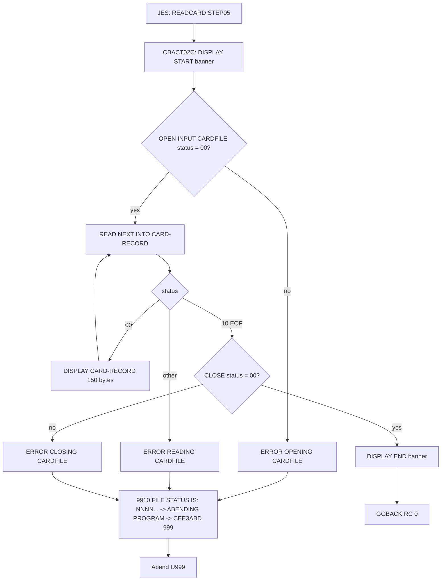

# READCARD — Technical Flow

## End-to-end processing flow

## Program relationships

| Caller | Callee | Mechanism | When |
|---|---|---|---|
| JCL STEP05 | CBACT02C | EXEC PGM | always |
| CBACT02C | CVACT02Y | COPY | compile |
| CBACT02C | CEE3ABD | static CALL | error path only |

## Data movement flow

| # | From | To | Mechanism | Change |
|---|---|---|---|---|
| 1 | CARDDATA.VSAM.KSDS | FD-CARDFILE-REC | sequential READ, key order | none |
| 2 | FD-CARDFILE-REC | CARD-RECORD | READ … INTO | none (150 → 150) |
| 3 | CARD-RECORD | SYSOUT | DISPLAY | none |
| 4 | CARDFILE-STATUS | IO-STATUS → IO-STATUS-04 | MOVE / REDEFINES | TR-003 formatting |

## Execution dependencies

| Dependency | Type | Required state |
|---|---|---|
| CARDFILE.jcl (DEFINE + REPRO) | Upstream job (data) | KSDS defined and loaded |
| AWS.M2.CARDDEMO.LOADLIB(CBACT02C) | Load module | present |
| CICS CARDDAT | Concurrent user | may be open; DISP=SHR, SHAREOPTIONS(2 3) |
| read-masters chain order | Off-host harness | after READACCT, before READXREF; no data hand-off |
